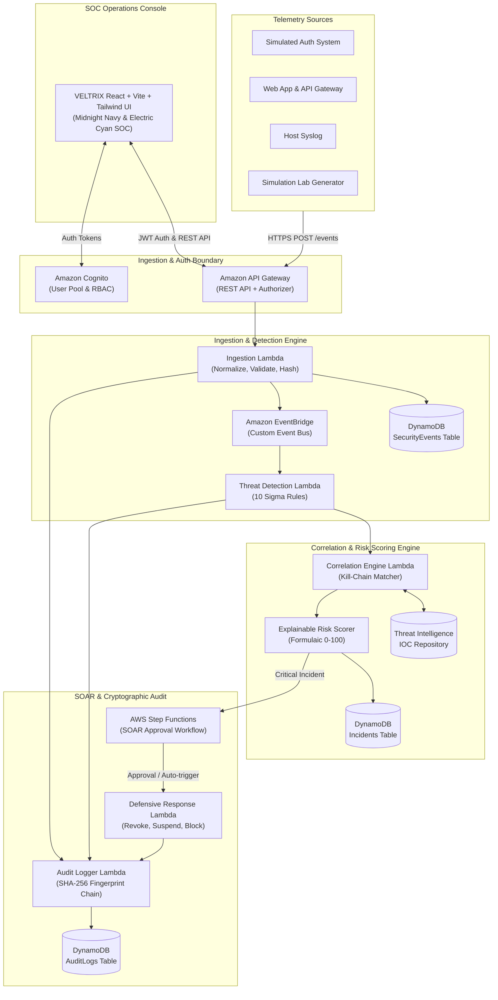

# VELTRIX: Autonomous Cyber Threat Detection & Response Platform
### *Beyond Detection. Into Defense.*

[](https://github.com/veltrix-cyber/veltrix/actions)
[](LICENSE)
[](https://www.typescriptlang.org/)
[](https://aws.amazon.com/serverless/)
[](https://attack.mitre.org/)

---

## 1. Overview & Vision

**VELTRIX** is an event-driven, cloud-native **Security Information and Event Management (SIEM)** and **Security Orchestration, Automation, and Response (SOAR)** platform engineered for modern enterprise environments.

Traditional monitoring solutions overwhelm analysts with disconnected alerts. VELTRIX autonomously:
1. Ingests and normalizes high-velocity security telemetry with idempotency deduplication.
2. Evaluates telemetry in real-time against **10 Sigma-inspired detection rules**.
3. Correlates disparate anomalies into coherent **multi-stage attack sequences** mapped to the MITRE ATT&CK® matrix.
4. Computes **mathematically explainable risk scores (0–100)** with factor breakdowns.
5. Executes **controlled defensive SOAR workflows** (IP blocking, session revocation, user suspension) governed by human-in-the-loop approval gates.
6. Guarantees non-repudiation with an append-only **SHA-256 cryptographic audit ledger**.
7. Provides a sandboxed **Simulation Lab** with 6 pre-built attack scenarios for live competition demonstrations.

---

## 2. System Architecture



---

## 3. Three-Person Team Ownership & Deliverables

| Team Member | Role & Tech Stack | Core Responsibilities & Modules |
| :--- | :--- | :--- |
| **Person 1** | **Frontend & User Experience Lead**<br/>`React`, `Vite`, `TypeScript`, `Tailwind CSS`, `Recharts`, `Lucide React` | - Complete SOC Console: Midnight Navy (`#0B0F19`) & Electric Cyan (`#00F5FF`) styling.<br/>- **Module A (UI):** Cognito Auth, Org Switcher.<br/>- **Module G (UI):** Incident Triage Dossier & Attack Timeline.<br/>- **Module J:** SOC Analytics Dashboard (Recharts telemetry & MITRE heatmap).<br/>- **Module K (UI):** Simulation Lab (6 interactive scenario cards & live terminal). |
| **Person 2** | **Backend & Cybersecurity Intelligence Lead**<br/>`Node.js`, `TypeScript`, `AWS Lambda`, `Vitest` | - **Module B:** Event Ingestion, Zod validation, normalization, SHA-256 deduplication.<br/>- **Module C:** Threat Detection Engine & 10 Sigma-inspired rules.<br/>- **Module D:** Event Correlation Engine (multi-stage attack sequence matching).<br/>- **Module E:** Explainable Risk Scoring Engine ($0-100$ mathematical formula).<br/>- **Module F:** Threat Intelligence & MITRE ATT&CK reference mapping.<br/>- **Module G (API):** Incident CRUD & lifecycle transitions.<br/>- 17 Vitest unit & integration test suites. |
| **Person 3** | **Cloud, Database & DevSecOps Lead**<br/>`AWS SAM`, `DynamoDB`, `Cognito`, `EventBridge`, `Step Functions` | - **Module A (Backend):** Cognito User Pool, JWT authorizer, tenant isolation middleware.<br/>- **Module H:** Automated Defensive Response Engine (SOAR containment & approval gates).<br/>- **Module I:** Security Audit Trail with SHA-256 cryptographic chain verification.<br/>- **Infrastructure as Code:** AWS SAM template (`template.yaml`), IAM least-privilege policies.<br/>- **DevSecOps:** GitHub Actions CI/CD, local mock AWS adapter harness, cost optimization. |

---

## 4. Built-in Detection Rules (Sigma-Inspired)

| Rule ID | Rule Name | MITRE Technique | Window | Threshold | Recommended Action |
| :--- | :--- | :--- | :--- | :--- | :--- |
| **RULE-001** | Distributed Brute-Force Authentication Attempt | `T1110.001` (Password Guessing) | 120s | $\ge 5$ events | `BLOCK_IP` (Approval Gate) |
| **RULE-002** | Password Spraying Across Multiple Accounts | `T1110.003` (Password Spraying) | 300s | $\ge 3$ users | `BLOCK_IP` (Approval Gate) |
| **RULE-003** | Compromise After Failure (Credential Stuffing Success) | `T1078` (Valid Accounts) | 600s | 1 success | `STEP_UP_AUTH` |
| **RULE-004** | Anomalous Geolocation / Impossible Travel | `T1078.004` (Cloud Accounts) | 1800s | 2 logins | `STEP_UP_AUTH` |
| **RULE-005** | Known Malicious / Tor / Proxy IP Activity | `T1090` (Proxy) | 60s | 1 event | `BLOCK_IP` (Approval Gate) |
| **RULE-006** | Privilege Escalation Indicator | `T1068` (Privilege Escalation) | 300s | 1 event | `SUSPEND_USER` (Approval Gate) |
| **RULE-007** | Bulk Sensitive Data Access / Exfiltration Indicator | `T1530` (Data from Cloud Storage) | 600s | 1 event | `SUSPEND_USER` (Approval Gate) |
| **RULE-008** | Excessive / Burst API Requests (DoS / Scraping) | `T1499` (Endpoint DoS) | 60s | 10 events | `BLOCK_IP` (Approval Gate) |
| **RULE-009** | Multi-Account Targeted Reconnaissance | `T1595` (Active Scanning) | 180s | 4 events | `BLOCK_IP` (Approval Gate) |
| **RULE-010** | Off-Hours Administrative Anomaly | `T1078` (Domain Accounts) | 300s | 1 event | `ESCALATE_ALERT` |

---

## 5. Explainable Risk Scoring Engine

Every incident calculates an auditable, formulaic risk score between $0$ and $100$:

$$\text{RiskScore} = \min\left(100, \text{Round}\left(S_{\text{base}} \times M_{\text{freq}} \times M_{\text{asset}} \times M_{\text{threat}} + B_{\text{sequence}}\right)\right)$$

- **$S_{\text{base}}$:** Base Severity score (Low: 20, Medium: 40, High: 65, Critical: 85).
- **$M_{\text{freq}}$:** Velocity multiplier ($1.0\times$ for $\le 2$, $1.15\times$ for $3-5$, $1.30\times$ for $> 5$).
- **$M_{\text{asset}}$:** Target Asset Criticality ($1.0\times$ standard user, $1.35\times$ administrative / root accounts).
- **$M_{\text{threat}}$:** Threat Intelligence Multiplier ($1.0\times$ clean, $1.20\times$ Tor / Proxy, $1.40\times$ Botnet C2).
- **$B_{\text{sequence}}$:** Attack Sequence Depth Bonus ($+0$ isolated, $+15$ for 2 kill-chain stages, $+25$ for $\ge 3$ stages).

---

## 6. Simulation Lab Scenarios

The platform includes six pre-configured, self-contained attack scenarios that fire realistic synthetic telemetry into the live ingestion and detection engine:

1. **Distributed Password Spraying & Brute Force** (6 events &bull; MITRE T1110.001)
2. **Impossible Travel & Geolocation Anomaly** (2 events &bull; Amsterdam to Tokyo in 2 min)
3. **Multi-Stage Account Compromise & Exfiltration** (8 events &bull; Brute Force $\to$ Valid Login $\to$ IAM Role Escalation $\to$ Bulk Customer Exfiltration)
4. **Unauthorized Administrative Role Assumption** (3 events &bull; MITRE T1068)
5. **Cloud Storage Bulk Data Exfiltration** (4 events &bull; MITRE T1530)
6. **Excessive API Rate-Limit Breach & Scraping** (12 events &bull; MITRE T1499)

---

## 7. Quickstart Guide (Local Execution)

```bash
# 1. Clone repository
git clone https://github.com/veltrix-cyber/veltrix.git
cd veltrix

# 2. Install all monorepo dependencies
npm install

# 3. Start Backend Intelligence Server (Port 4000)
npm run backend:dev

# 4. In a separate terminal, start Frontend SOC Console (Port 3000)
npm run frontend:dev
```
Open **`http://localhost:3000`** in your browser.

### Run Verification Test Suite
```bash
# Execute all 17 backend unit and integration tests
npm test
```

---

## 8. AWS Serverless Deployment & Cost Analysis

Deploy to AWS using AWS SAM:
```bash
cd infrastructure
sam build
sam deploy --guided
```

### Monthly Cost Estimation (100,000 events/month)
- **AWS Lambda:** $0.00 (Free tier: 1M requests, 400K GB-s)
- **Amazon API Gateway:** $0.12 (1M calls free tier in month 1-12)
- **Amazon DynamoDB:** $0.25 (On-demand capacity + TTL)
- **Amazon EventBridge:** $0.10
- **Amazon Cognito:** $0.00 (50,000 free MAUs)
- **AWS Step Functions:** $0.00 (4,000 free transitions)
- **Amazon CloudWatch & S3:** ~$0.53
- **Total Projected Monthly Cost:** **~ $1.00 / month** (*100% Free-Tier Eligible*)

See [`docs/aws-cost-analysis.md`](file:///d:/Veltrix/docs/aws-cost-analysis.md) for full calculation details.

---

## 9. Competition Demonstration Walkthrough

For a step-by-step 5-minute presentation script highlighting the live Multi-Stage Account Takeover scenario, consult [`docs/demo-script.md`](file:///d:/Veltrix/docs/demo-script.md).

---

## 10. Specifications & Kiro Steering Reference

- **System Requirements:** [`specs/requirements.md`](file:///d:/Veltrix/specs/requirements.md)
- **Technical Design:** [`specs/design.md`](file:///d:/Veltrix/specs/design.md)
- **Tasks & Work Breakdown:** [`specs/tasks.md`](file:///d:/Veltrix/specs/tasks.md)
- **Kiro Steering Files:** [`.kiro/steering/`](file:///d:/Veltrix/.kiro/steering/)
- **REST API Reference:** [`docs/api-reference.md`](file:///d:/Veltrix/docs/api-reference.md)
- **Deployment Guide:** [`docs/deployment-guide.md`](file:///d:/Veltrix/docs/deployment-guide.md)
