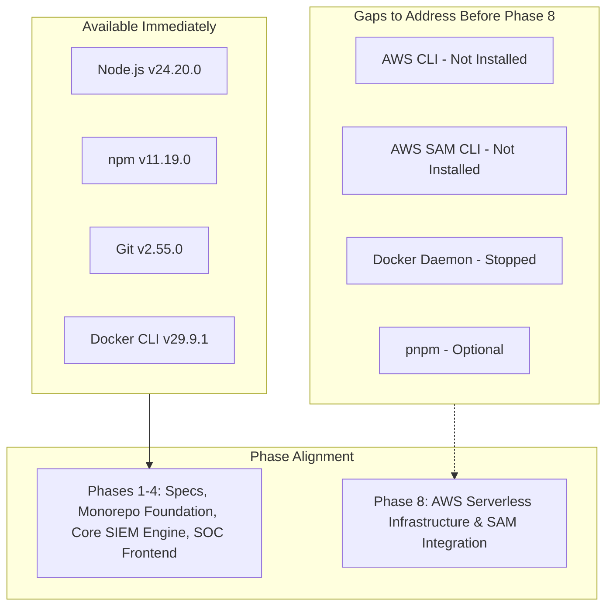

# VELTRIX — Development Environment Audit

**Document:** Environment Audit Report  
**Phase:** Phase 0 — Repository and Environment Inspection  
**Platform:** VELTRIX Autonomous Cyber Threat Detection & Response Platform  
**Audited At:** 2026-10-31  
**Auditor:** Principal Software Architect & Application Security Lead  

---

## 1. Executive Summary

A comprehensive inspection of the host workstation, execution runtime, development tools, package managers, and cloud infrastructure utilities was performed prior to executing any code modifications or architectural definitions. 

The environment is in a clean, highly capable state for TypeScript, Node.js, and React development. Key cloud-native tooling (AWS CLI, AWS SAM CLI) is currently absent, and the local container daemon (Docker Desktop) is installed but not actively running. 

Because the VELTRIX architectural methodology mandates strict separation between pure domain logic and cloud infrastructure adapters (with local in-memory persistence planned for initial phases), development can proceed through Phases 1, 2, 3, and 4 without being blocked by cloud tool availability.

---

## 2. Host System & Platform Profile

| Property | Value | Notes |
|---|---|---|
| **Operating System** | Windows 11 / Windows NT x64 | PowerShell shell environment |
| **Development IDE** | Google Antigravity IDE | Local workspace mode |
| **Workspace Root** | `d:\Development\08_GitHub_Repos\Veltrix` | Parent directory of the cloned repo |
| **Active Repository** | `d:\Development\08_GitHub_Repos\Veltrix\Veltrix` | Git root containing `.git` |
| **User Profile** | `C:\Users\rohit` | Home directory |

---

## 3. Runtimes & Package Managers

| Tool | Status | Version | Assessment |
|---|---|---|---|
| **Node.js** | Installed | `v24.20.0` | Active LTS/Current. High performance V8 engine with native ESM support. Note: AWS Lambda currently targets `nodejs20.x` or `nodejs22.x`; build targets should ensure backward-compatible bundle output. |
| **npm** | Installed | `11.19.0` | Production-ready package manager with native monorepo workspace support (`npm workspaces`). Available immediately without extra installation. |
| **pnpm** | Not Installed | N/A | Not found in PATH. If pnpm workspaces are selected in Phase 2, `corepack enable` or `npm install -g pnpm` will be required. |
| **yarn** | Not Installed | N/A | Not found in PATH. |
| **TypeScript (`tsc`)** | Local Only | N/A (Global) | Not installed globally in PATH. This is standard modern practice; TypeScript will be managed as a project devDependency and invoked via `npx tsc` or workspace scripts. |
| **Git** | Installed | `2.55.0.windows.5` | Modern Git client with support for worktrees, signing, and submodules. |

---

## 4. Cloud Infrastructure & Virtualization Tooling

| Tool | Status | Version / State | Assessment |
|---|---|---|---|
| **AWS CLI (`aws`)** | Not Installed | N/A | Missing from PATH. Required later for Phase 8 (AWS deployment and infrastructure provisioning). Not required for Phases 1–4. |
| **AWS SAM CLI (`sam`)** | Not Installed | N/A | Missing from PATH. Required in Phase 8 for local Lambda testing and SAM template packaging. |
| **AWS Credentials** | Not Configured | N/A (`~/.aws` absent) | No credentials detected in `~/.aws` or environment variables. This is positive for security: zero risk of accidental credential leakage during early phases. |
| **Docker** | Installed (Stopped) | Client `29.9.1` (build `dfc520d`) | Docker CLI is available. Docker Desktop service / Linux daemon (`npipe:////./pipe/dockerDesktopLinuxEngine`) is currently stopped. Required if local containerized testing (e.g., DynamoDB Local / LocalStack) is desired. |

---

## 5. Tooling Gap Analysis & Mitigation Roadmap

### Action Items by Phase:

1. **Phases 1–4 (Specification, Foundation, Core Engine, SOC UI):**
   - **Zero blockers.** Development will utilize `node`, `npm workspaces`, `vitest`, `vite`, and local in-memory/JSON-file persistence adapters.
   - Decouple domain entities from AWS SDKs.
2. **Phase 5–7 (Cognito Auth, Threat Intel, SOAR Response):**
   - Use mockable auth provider interfaces and simulation adapters.
3. **Phase 8 (AWS Serverless Integration):**
   - Install AWS CLI and configure IAM least-privilege credentials.
   - Install AWS SAM CLI for CloudFormation / Serverless Application Model deployment.
   - Start Docker Desktop if SAM local Lambda invocation (`sam local start-api`) or local DynamoDB is utilized.

---

## 6. Environment Audit Sign-Off

- **Audit Status:** COMPLETED
- **Readiness for Phase 1 (Specification and Architecture):** APPROVED (100% ready)
- **Constraint Compliance:** No packages installed, no destructive commands run, no cloud resources touched.

