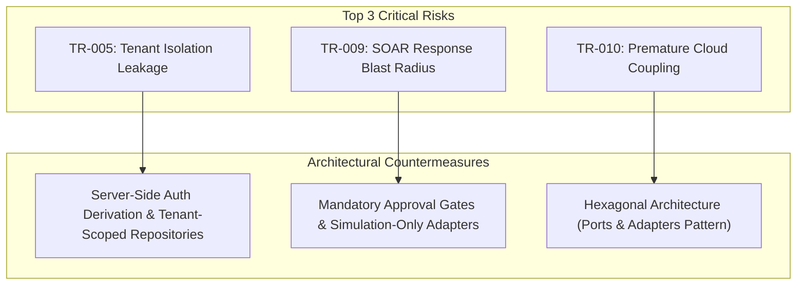

# VELTRIX — Technical & Architectural Risk Assessment

**Document:** Technical Risk Register & Mitigation Strategy  
**Phase:** Phase 0 — Repository and Environment Inspection  
**Platform:** VELTRIX Autonomous Cyber Threat Detection & Response Platform  
**Audited At:** 2026-10-31  
**Auditor:** Principal Software Architect & Application Security Lead  

---

## 1. Executive Summary

This risk assessment establishes the technical, architectural, operational, and security risks identified during the Phase 0 inspection of the VELTRIX environment and repository. 

Proactive mitigation strategies are formulated for each risk to ensure uninterrupted, high-integrity delivery across subsequent phases (Specification, Monorepo Foundation, Core SIEM Engine, SOC Dashboard, and Serverless Deployment).

---

## 2. Technical Risk Matrix

| Risk ID | Category | Risk Description | Probability | Impact | Severity | Mitigation Strategy |
|---|---|---|---|---|---|---|
| **TR-001** | Repository | **Directory Nesting Anomaly** Git repository is cloned into a subfolder (`Veltrix/Veltrix`) relative to IDE workspace root. Shell commands and path resolutions may misalign. | High | Medium | **HIGH** | Resolve before Phase 2 by either flattening repo files into root or re-pointing IDE workspace root directly to Git repository. |
| **TR-002** | Environment | **Missing AWS CLI & SAM CLI** Host machine lacks AWS CLI and AWS SAM CLI tools. | High | Medium | **MEDIUM** | Decouple pure domain logic from AWS infrastructure. Build with in-memory adapters first in Phases 2–4. Install AWS CLI & SAM prior to Phase 8. |
| **TR-003** | Environment | **Docker Daemon Stopped** Docker CLI is present but Docker Desktop daemon is not running. Local containerized AWS emulation (LocalStack / DynamoDB Local) is unavailable. | High | Low | **LOW** | Use lightweight in-memory repository adapters for automated unit/integration testing in early phases. Start Docker Desktop when SAM local testing begins. |
| **TR-004** | Runtime | **Node.js 24 vs AWS Lambda Target** Host runs Node.js `v24.20.0`, while AWS Lambda typically runs `nodejs20.x` or `nodejs22.x`. Use of Node 24 experimental APIs could cause runtime failures on Lambda. | Low | High | **MEDIUM** | Configure TypeScript `tsconfig.json` target to `ES2022` / Node 20 runtime standards. Use bundler (e.g., `esbuild` / `vite`) targeting Node 20. |
| **TR-005** | Security | **Tenant Isolation & Cross-Tenant Leakage** In multi-tenant SIEM systems, accidental querying across organizational boundaries exposes sensitive threat telemetry. | Medium | Critical | **CRITICAL** | Mandate server-side organization derivation from authenticated session token (never frontend input). Enforce organization partition keys (`PK: ORG#<orgId>`) in all storage queries. Write negative cross-tenant automated integration tests. |
| **TR-006** | Architecture | **Out-of-Order & Duplicate Event Ingestion** Distributed security events can arrive out of chronological order, or network retries can generate duplicate events, corrupting correlation chains. | High | High | **HIGH** | Implement idempotency cache based on deterministic `eventId` hash. In correlation engine, use sliding time windows with configurable drift tolerances (`allowOutOfOrderWindowMs`) rather than strict chronological assumptions. |
| **TR-007** | Detection | **State Explosion in Windowed Correlation** Sliding window aggregation (e.g., tracking failed logins over 15 minutes) can exhaust memory if high-volume traffic is buffered without TTL or eviction. | Medium | High | **HIGH** | Bound in-memory aggregation buffers with maximum sliding window capacities and automatic TTL purging. In Phase 8 DynamoDB adapter, leverage TTL attributes. |
| **TR-008** | Integrity | **Synthetic vs Real Telemetry Contamination** Simulation Lab generates fake security events (brute force, exfiltration) that could pollute real organization metrics or trigger unintended incident escalations. | Medium | High | **HIGH** | Every simulated event MUST contain a mandatory schema-enforced flag `isSimulated: true`. Simulation events must be segregated logically or scoped to explicit demo tenants, and clearly highlighted in the SOC dashboard. |
| **TR-009** | Safety | **Unintended Automated SOAR Blast Radius** Autonomous response execution (e.g., account suspension, IP blocking) could affect production systems or unauthorized external IPs if executed unconditionally. | Low | Critical | **CRITICAL** | All response adapters must default to SIMULATION mode. Real action execution must require multi-step human-in-the-loop approval and explicitly whitelist test identity scopes only. Never execute active defense against external systems. |
| **TR-010** | Architecture | **Premature Cloud Coupling** Directly binding application services to AWS SDKs (DynamoDB DocumentClient, EventBridge client) complicates local testing and slows feedback loops. | High | High | **HIGH** | Implement Hexagonal / Clean Architecture. Domain entities and use cases interact strictly via Ports (interfaces). AWS adapters implement these interfaces in Phase 8; In-memory adapters implement them in Phases 2–7. |

---

## 3. Deep-Dive Risk Analysis & Engineering Countermeasures

### 3.1 Multi-Tenancy Protection (TR-005)
- **Problem:** If `organizationId` is accepted from client payload parameters, malicious or buggy clients could query or manipulate another organization's incidents.
- **Countermeasure:** 
  1. The API Gateway / Lambda authorizer extracts `organizationId` directly from the validated Cognito JWT claims (`custom:organizationId`).
  2. The application service injects `context.organizationId` into every repository call.
  3. All database queries use composite keys partitioned by `ORG#<orgId>`.
  4. Integration tests specifically verify that User A from Org 1 receives `403 Forbidden` or `404 Not Found` when requesting `GET /api/v1/incidents/{incidentId}` belonging to Org 2.

### 3.2 Controlled SOAR Blast Radius (TR-009)
- **Problem:** Autonomous defensive platforms can cause severe denial of service if response policies trigger aggressive automated blocking against legitimate assets.
- **Countermeasure:**
  1. High-impact actions (`SUSPEND_ACCOUNT`, `BLOCK_IP`, `ISOLATE_HOST`) are categorized with severity `HIGH` or `CRITICAL` and **require mandatory analyst approval** in the Response Center.
  2. All initial response adapters in Phase 7 are **pure simulation adapters** that log simulated remediation steps without executing system-level changes.
  3. Target targets are validated against an explicit sandbox identity whitelist (`test-*`, `192.168.0.0/16`, `10.0.0.0/8`). External or production identities are rejected unconditionally.

### 3.3 Decoupled Clean Architecture (TR-010)
- **Problem:** Writing AWS DynamoDB or EventBridge code directly inside threat detection or risk scoring makes unit testing slow, expensive, and fragile.
- **Countermeasure:**
  1. Domain entities (`SecurityEvent`, `DetectionRule`, `Incident`, `RiskScore`) are plain TypeScript classes/interfaces with zero external dependencies.
  2. Repository interfaces (`IEventRepository`, `IIncidentRepository`, `IRuleRepository`) define contract boundaries.
  3. `InMemoryEventRepository` and `InMemoryIncidentRepository` enable instant, repeatable tests during Phases 2–7.
  4. `DynamoDbEventRepository` and `EventBridgePublisher` are plugged in during Phase 8 without changing a single line of detection or scoring logic.

---

## 4. Recommendations for Phase 1 (Specification and Architecture)

1. **Formalize Contracts First:** Detail the complete event schema, incident schema, and REST API contracts using Zod in `specs/design.md`.
2. **Explicit ADRs (Architecture Decision Records):** Write ADRs for:
   - Monorepo package management strategy (`npm workspaces`).
   - Hexagonal Architecture (Ports and Adapters).
   - DynamoDB Single-Table Design and partition key schemas.
   - Explainable Risk Scoring algorithm formulation.
   - Safe SOAR Approval Workflow state machine.
3. **Resolve Directory Layout:** Agree on flattening the repository directory structure before Phase 2 monorepo initialization.
4. **Agent Rules & Skills:** Author `.agents/rules/` (`architecture.md`, `coding-standards.md`, `security.md`, `testing.md`) and `.agents/skills/` to enforce these constraints permanently across all development agents.

---

## 5. Technical Risk Sign-Off

- **Assessment Status:** COMPLETED
- **Unmitigated Blockers for Phase 1:** NONE
- **Recommendation:** Proceed to user review and approval of Phase 0 deliverables.

