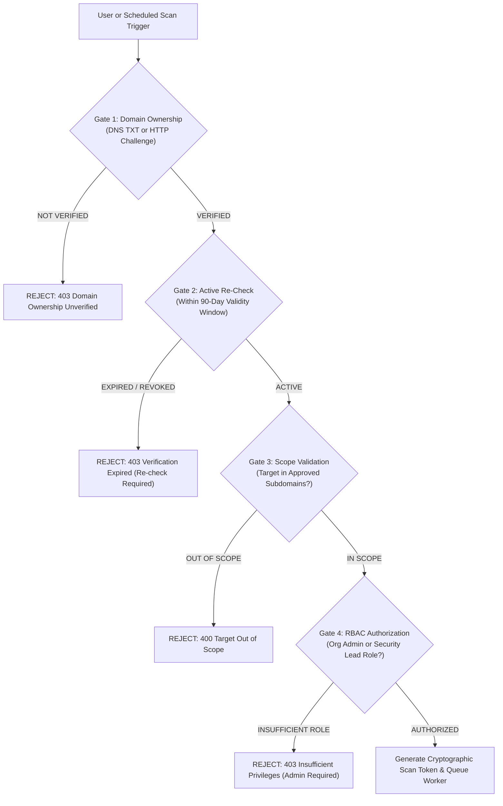
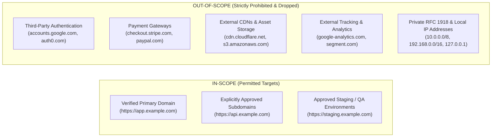
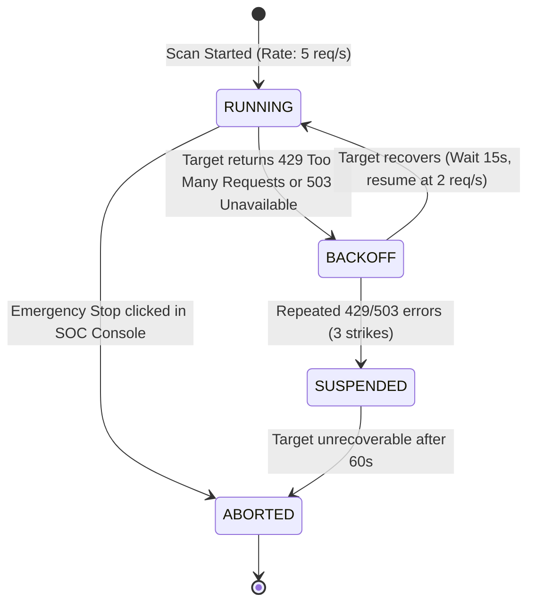

# VELTRIX: Authorized Website Scanning & Security Assessment Policy (`specs/authorized-scanning-policy.md`)

**Document Version:** 1.0.0  
**Status:** Approved Security Policy  
**Classification:** Operational Governance, Legal Authorization & Rules of Engagement  
**Applies To:** All Vulnerability Assessment Scans, Automated Workers & SOC Operators  

---

## 1. Purpose & Legal Preambles

The VELTRIX Vulnerability Assessment Engine provides continuous security verification of web applications. However, automated vulnerability scanning involves network probing, banner querying, and structured security checks that resemble adversarial reconnaissance or exploitation if executed against unowned, unauthorized, or third-party infrastructure.

To ensure all scanning activity is lawful, ethical, safe, and compliant with computer crime legislation (e.g., Computer Fraud and Abuse Act 18 U.S.C. § 1030, UK Computer Misuse Act 1990, EU NIS2 Directive), VELTRIX enforces a strict, software-enforced **Authorized Scanning Policy**.

### Cardinal Rule
> **Under no circumstances will VELTRIX initiate, queue, or execute an active or passive vulnerability scan against any domain or IP address without cryptographic proof of domain ownership and explicit administrative authorization.**

---

## 2. Inviolable Authorization Prerequisites

Before any scan job can be dispatched to an isolated scanner worker, the control plane enforces four mandatory verification gates:



### Gate 1: Cryptographic Domain Ownership Verification
Ownership must be verified via:
1. **DNS TXT Record:** `_veltrix-challenge.<domain>` containing `veltrix-verify=<orgId>.<token>`.
2. **HTTP Challenge File:** `https://<domain>/.well-known/veltrix-challenge/<token>` returning the matching JSON challenge payload over valid HTTPS.
*Unverified domains cannot be scanned under any circumstances.*

### Gate 2: Temporal Re-Certification Window
- Domain ownership verification is valid for a maximum of **90 days**.
- The control plane executes background DNS verification checks every 24 hours.
- If DNS records change or ownership tokens are removed, the asset transitions to `GRACE_PERIOD` for 7 days, after which it enters `REVOKED`. Any queued or scheduled scans are immediately cancelled.

### Gate 3: Strict Scope Boundary
- The target URL must strictly match the registered asset's `primaryDomain` or explicitly approved entries in `approvedSubdomains`.
- Third-party endpoints (e.g. CDNs, external payment processors, authentication providers, analytics endpoints) are strictly out of scope.

### Gate 4: Administrative Authorization & Cryptographic Token
- Scans can only be created or scheduled by users possessing the `ORG_ADMIN` or `SUPER_ADMIN` role.
- Upon approval, the API generates a tamper-evident `scanAuthorizationToken` signed with an internal HMAC-SHA256 secret:
  $$\text{scanAuthorizationToken} = \text{Sign}_{\text{K}}(\text{scanId} \,\|\, \text{orgId} \,\|\, \text{siteId} \,\|\, \text{targetFqdn} \,\|\, \text{policyId} \,\|\, \text{expiresAt})$$
- The isolated worker verifies this token before emitting a single network packet.

---

## 3. Approved Assessment Scope & Out-of-Scope Boundaries



### In-Scope Assets
- Fully Qualified Domain Names (FQDNs) registered under the organization and verified.
- Explicit URI path prefixes defined in the asset's scan configuration (e.g. `/`, `/api/v1`).
- Specific staging, development, or production hostnames explicitly mapped to the site asset.

### Out-of-Scope Assets & Drop Policy
If during spidering or scanning, an HTTP redirect, hyperlink, iframe, or API request points to an unverified FQDN or IP:
1. The isolated scanner's network filter immediately terminates the request.
2. The URL is logged in the scan audit record as `DROPPED_OUT_OF_SCOPE`.
3. No payloads, probes, or headers are transmitted to the out-of-scope host.

---

## 4. Assessment Tiers: Non-Destructive Defaults

VELTRIX establishes two clear assessment tiers. **Passive scanning is the system default.**

| Assessment Tier | Modality | Payload Characteristics | Default Status | Operational Impact |
| :--- | :--- | :--- | :---: | :---: |
| **Tier 1: Safe Passive Assessment** | Read-only crawling & response inspection | Zero attack payloads; examines TLS certificates, HTTP response headers, cookies, CORS headers, information disclosure banners | **DEFAULT ON** | Zero risk of service disruption or data alteration |
| **Tier 2: Controlled Active Assessment** | Non-destructive vulnerability probing | Benign canary strings (`veltrix-probe-<uuid>`), SQL syntax characters (`'`), safe directory traversal probes (`/../`) | **OPT-IN ONLY** (Requires explicit policy toggle) | Minimal load; rate-limited; zero data corruption |

---

## 5. Absolute Prohibitions

The following activities are strictly prohibited and structurally prevented in the scanner engine code:

### 1. No Denial of Service (DoS / DDoS) Testing
- The scanner MUST NOT send malformed packets, Slowloris requests, oversized payloads, or volumetric request floods intended to degrade application performance or exhaust server resources.

### 2. No Destructive Data Modification
- The scanner MUST NOT submit HTTP `DELETE`, `PUT`, or state-changing `POST` requests to administrative or business-critical endpoints without explicit mock data configurations.
- Active scan payloads MUST NOT contain SQL statements that mutate or destroy data (`DROP`, `DELETE`, `TRUNCATE`, `UPDATE`, `ALTER`, `INSERT`).
- Canaries and probes must be strictly read-only or self-contained.

### 3. No Automated Brute-Forcing of Production Forms
- Active assessment MUST NOT attempt dictionary or brute-force attacks against user login forms, password reset forms, contact/support ticketing forms, or payment checkout workflows.
- Testing of authentication rate limits must be conducted using synthetic test accounts in staging environments only.

### 4. No Server-Side Request Forgery (SSRF) Against Private Infrastructure
- The scanner worker sandbox MUST enforce an OS-level and application-level network egress guard blocking outbound connections to:
  - `10.0.0.0/8` (RFC 1918 Private)
  - `172.16.0.0/12` (RFC 1918 Private)
  - `192.168.0.0/16` (RFC 1918 Private)
  - `127.0.0.0/8` (Loopback)
  - `169.254.169.254` (Link-local cloud instance metadata)
  - `::1/128` (IPv6 Loopback)
  - `fc00::/7` (IPv6 Unique Local)

---

## 6. Rate Limiting, Backoff & Emergency Circuit Breakers

To protect customer production infrastructure from accidental overload, scanner workers enforce rigorous traffic throttling:



### Rate Limiting Invariants
1. **Default Rate:** Capped at **5 requests per second** (burst max 10 req/s).
2. **Maximum Permitted Rate:** Even for high-capacity enterprise assets, active scans cannot exceed **20 requests per second**.
3. **Adaptive Backoff:**
   - If the target returns an HTTP status `429 Too Many Requests` or `503 Service Unavailable`, the scanner pauses all requests for 15 seconds.
   - Upon resumption, the request rate is halved.
4. **Circuit Breaker Abort:**
   - If the target server exhibits $\ge 5\%$ connection timeout rates or returns 3 consecutive `503/429` responses during backoff, the scan automatically **aborts**.
   - Status transitions to `ABORTED_TARGET_PROTECTION` and an alert is dispatched to the SOC console.
5. **Instant Kill-Switch:**
   - The Web SOC Console and CLI provide an instant emergency stop button: `POST /api/v1/scans/{scanId}/abort`.
   - The worker checks the abort flag every 500ms; upon receiving the abort signal, it immediately terminates running browser/ZAP processes and drains active sockets.

---

## 7. Audit Logging & Chain of Custody

Every scanning action is an auditable event. The scanner worker writes tamper-evident audit records to `Veltrix-AuditLogs` for full chain of custody:

### Recorded Audit Events
1. `SCAN_REQUESTED`: Triggered by user/scheduler; captures user identity, IP address, target asset, and requested scan profile.
2. `SCAN_AUTHORIZED`: Captures validation of domain ownership and issuance of the `scanAuthorizationToken`.
3. `SCAN_STARTED`: Captures scanner worker ID, container IP, target FQDN, and resolved target IP.
4. `SCAN_COMPLETED`: Captures duration, total requests sent, average rate, findings summary, and final status (`SUCCESS`, `ABORTED`, `FAILED`).
5. `SCAN_ABORTED`: Captures emergency stop initiator or circuit breaker trigger reason.

### Audit Record Schema
```json
{
  "logId": "018d5f30-74e1-7cb2-b43a-e9fa651f8b1c",
  "orgId": "org-enterprise-01",
  "timestamp": "2026-11-01T12:30:00.000Z",
  "action": "SCAN_COMPLETED",
  "actor": {
    "userId": "system:scanner-worker-04",
    "role": "SYSTEM_WORKER",
    "ipAddress": "10.100.4.12"
  },
  "resource": "Veltrix-VulnerabilityScans/scan-018d5f30",
  "details": {
    "siteId": "site-ecommerce-prod",
    "targetDomain": "app.example.com",
    "resolvedIp": "198.51.100.88",
    "scanType": "SAFE_PASSIVE",
    "durationSeconds": 42,
    "totalRequests": 128,
    "findingsCount": { "CRITICAL": 0, "HIGH": 1, "MEDIUM": 2, "LOW": 3, "INFO": 1 }
  },
  "integrityHash": "a6b7c8d9e0..."
}
```
