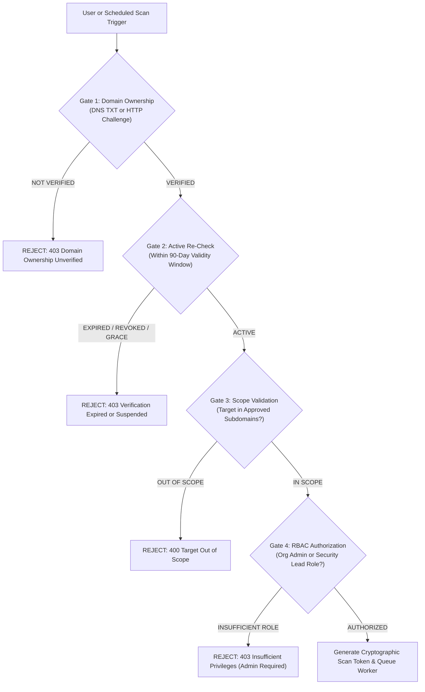
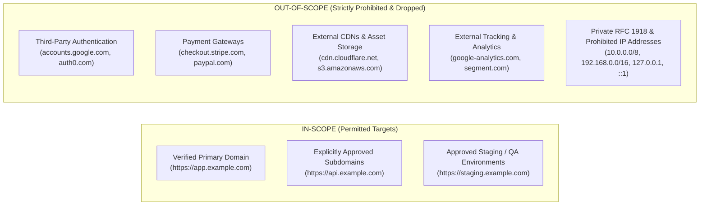
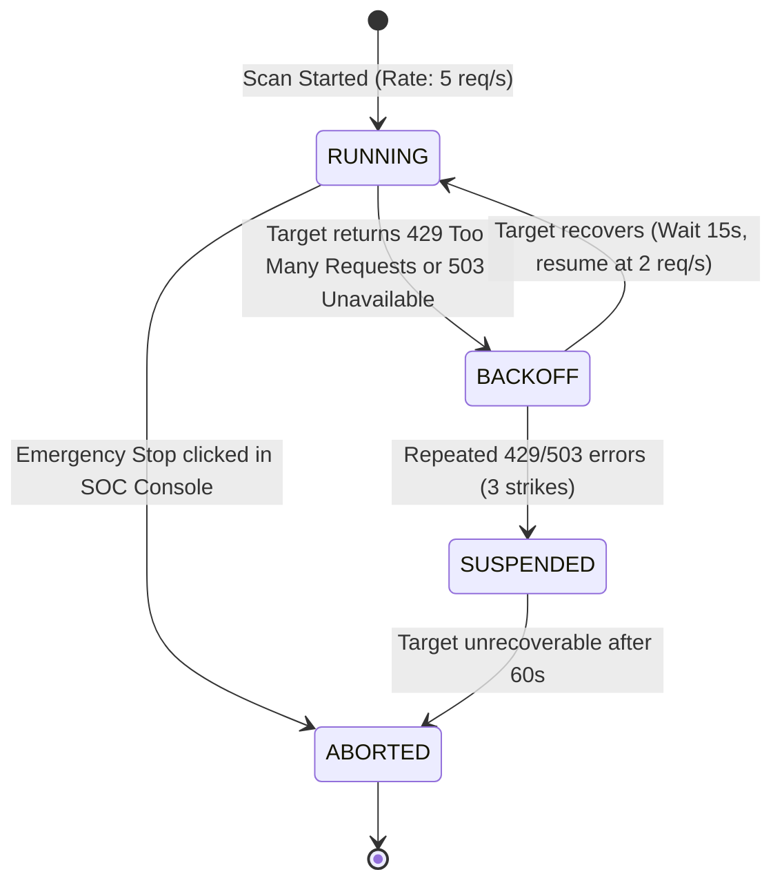

# VELTRIX: Authorized Website Scanning & Security Assessment Policy (`specs/authorized-scanning-policy.md`)

**Document Version:** 1.1.0 (Post-Safety Review Hardened)  
**Status:** PROPOSED / IN REVIEW (PR #4 Architecture Review)  
**Classification:** Operational Governance, Legal Authorization & Rules of Engagement  
**Applies To:** All Vulnerability Assessment Scans, Automated Workers & SOC Operators  

---

## 1. Purpose & Legal Preambles

The VELTRIX Vulnerability Assessment Engine provides continuous security verification of web applications. However, automated vulnerability scanning involves network probing, banner querying, and structured security checks that resemble adversarial reconnaissance or exploitation if executed against unowned, unauthorized, or third-party infrastructure.

To ensure all scanning activity is lawful, ethical, safe, and compliant with computer crime legislation (e.g., Computer Fraud and Abuse Act 18 U.S.C. § 1030, UK Computer Misuse Act 1990, EU NIS2 Directive), VELTRIX enforces a strict, software-enforced **Authorized Scanning Policy**.

### Cardinal Rule
> **Under no circumstances will VELTRIX initiate, queue, or execute an active or passive vulnerability scan against any domain or IP address without cryptographic proof of domain ownership and explicit administrative authorization.**

---

## 2. Inviolable Authorization Prerequisites

Before any scan job can be dispatched to an isolated scanner worker, the control plane enforces four mandatory verification gates:



### Gate 1: Cryptographic Domain Ownership Verification
Ownership must be verified via:
1. **DNS TXT Record:** `_veltrix-challenge.<domain>` containing `veltrix-verify=<orgId>.<token>`.
2. **HTTP Challenge File:** `https://<domain>/.well-known/veltrix-challenge/<token>` returning the matching JSON challenge payload over valid HTTPS.
*Unverified domains cannot be scanned under any circumstances.*

### Gate 2: Temporal Re-Certification Window & Grace Period Policy
- Domain ownership verification is valid for a maximum of **90 days**.
- The control plane executes background DNS verification checks every 24 hours.
- If DNS records change or ownership tokens are removed, the asset transitions to `GRACE_PERIOD` for 7 days, after which it enters `REVOKED`.
- **CRITICAL INVARIANT:** Entering `GRACE_PERIOD` **immediately freezes and blocks all scanning**:
  - No new scans can be launched or scheduled while an asset is in `GRACE_PERIOD`.
  - All queued and scheduled scans for the asset are **cancelled immediately**.
  - Active worker containers running against the asset receive an **immediate abort signal**.
  - The 7-day grace period is strictly an administrative grace period to alert the domain owner and allow DNS renewal before full asset deregistration; **it is NEVER permission to continue scanning**.
  - Resuming scanning strictly requires successful domain re-verification.

### Gate 3: Strict Scope Boundary
- The target URL must strictly match the registered asset's `primaryDomain` or explicitly approved entries in `approvedSubdomains`.
- Third-party endpoints (e.g. CDNs, external payment processors, authentication providers, analytics endpoints) are strictly out of scope.

### Gate 4: Administrative Authorization & Cryptographic Token
- Scans can only be created or scheduled by users possessing the `ORG_ADMIN` or `SUPER_ADMIN` role.
- Upon approval, the API generates a tamper-evident `scanAuthorizationToken` signed with an internal HMAC-SHA256 secret:
  $$\text{scanAuthorizationToken} = \text{Sign}_{\text{K}}(\text{scanId} \,\|\, \text{orgId} \,\|\, \text{siteId} \,\|\, \text{targetFqdn} \,\|\, \text{policyId} \,\|\, \text{expiresAt})$$
- The isolated worker verifies this token before emitting a single network packet.

---

## 3. Approved Assessment Scope & Out-of-Scope Boundaries



### In-Scope Assets
- Fully Qualified Domain Names (FQDNs) registered under the organization and verified.
- Explicit URI path prefixes defined in the asset's scan configuration (e.g. `/`, `/api/v1`).
- Specific staging, development, or production hostnames explicitly mapped to the site asset.

### Out-of-Scope Assets & Drop Policy
If during spidering or scanning, an HTTP redirect, hyperlink, iframe, or API request points to an unverified FQDN or IP:
1. The isolated scanner's network filter immediately terminates the request.
2. The URL is logged in the scan audit record as `DROPPED_OUT_OF_SCOPE`.
3. No payloads, probes, or headers are transmitted to the out-of-scope host.

---

## 4. Assessment Tiers: Non-Destructive Defaults

VELTRIX establishes two clear assessment tiers. **Passive scanning is the system default.**

| Assessment Tier | Modality | Payload Characteristics | Default Status | Operational Impact |
| :--- | :--- | :--- | :---: | :---: |
| **Tier 1: Safe Passive Assessment** | Read-only crawling & response inspection | Zero attack payloads; examines TLS certificates, HTTP response headers, cookies, CORS headers, information disclosure banners | **DEFAULT ON** | Zero risk of service disruption or data alteration |
| **Tier 2: Controlled Active Assessment** | Non-destructive vulnerability probing | Benign canary strings (`veltrix-probe-<uuid>`), SQL syntax characters (`'`), safe directory traversal probes (`/../`) | **OPT-IN ONLY** (Requires explicit policy toggle) | Minimal load; rate-limited; zero data corruption |

---

## 5. Absolute Prohibitions & Network Egress Safeguards

The following activities are strictly prohibited and structurally prevented in the scanner engine code:

### 1. No Denial of Service (DoS / DDoS) Testing
- The scanner MUST NOT send malformed packets, Slowloris requests, oversized payloads, or volumetric request floods intended to degrade application performance or exhaust server resources.

### 2. No Destructive Data Modification
- The scanner MUST NOT submit HTTP `DELETE`, `PUT`, or state-changing `POST` requests to administrative or business-critical endpoints without explicit mock data configurations.
- Active scan payloads MUST NOT contain SQL statements that mutate or destroy data (`DROP`, `DELETE`, `TRUNCATE`, `UPDATE`, `ALTER`, `INSERT`).
- Canaries and probes must be strictly read-only or self-contained.

### 3. No Automated Brute-Forcing of Production Forms
- Active assessment MUST NOT attempt dictionary or brute-force attacks against user login forms, password reset forms, contact/support ticketing forms, or payment checkout workflows.
- Testing of authentication rate limits must be conducted using synthetic test accounts in staging environments only.

### 4. Comprehensive SSRF & Prohibited Network Ranges
The scanner worker sandbox MUST enforce socket-level and OS-level network egress validation blocking outbound connections to all of the following prohibited ranges:

| Address Category | Prohibited CIDR Ranges & Values | Description / Risk |
| :--- | :--- | :--- |
| **IPv4 Private (RFC 1918)** | `10.0.0.0/8`, `172.16.0.0/12`, `192.168.0.0/16` | Internal enterprise networks. |
| **IPv4 Loopback** | `127.0.0.0/8` | Host loopback interfaces. |
| **IPv4 Link-Local & Metadata** | `169.254.0.0/16` (specifically `169.254.169.254`) | Cloud provider instance metadata services. |
| **IPv4 Unspecified & Broadcast** | `0.0.0.0/8`, `255.255.255.255/32` | Non-routable and broadcast. |
| **IPv4 Multicast & Reserved** | `224.0.0.0/4`, `240.0.0.0/4` | Multicast and reserved ranges. |
| **IPv4 Documentation (TEST-NET)** | `192.0.2.0/24`, `198.51.100.0/24`, `203.0.113.0/24` | Non-production test networks. |
| **IPv6 Loopback & Unspecified** | `::1/128`, `::/128` | IPv6 loopback and unspecified addresses. |
| **IPv6 Unique-Local (ULA)** | `fc00::/7` | RFC 4193 private IPv6 addresses. |
| **IPv6 Link-Local** | `fe80::/10` | IPv6 auto-configured link-local. |
| **IPv4-Mapped IPv6** | `::ffff:0:0/96` (e.g. `::ffff:127.0.0.1`, `::ffff:10.0.0.1`, `::ffff:169.254.169.254`) | Circumvents basic IPv4 filters when wrapped in IPv6. |
| **IPv6 Documentation / Discard** | `2001:db8::/32`, `100::/64` | Documentation and discard prefixes. |

#### Application-Level Connection Validation (Socket Pinning & DNS Protection)
Application-level connection hooks enforce the primary defense against SSRF and DNS manipulation:
1. **Destination IP Validation:** The target FQDN is resolved immediately prior to TCP connection establishment. Every resolved IPv4 and IPv6 address is matched against the prohibited network matrix above. If any resolved address belongs to a prohibited range, connection initiation is aborted immediately.
2. **DNS Pinning:** Rather than allowing downstream HTTP libraries or OS resolvers to re-query DNS during handshake, the scanner agent bypasses secondary lookups by pinning the socket directly to the validated IP (`socket.connect({ host: validatedIp, port })`). This completely eliminates time-of-check to time-of-use (TOCTOU) DNS rebinding vulnerabilities.
3. **Redirect Re-Validation:** All HTTP 3xx redirects (`301`, `302`, `307`, `308`) are intercepted by custom client handlers. The target redirect URL is checked against the registered asset's verified primary domain or approved subdomains, and its destination IP is resolved and re-validated against the prohibited matrix before any redirect is followed.
4. **TLS Hostname & SNI Preservation:** To ensure virtual hosting, multi-tenant CDNs, and TLS certificate validation operate correctly despite IP-level socket pinning, the target FQDN is explicitly preserved and supplied in the TLS Server Name Indication (`servername` SNI) header and the HTTP `Host` header.

#### Multi-Layer AWS Cloud Network Controls (Proposed Architecture)
> [!NOTE]
> **Proposed Cloud Architecture — Pending Implementation in Phase 11/12; Not Deployed in Current Phase.**  
> The AWS infrastructure controls described below represent the defense-in-depth cloud network design for production scanner isolation. They are scheduled for implementation in Phase 11/12 and are not deployed in local development environments.

To provide defense-in-depth below the application layer, the production cloud architecture distributes egress safeguards across specialized AWS controls. **Security Groups alone do not provide explicit deny rules or full DNS/URL-based SSRF protection**, because Security Groups are purely stateful allow-only rules operating at Layer 4 and cannot inspect DNS queries, HTTP URLs, or redirect targets.

The platform coordinates five distinct layers of protection:

| Layer / AWS Control | Nature & Scope | Specific Responsibility & Configuration | Limitations (Why Control Alone Is Insufficient) |
| :--- | :--- | :--- | :--- |
| **Application Connection Validation** | In-Process / Socket Hook | Destination IP validation against prohibited CIDR matrix, socket IP pinning to prevent DNS rebinding, HTTP 3xx redirect re-validation, and TLS SNI preservation. | Relies on process runtime integrity; requires defense-in-depth at network perimeter. |
| **Security Groups** | Elastic Network Interface (ENI) / Stateful | **Restrictive Outbound Allow Rules:** Restrict scanner task ENIs strictly to outbound TCP ports 80 and 443 destined for internet CIDRs (or specific VPC Endpoint interfaces). All non-web egress (SSH, RDP, SMTP, internal RPCs) is blocked at Layer 4. | **Allow-only:** Security Groups do NOT support explicit DENY rules. Cannot selectively block internal CIDRs while allowing broad internet egress; cannot inspect URLs, DNS, or redirects. |
| **Network ACLs (NACLs)** | Subnet Boundary / Stateless | **Subnet-Level Stateless Allow/Deny Filtering:** Enforces explicit stateless outbound DENY rules on the Scanner Worker Subnet before the default allow rule:<br>- `Rule 100: DENY 10.0.0.0/8` (RFC 1918 Private)<br>- `Rule 110: DENY 172.16.0.0/12` (RFC 1918 Private)<br>- `Rule 120: DENY 192.168.0.0/16` (RFC 1918 Private)<br>- `Rule 130: DENY 169.254.169.254/32` (Cloud Metadata)<br>- `Rule 140: DENY 169.254.0.0/16` (Link-Local)<br>- `Rule 200: ALLOW 0.0.0.0/0` (Outbound Internet TCP 80/443) | Stateless (requires return ephemeral port rules); does not inspect domain names, HTTP headers, or TLS SNI. |
| **AWS Network Firewall** | VPC Egress Boundary / Stateful | **Stateful Network & Domain-Based Egress Filtering:** Centrally inspects Layer 3 through Layer 7 traffic using Suricata-compatible rules and AWS domain list filtering. Enforces domain name allowlists (TLS SNI and HTTP Host) and blocks non-TLS tunnels. | Requires dedicated firewall subnets and route table orchestration; higher latency and cost than basic ACLs. |
| **Route 53 Resolver DNS Firewall** | VPC DNS Layer (`169.254.169.253`) | **DNS Query Filtering:** Filters VPC-level DNS queries before name resolution completes. Blocks queries for internal private hosted zones (`*.internal`, `*.local`, `*.ec2.internal`), cloud metadata domains, and known threat domains. | Does not prevent DNS rebinding where an external nameserver returns internal IPs; requires application-level IP validation. |

#### AWS Network Firewall Routing & Deployment Requirements (Proposed)
Deploying AWS Network Firewall for isolated scanner task subnets requires specific VPC route table orchestration to ensure stateful symmetric inspection:

1. **Dedicated Firewall Subnet per AZ:** AWS Network Firewall endpoints must be provisioned in dedicated, separate subnets (`Firewall-Subnet-AZ1`, `Firewall-Subnet-AZ2`) distinct from the Scanner Worker Subnet and NAT Gateway Subnet.
2. **Scanner Subnet Route Table:** The route table associated with the Scanner Worker Subnet configures the default route (`0.0.0.0/0`) with the target set to the **AWS Network Firewall VPC Endpoint** (`vpce-xxx`) in the corresponding Availability Zone.
3. **Firewall Subnet Route Table:** The route table associated with the Firewall Subnet configures the default route (`0.0.0.0/0`) with the target set to the **NAT Gateway** in the public subnet of the same AZ.
4. **Public / NAT Subnet Route Table:** Configures default route (`0.0.0.0/0`) pointing to the AWS Internet Gateway (IGW).
5. **IGW Ingress Route Table (Edge Association):** To maintain symmetric stateful inspection, an ingress route table is associated with the Internet Gateway containing explicit routes for the Scanner Subnet CIDR pointing back through the **AWS Network Firewall VPC Endpoint**.

---

## 6. Rate Limiting, Backoff & Emergency Circuit Breakers

To protect customer production infrastructure from accidental overload, scanner workers enforce rigorous traffic throttling:



### Rate Limiting Invariants
1. **Default Rate:** Capped at **5 requests per second** (burst max 10 req/s).
2. **Maximum Permitted Rate:** Even for high-capacity enterprise assets, active scans cannot exceed **20 requests per second**.
3. **Adaptive Backoff:**
   - If the target returns an HTTP status `429 Too Many Requests` or `503 Service Unavailable`, the scanner pauses all requests for 15 seconds.
   - Upon resumption, the request rate is halved.
4. **Circuit Breaker Abort:**
   - If the target server exhibits $\ge 5\%$ connection timeout rates or returns 3 consecutive `503/429` responses during backoff, the scan automatically **aborts**.
   - Status transitions to `ABORTED_TARGET_PROTECTION` and an alert is dispatched to the SOC console.

### Emergency Cancellation Target SLO & Worker Lifecycle
1. **Target SLO:** The platform targets a **500ms Service Level Objective (SLO)** from operator click to worker socket termination.
2. **Cancellation Signaling & Worker Polling:**
   - The control plane marks scan state as `ABORT_REQUESTED` in DynamoDB and emits an abort message via Redis Pub/Sub or SQS urgent channel.
   - The scanner worker checks the cancellation token on every HTTP request cycle (at most every 250ms).
3. **Process Termination Handling:**
   - Upon cancellation receipt, the worker immediately terminates active HTTP connection pools and drains pending requests.
   - The worker sends a graceful `SIGTERM` to running browser/ZAP engine daemons.
   - If the daemon process does not exit within 5 seconds, the worker issues an immediate `SIGKILL`.
4. **Cancellation Acknowledgement:**
   - The worker acknowledges cancellation by updating `Veltrix-VulnerabilityScans` to `ABORTED` with `abortedAt`, `abortedBy`, and total completed request count.
   - An immutable audit log record (`SCAN_ABORTED`) is appended.
5. **Failure & Timeout Reporting:**
   - If the worker fails to acknowledge cancellation within **10 seconds**, the control plane automatically transitions the scan to `ABORT_FAILED_TIMED_OUT`, terminates the container task via AWS ECS API, and alerts the SOC.

---

## 7. Audit Logging & Chain of Custody

Every scanning action is an auditable event. The scanner worker writes tamper-evident audit records to `Veltrix-AuditLogs` for full chain of custody:

### Recorded Audit Events
1. `SCAN_REQUESTED`: Triggered by user/scheduler; captures user identity, IP address, target asset, and requested scan profile.
2. `SCAN_AUTHORIZED`: Captures validation of domain ownership and issuance of the `scanAuthorizationToken`.
3. `SCAN_STARTED`: Captures scanner worker ID, container IP, target FQDN, and resolved target IP.
4. `SCAN_COMPLETED`: Captures duration, total requests sent, average rate, findings summary, and final status (`SUCCESS`, `ABORTED`, `FAILED`).
5. `SCAN_ABORTED`: Captures emergency stop initiator or circuit breaker trigger reason.

### Audit Record Schema
```json
{
  "logId": "018d5f30-74e1-7cb2-b43a-e9fa651f8b1c",
  "orgId": "org-enterprise-01",
  "timestamp": "2026-11-01T12:30:00.000Z",
  "action": "SCAN_COMPLETED",
  "actor": {
    "userId": "system:scanner-worker-04",
    "role": "SYSTEM_WORKER",
    "ipAddress": "10.100.4.12"
  },
  "resource": "Veltrix-VulnerabilityScans/scan-018d5f30",
  "details": {
    "siteId": "site-ecommerce-prod",
    "targetDomain": "app.example.com",
    "resolvedIp": "198.51.100.88",
    "scanType": "SAFE_PASSIVE",
    "durationSeconds": 42,
    "totalRequests": 128,
    "findingsCount": { "CRITICAL": 0, "HIGH": 1, "MEDIUM": 2, "LOW": 3, "INFO": 1 }
  },
  "integrityHash": "a6b7c8d9e0..."
}
```
