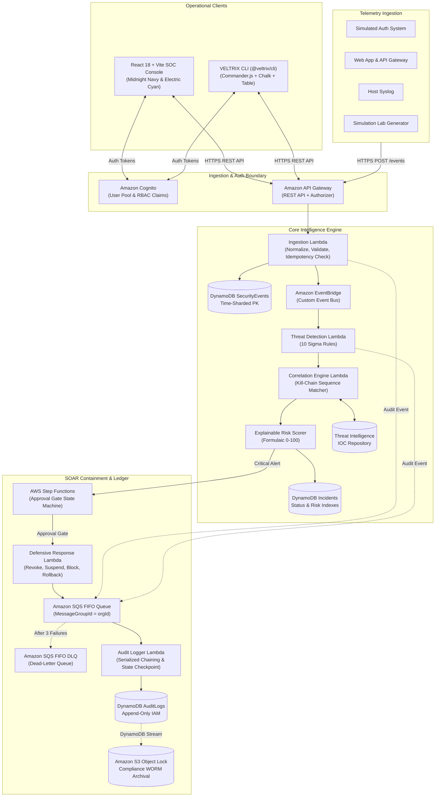

# VELTRIX: Autonomous Cyber Threat Detection & Response Platform
## System Architecture & Technical Design (`specs/design.md`)

**Document Version:** 2.2.0 (Verified & Reliability-Hardened)  
**Status:** In Review (Phase 1 Final Verification)  
**Brand Palette:** Midnight Navy (`#0B0F19`), Electric Cyan (`#00F5FF`), Royal Blue (`#2563EB`)  

---

## 1. End-to-End System Architecture

VELTRIX is architected as an event-driven, cloud-native serverless platform supporting two synchronized operational interfaces: the **Web SOC Console** and the **VELTRIX CLI**.



---

## 2. Monorepo & Module Architecture

```text
VELTRIX/
├── frontend/                     # React 18 + Vite + Tailwind CSS + Recharts
│   ├── src/
│   │   ├── components/           # Header, Sidebar, Cyber cards, Modals
│   │   ├── pages/                # Overview, Events, Detection, Incidents, etc.
│   │   ├── services/             # REST API Client with JWT interceptors
│   │   └── types/                # Domain types
│   └── tests/                    # Playwright & Vitest UI tests
│
├── backend/                      # Node.js + TypeScript Lambda Micro-services
│   ├── src/
│   │   ├── ingestion/            # Schema validation, Normalization, Deduplication
│   │   ├── detection/            # 10 Sigma-inspired rules & evaluation engine
│   │   ├── correlation/          # Sliding-window entity sequence matcher
│   │   ├── risk-engine/          # Mathematical 0-100 explainable risk scorer
│   │   ├── threat-intelligence/  # Embedded IOC catalog & IP enrichment
│   │   ├── incidents/            # Incident CRUD & state machine
│   │   ├── response/             # SOAR containment, approval queue & rollback
│   │   ├── audit/                # SHA-256 cryptographic chaining & verification
│   │   ├── simulation/           # 6 Synthetic attack scenarios runner
│   │   ├── shared/               # MemoryStore, Crypto, Types, Errors
│   │   └── server.ts             # REST API HTTP runner & Lambda adapters
│   └── tests/                    # 17+ Vitest unit & integration tests
│
├── cli/                          # Standalone CLI package (@veltrix/cli)
│   ├── bin/veltrix.ts            # Executable entrypoint
│   ├── src/
│   │   ├── commands/             # auth, events, detect, incidents, intel, response, sim
│   │   ├── formatters/           # Cli-table3 human output & JSON formatters
│   │   └── api/                  # Axios HTTP client matching Web dashboard
│   └── package.json
│
├── infrastructure/               # Cloud-native IaC
│   ├── template.yaml             # Complete AWS SAM template
│   └── response/                 # Step Functions ASL state machine
│
├── specs/                        # Spec-driven development documentation
│   ├── requirements.md
│   ├── design.md
│   ├── tasks.md
│   ├── api-contracts.md
│   ├── database-schema.md
│   └── testing-strategy.md
│
├── docs/                         # Guides, API docs, Demo scripts, Cost model
└── .github/workflows/ci.yml      # GitHub Actions CI workflow
```

---

## 3. High-Precision Event Deduplication Architecture

### Client Retries vs Legitimate Rapid Attacks
1. **Network Retries:** An HTTP client experiencing network timeout re-sends the exact same event with the original `eventId` and `idempotencyKey`.
2. **High-Velocity Brute Force Attacks:** Distinct authentication attempts generated milliseconds apart carry unique `eventId` values.

### Deduplication Logic
- Every event assigns `idempotencyKey = event.idempotencyKey || event.eventId`.
- DynamoDB conditional write: `attribute_not_exists(PK) AND attribute_not_exists(SK)`.
- If an exact duplicate retry arrives, the conditional check fails $\to$ Ingestion engine intercepts `ConditionalCheckFailedException` and returns `202 Accepted` with `{ "status": "DUPLICATE_SUPPRESSED" }`.
- Distinct brute-force attempts have unique `eventId` tokens $\to$ **All attempts are persisted and trigger RULE-001**.

---

## 4. DynamoDB Schema & Sharding Design

- **Default Implementation ($N=1$):** `PK = ORG#{orgId}#DATE#{YYYY-MM-DD}` provides deterministic, single-query reads per day without scatter-gather complexity.
- **Enterprise Scaling ($N>1$):** If an organization's ingestion exceeds 1,000 writes/sec, write sharding activates using $\text{shardId} = \text{hash}(\text{eventId}) \pmod N$, and queries scatter-gather across $N$ shards with k-way merge-sort.

---

## 5. SQS FIFO Audit Reliability & Linear Chain Recovery

### Message Ordering & Deduplication
- **Queue:** Amazon SQS FIFO (`veltrix-audit-queue.fifo`).
- **Grouping:** `MessageGroupId = orgId` ensures that all audit messages for a tenant are strictly serialized.
- **Deduplication ID:** `MessageDeduplicationId = SHA-256(orgId + logId + payloadHash)`. SQS automatically discards duplicate messages within a 5-minute sliding window.

### Lambda Processing & Atomic Hash Chaining
1. Audit Logger Lambda consumes a message.
2. Reads the tenant checkpoint from `Veltrix-AuditState` (`lastVerifiedHash`, `sequenceNumber`).
3. Computes:
   $$\text{IntegrityHash} = \text{SHA-256}(\text{lastVerifiedHash} \,\|\, \text{logId} \,\|\, \text{orgId} \,\|\, \text{actor} \,\|\, \text{action} \,\|\, \text{targetResource} \,\|\, \text{timestamp})$$
4. Performs a **DynamoDB Transaction (`TransactWriteItems`)**:
   - `PutItem` to `Veltrix-AuditLogs` with `attribute_not_exists(PK)`.
   - `UpdateItem` to `Veltrix-AuditState` setting `lastVerifiedHash = IntegrityHash` and incrementing `sequenceNumber`.
5. On success, SQS message is deleted.

### Retry, Dead-Letter Queue (DLQ) & Chain Recovery
- **Transient Failures:** SQS automatically retries the message after the visibility timeout. Because of the atomic transaction, partial writes cannot occur.
- **Poison Pill / DLQ Handling:** If a malformed payload fails 3 times (`maxReceiveCount = 3`), SQS moves the message to `veltrix-audit-dlq.fifo`.
- **Chain Continuity Recovery:**
  - If a message were dropped without recovery, the linear hash chain would break for all subsequent messages!
  - **Recovery Protocol:**
    1. A CloudWatch alarm notifies the SOC of a DLQ event.
    2. The DLQ message is inspected via administrative CLI: `veltrix audit inspect-dlq`.
    3. The administrator can trigger an atomic repair using `veltrix audit replay-dlq` or insert a signed administrative bridge record (`CHAIN_REPAIR_BRIDGE`) recording the dead-letter event and re-anchoring `lastVerifiedHash`.

---

## 6. Two-Tier Runtime Separation: Simulation vs Real AWS

| Tier | Environment | Scope | Verification Method |
| :--- | :--- | :--- | :--- |
| **Tier 1: Local Emulation & Simulation Harness** | Development / Offline Demo | In-memory `MemoryStore`, mock Express server, local CLI. | Vitest unit tests verifying business logic in $< 1\text{ second}$. |
| **Tier 2: AWS Serverless Production Layer** | Staging / Production | API Gateway, AWS Lambda, DynamoDB On-Demand, EventBridge, Step Functions, SQS FIFO, Cognito. | AWS SAM template validation (`cfn-lint`), LocalStack/DynamoDB-Local, and authorized AWS staging deployment. |

---

## 7. Realistic AWS Cost Spectrum

> [!NOTE]
> AWS cloud operating costs are variable and depend on workload velocity, data retention, AWS region, and optional security hardening (such as AWS WAF). No guaranteed fixed cost or perpetual 100% Free Tier eligibility is claimed.

### Workload Basis (100,000 events/month, 1.2 KB payload, 10 active analysts)

| Cost Tier | Monthly Estimate ($ USD) | Conditions & Assumptions |
| :--- | :--- | :--- |
| **Tier A: Development / Year 1 with Free Tier** | **~$0.10 – $1.50 / month** | Covers early testing within AWS Free Tier limits (1M Lambda calls, 1M API Gateway calls in Year 1, 25 GB DynamoDB free, 50K Cognito MAUs free). |
| **Tier B: Standard Production (Post-Year 1, No WAF)** | **~$2.50 – $4.50 / month** | Post-12-month standard serverless pricing without Free Tier API Gateway discounts; includes ~2 GB CloudWatch log ingestion ($1.00), DynamoDB on-demand writes/reads ($0.35), SQS FIFO ($0.05), and EventBridge ($0.10). |
| **Tier C: Enterprise Hardened (With AWS WAF & Archival)** | **~$8.50 – $15.00 / month** | Includes AWS WAF baseline ($5.00/WebACL + $1.00/rule/month), S3 Object Lock compliance archival, and CloudWatch metrics alarms. |
