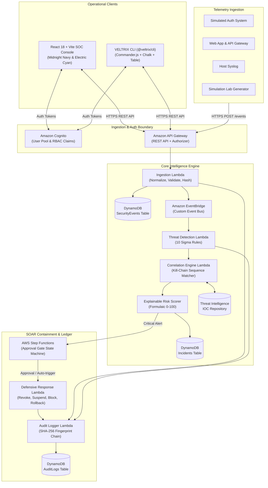
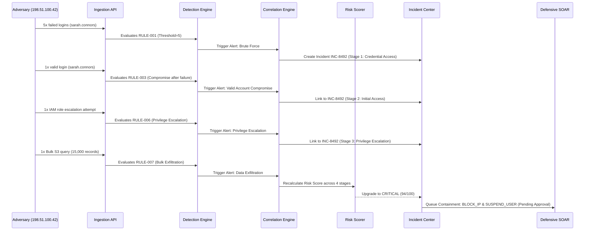

# VELTRIX: Autonomous Cyber Threat Detection & Response Platform
## System Architecture & Technical Design (`specs/design.md`)

**Document Version:** 2.0.0  
**Status:** In Review (Phase 1 Specification)  
**Brand Palette:** Midnight Navy (`#0B0F19`), Electric Cyan (`#00F5FF`), Royal Blue (`#2563EB`)  

---

## 1. End-to-End System Architecture

VELTRIX is architected as an event-driven, cloud-native serverless system supporting two unified operational interfaces: the **Web SOC Console** and the **VELTRIX CLI**.



---

## 2. Monorepo & Module Architecture

```text
VELTRIX/
├── frontend/                     # React 18 + Vite + Tailwind CSS + Recharts
│   ├── src/
│   │   ├── components/           # Header, Sidebar, Cyber cards, Modals
│   │   ├── pages/                # Overview, Events, Detection, Incidents, etc.
│   │   ├── services/             # REST API Client with JWT interceptors
│   │   └── types/                # Domain types
│   └── tests/                    # Playwright & Vitest UI tests
│
├── backend/                      # Node.js + TypeScript Lambda Micro-services
│   ├── src/
│   │   ├── ingestion/            # Schema validation, Normalization, Deduplication
│   │   ├── detection/            # 10 Sigma-inspired rules & evaluation engine
│   │   ├── correlation/          # Sliding-window entity sequence matcher
│   │   ├── risk-engine/          # Mathematical 0-100 explainable risk scorer
│   │   ├── threat-intelligence/  # Embedded IOC catalog & IP enrichment
│   │   ├── incidents/            # Incident CRUD & state machine
│   │   ├── response/             # SOAR containment, approval queue & rollback
│   │   ├── audit/                # SHA-256 cryptographic chaining & verification
│   │   ├── simulation/           # 6 Synthetic attack scenarios runner
│   │   ├── shared/               # MemoryStore, Crypto, Types, Errors
│   │   └── server.ts             # REST API HTTP runner & Lambda adapters
│   └── tests/                    # 17+ Vitest unit & integration tests
│
├── cli/                          # Standalone CLI package (@veltrix/cli)
│   ├── bin/veltrix.ts            # Executable entrypoint
│   ├── src/
│   │   ├── commands/             # auth, events, detect, incidents, intel, response, sim
│   │   ├── formatters/           # Cli-table3 human output & JSON formatters
│   │   └── api/                  # Axios HTTP client matching Web dashboard
│   └── package.json
│
├── infrastructure/               # Cloud-native IaC
│   ├── template.yaml             # Complete AWS SAM template
│   └── response/                 # Step Functions ASL state machine
│
├── specs/                        # Spec-driven development documentation
│   ├── requirements.md
│   ├── design.md
│   ├── tasks.md
│   ├── api-contracts.md
│   ├── database-schema.md
│   └── testing-strategy.md
│
├── docs/                         # Guides, API docs, Demo scripts, Cost model
└── .github/workflows/ci.yml      # GitHub Actions CI workflow
```

---

## 3. CLI Architecture (`cli/`)

The CLI provides parity with the web dashboard, invoking the exact same backend endpoints:

- **Command Parser:** Commander.js structured subcommands (`auth`, `events`, `detect`, `incidents`, `intel`, `response`, `simulate`, `status`, `config`).
- **Local Credential Storage:** Securely stores session token and active `orgId` in `~/.veltrix/config.json`.
- **Output Engine:**
  - Default: Colorized terminal tables via `cli-table3` and status spinners via `ora`.
  - Machine Mode: `--json` flag prints clean, parseable JSON payloads with exit codes:
    - `0`: Success
    - `1`: Operational or Validation Error
    - `2`: Authentication Required / Unauthorized

---

## 4. Threat Detection & Correlation Logic

### Sigma-Inspired Rule Model
```json
{
  "ruleId": "RULE-001",
  "name": "Distributed Brute-Force Authentication Attempt",
  "severity": "HIGH",
  "category": "AUTHENTICATION",
  "mitreAttack": {
    "tactic": "Credential Access",
    "techniqueId": "T1110.001",
    "techniqueName": "Brute Force: Password Guessing"
  },
  "timeWindowSeconds": 120,
  "threshold": 5,
  "groupBy": "sourceIp",
  "conditions": [{ "field": "eventType", "operator": "equals", "value": "auth.login.failed" }],
  "recommendedAction": "BLOCK_IP",
  "requiresApproval": true,
  "enabled": true
}
```

### Correlation Attack Progression Model
When multiple alerts share common tokens within a 15-minute sliding window, the engine links them:


---

## 5. Explainable Risk Scoring Engine Formula

$$\text{RiskScore} = \min\left(100, \text{Round}\left(S_{\text{base}} \times M_{\text{freq}} \times M_{\text{asset}} \times M_{\text{threat}} + B_{\text{sequence}}\right)\right)$$

- **$S_{\text{base}}$:** Base Severity score (Low: 20, Medium: 40, High: 65, Critical: 85).
- **$M_{\text{freq}}$:** Velocity multiplier ($1.0\times$ for $\le 2$, $1.15\times$ for $3-5$, $1.30\times$ for $> 5$).
- **$M_{\text{asset}}$:** Target Asset Criticality ($1.0\times$ standard user, $1.35\times$ administrative / root accounts).
- **$M_{\text{threat}}$:** Threat Intelligence Multiplier ($1.0\times$ clean, $1.20\times$ Tor / Proxy, $1.40\times$ Botnet C2).
- **$B_{\text{sequence}}$:** Attack Sequence Depth Bonus ($+0$ isolated, $+15$ for 2 kill-chain stages, $+25$ for $\ge 3$ stages).

---

## 6. Defensive SOAR Containment & Rollback

Disruptive containment actions are protected by **Human Approval Gates**:
- When an incident reaches `CRITICAL` severity, low-impact actions (`ESCALATE_ALERT`) execute autonomously.
- High-impact actions (`BLOCK_IP`, `SUSPEND_USER`) transition to `PENDING_APPROVAL`.
- Analysts approve actions via the Web console or CLI (`veltrix response execute <incidentId>`).
- Containment status changes to `CONTAINED`.
- Rollback actions (`UNBLOCK_IP`, `REINSTATE_USER`) are available at any time to restore operations.

---

## 7. Cryptographic Security Audit Trail

The audit ledger maintains an append-only cryptographic chain:
$$\text{IntegrityHash}_k = \text{SHA-256}(\text{IntegrityHash}_{k-1} \,\|\, \text{logId} \,\|\, \text{orgId} \,\|\, \text{actor} \,\|\, \text{action} \,\|\, \text{resource} \,\|\, \text{timestamp})$$

The verification tool iterates through all records, recomputing every hash and asserting that `record.previousHash === previousRecord.integrityHash`. Any modification causes verification to immediately flag the broken record.
