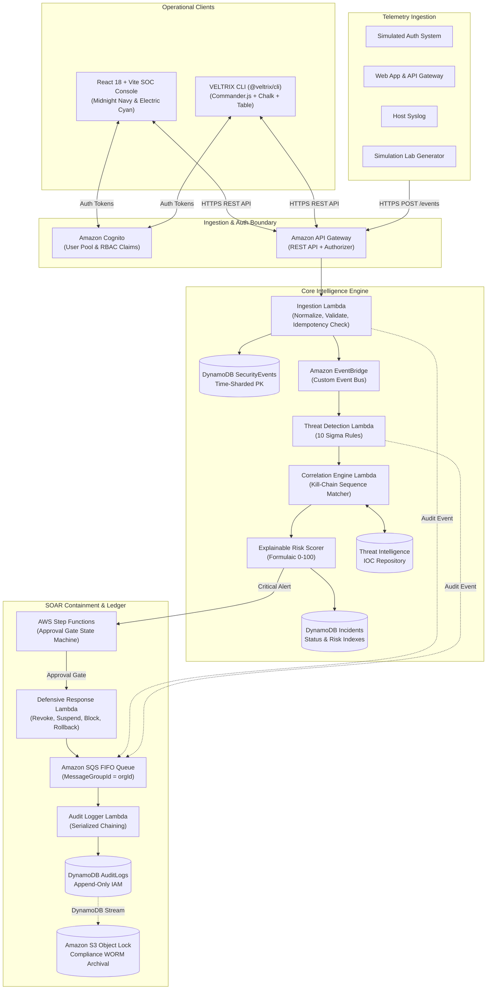

# VELTRIX: Autonomous Cyber Threat Detection & Response Platform
## System Architecture & Technical Design (`specs/design.md`)

**Document Version:** 2.1.0 (Post-Audit Hardened)  
**Status:** In Review (Phase 1 Specification)  
**Brand Palette:** Midnight Navy (`#0B0F19`), Electric Cyan (`#00F5FF`), Royal Blue (`#2563EB`)  

---

## 1. End-to-End System Architecture

VELTRIX is architected as an event-driven, cloud-native serverless platform supporting two synchronized operational interfaces: the **Web SOC Console** and the **VELTRIX CLI**.



---

## 2. Monorepo & Module Architecture

```text
VELTRIX/
├── frontend/                     # React 18 + Vite + Tailwind CSS + Recharts
│   ├── src/
│   │   ├── components/           # Header, Sidebar, Cyber cards, Modals
│   │   ├── pages/                # Overview, Events, Detection, Incidents, etc.
│   │   ├── services/             # REST API Client with JWT interceptors
│   │   └── types/                # Domain types
│   └── tests/                    # Playwright & Vitest UI tests
│
├── backend/                      # Node.js + TypeScript Lambda Micro-services
│   ├── src/
│   │   ├── ingestion/            # Schema validation, Normalization, Deduplication
│   │   ├── detection/            # 10 Sigma-inspired rules & evaluation engine
│   │   ├── correlation/          # Sliding-window entity sequence matcher
│   │   ├── risk-engine/          # Mathematical 0-100 explainable risk scorer
│   │   ├── threat-intelligence/  # Embedded IOC catalog & IP enrichment
│   │   ├── incidents/            # Incident CRUD & state machine
│   │   ├── response/             # SOAR containment, approval queue & rollback
│   │   ├── audit/                # SHA-256 cryptographic chaining & verification
│   │   ├── simulation/           # 6 Synthetic attack scenarios runner
│   │   ├── shared/               # MemoryStore, Crypto, Types, Errors
│   │   └── server.ts             # REST API HTTP runner & Lambda adapters
│   └── tests/                    # 17+ Vitest unit & integration tests
│
├── cli/                          # Standalone CLI package (@veltrix/cli)
│   ├── bin/veltrix.ts            # Executable entrypoint
│   ├── src/
│   │   ├── commands/             # auth, events, detect, incidents, intel, response, sim
│   │   ├── formatters/           # Cli-table3 human output & JSON formatters
│   │   └── api/                  # Axios HTTP client matching Web dashboard
│   └── package.json
│
├── infrastructure/               # Cloud-native IaC
│   ├── template.yaml             # Complete AWS SAM template
│   └── response/                 # Step Functions ASL state machine
│
├── specs/                        # Spec-driven development documentation
│   ├── requirements.md
│   ├── design.md
│   ├── tasks.md
│   ├── api-contracts.md
│   ├── database-schema.md
│   └── testing-strategy.md
│
├── docs/                         # Guides, API docs, Demo scripts, Cost model
└── .github/workflows/ci.yml      # GitHub Actions CI workflow
```

---

## 3. High-Precision Event Deduplication Architecture

### Problem Discovered in Initial Proposal
Truncating timestamps to the minute:
$$\text{Hash} = \text{SHA-256}(\text{orgId} + \text{eventType} + \text{sourceIp} + \text{username} + \text{timestamp}_{\text{minute}})$$
causes legitimate high-velocity brute-force attempts (e.g. 5 failed logins within 10 seconds) to produce identical hashes and get incorrectly dropped!

### Hardened Solution
1. **Network Retries vs Legitimate Distinct Events:**
   - A true duplicate occurs when an HTTP client or queue retries the exact same event. This retry carries an identical client-supplied `idempotencyKey` or `eventId`.
   - Distinct authentication attempts have unique `eventId` tokens (UUIDv7 incorporating a millisecond timestamp and random entropy).
2. **Idempotency Strategy:**
   - Every event specifies or receives an `idempotencyKey` (defaults to `eventId`).
   - The deduplication key in DynamoDB `Veltrix-SecurityEvents` is `attribute_not_exists(idempotencyKey)`.
   - Result: 5 rapid failed logins within 10 seconds have 5 unique `eventId` values $\to$ **all 5 events are preserved and trigger RULE-001**, while an accidental network retry of event #3 is safely discarded!

---

## 4. DynamoDB Schema & Hot-Partition Mitigation

### Time-Sharded Compound Partition Keys
To prevent partition throttling during 1,000 events/second bursts, the `Veltrix-SecurityEvents` table shards the partition key by date:
- **Partition Key (PK):** `ORG#{orgId}#DATE#{YYYY-MM-DD}`
- **Sort Key (SK):** `EVENT#{timestampIso}#{eventId}`

### Global Secondary Indexes (GSI)
1. **`GSI1-EventType`:**
   - `GSI1_PK`: `ORG#{orgId}#TYPE#{eventType}`
   - `GSI1_SK`: `timestampIso`
   - Purpose: Enables sub-second filtering across all `auth.login.failed` or `data.exfiltration` events without full-table scans.
2. **`GSI2-SourceIp`:**
   - `GSI2_PK`: `ORG#{orgId}#IP#{sourceIp}`
   - `GSI2_SK`: `timestampIso`
   - Purpose: Enables deep forensic investigation of specific adversary IPs across multiple days.
3. **`GSI1-StatusRisk` on `Veltrix-Incidents`:**
   - `GSI1_PK`: `ORG#{orgId}#STATUS#{status}`
   - `GSI1_SK`: `riskScore` (Numeric)
   - Purpose: Direct ordered retrieval of highest-risk open incidents (`status = NEW` or `INVESTIGATING`).

---

## 5. Serialized Cryptographic Audit Ledger & Cloud Immutability

### Concurrency Handling
In a distributed serverless architecture, concurrent Lambda functions writing audit logs directly to DynamoDB create race conditions (hash chain branching).

VELTRIX solves this by decoupling audit ingestion from ledger anchoring:
1. System events dispatch audit messages to an **Amazon SQS FIFO Queue** (`veltrix-audit-queue.fifo`).
2. SQS FIFO enforces `MessageGroupId = orgId` and deduplication.
3. A single-concurrency Audit Logger Lambda processes messages strictly in sequential order, calculating:
   $$\text{IntegrityHash}_k = \text{SHA-256}(\text{IntegrityHash}_{k-1} \,\|\, \text{logId} \,\|\, \text{orgId} \,\|\, \text{actor} \,\|\, \text{action} \,\|\, \text{resource} \,\|\, \text{timestamp})$$
4. **Cloud Immutability Enforcement:**
   - Application-level: Append-only hash verification.
   - Cloud IAM: DynamoDB execution roles explicitly deny `dynamodb:DeleteItem` and `dynamodb:UpdateItem` on `Veltrix-AuditLogs`.
   - Long-Term Archival: DynamoDB Streams replicate logs into an **Amazon S3 Bucket with S3 Object Lock enabled in Compliance Mode**, technically preventing deletion or overwriting even by the root AWS account.

---

## 6. Two-Tier Runtime Separation: Simulation vs Real AWS

To avoid confusing local test harness mocks with true AWS compatibility, VELTRIX enforces a strict two-tier architecture:

| Tier | Environment | Components | Purpose |
| :--- | :--- | :--- | :--- |
| **Tier 1: Local Emulation & Simulation Harness** | Development / Offline Demo | In-memory `MemoryStore`, mock Express server, local CLI. | Ultra-fast unit testing, lightning UI rendering, zero AWS billing, offline demo resilience. |
| **Tier 2: AWS Serverless Production Layer** | Staging / Production | API Gateway, AWS Lambda (Node 20.x ARM64), DynamoDB On-Demand, EventBridge, Step Functions, SQS FIFO, Cognito. | Real-world high-throughput deployment, true IAM least privilege, CloudWatch monitoring. |

*Rule:* Passing tests against `MemoryStore` verify domain logic, but are explicitly distinguished from AWS integration tests running against LocalStack or deployed AWS SAM resources.

---

## 7. Defensive SOAR Containment & Sandboxing

### Target Sandboxing
To ensure automated defensive actions cannot accidentally impact production systems:
- All containment actions (`BLOCK_IP`, `SUSPEND_USER`) evaluate target entities against a registered test organization inventory (`isSimulated: true` or RFC 5737 test IP ranges: `198.51.100.0/24`, `203.0.113.0/24`, `192.0.2.0/24`).
- Any attempt to target real non-whitelisted IP addresses or production user handles is rejected with `400 Bad Request (UNAUTHORIZED_CONTAINMENT_TARGET)`.

### Zero-Bypass Approval Enforcement
- High-impact containment actions require approval tokens.
- Direct execution via `POST /responses/:incidentId/execute` requires Organization Administrator credentials or a valid approval token; otherwise, it automatically queues as `PENDING_APPROVAL`.

---

## 8. Realistic AWS Serverless Cost Model

### Workload Profile Assumptions (Monthly)
- **Ingestion Velocity:** 100,000 events / month (~2.3 events/min average, burst capacity to 1,000 events/min during simulations).
- **Average Event Payload:** 1.2 KB JSON.
- **Compute:** 100,000 Lambda invocations @ 256 MB ARM64, average duration 120 ms.
- **Active Analysts:** 10 Monthly Active Users (Cognito).
- **Log Generation:** ~2 GB structured CloudWatch logs.
- **Data Transfer Out:** ~5 GB / month.

### Cost Breakdown: Year 1 Free Tier vs Post-Free Tier

| Service | Usage Metric | Year 1 Free Tier ($ USD) | Post-Free Tier Standard ($ USD) | Pricing Basis |
| :--- | :--- | :--- | :--- | :--- |
| **AWS Lambda** | 100K calls, 12K GB-s | $0.00 | $0.05 | 1M free requests & 400K GB-s free tier indefinitely. |
| **Amazon API Gateway** | 120K REST calls | $0.00 | $0.15 | 1M free calls/month for first 12 months, then $1.00/million. |
| **Amazon DynamoDB** | 100K WRUs, 500K RRUs, 1 GB | $0.00 | $0.35 | 25 GB free storage indefinitely; On-Demand reads/writes. |
| **Amazon EventBridge** | 100K custom events | $0.10 | $0.10 | $1.00 / million events. |
| **Amazon SQS (FIFO)** | 100K audit messages | $0.00 | $0.05 | 1M free requests indefinitely. |
| **Amazon Cognito** | 10 MAUs | $0.00 | $0.00 | First 50,000 MAUs are free indefinitely. |
| **AWS Step Functions** | 100 state transitions | $0.00 | $0.00 | 4,000 free state transitions / month indefinitely. |
| **Amazon CloudWatch** | 2 GB logs + basic metrics | $0.00 | $1.10 | 5 GB free tier ingestion first 12 months, then $0.50/GB. |
| **Amazon S3 + Object Lock**| 1 GB standard + WORM | $0.00 | $0.05 | Standard S3 storage & request charges. |
| **Data Transfer Out** | 5 GB internet egress | $0.00 | $0.00 | First 100 GB/month egress is free. |
| **Total Estimated Monthly:**| | **~$0.10 – $0.50** | **~$1.85 – $2.50 / month** | *Ultra-low cost serverless architecture.* |

*(Note: Adding AWS WAF adds a baseline charge of $5.00/WebACL + $1.00/rule/month, bringing total to ~$8.50/month if WAF is attached to API Gateway).*
