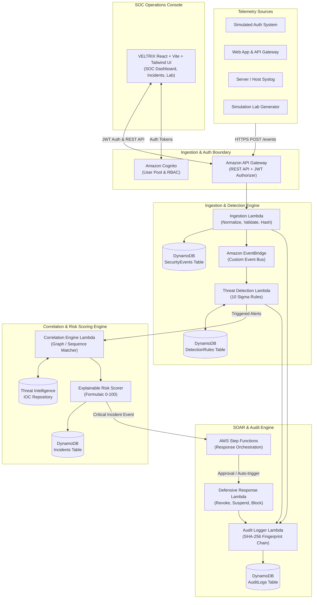
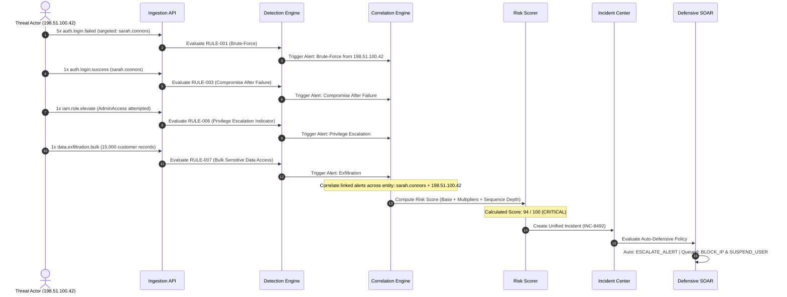
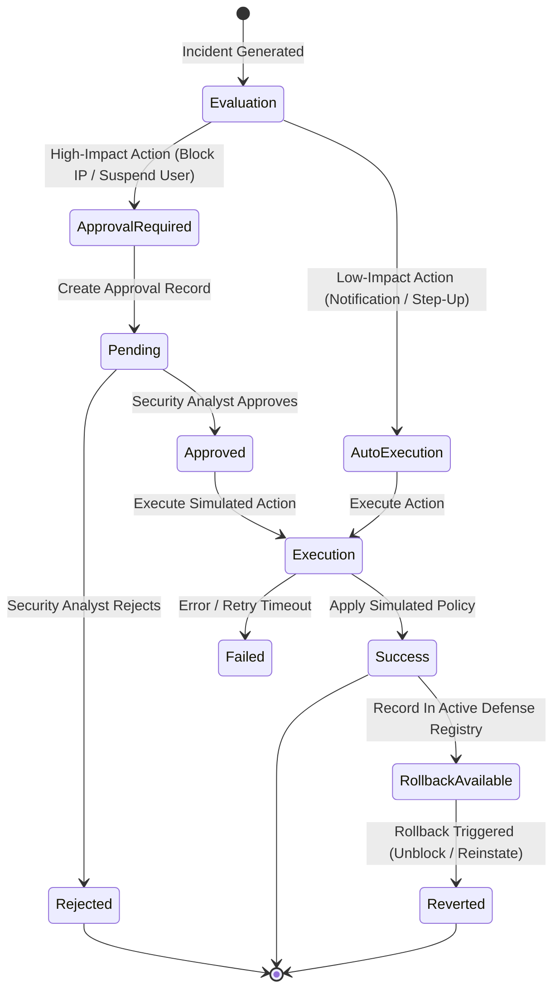

# VELTRIX: Autonomous Cyber Threat Detection & Response Platform
## System Architecture & Technical Design Specification (`design.md`)

**Document Version:** 1.0.0  
**Status:** Approved for Implementation Planning  
**Classification:** Enterprise System Architecture  
**Primary Brand Colors:** Midnight Navy (`#0B0F19`, `#111827`), Electric Cyan (`#00F5FF`, `#06B6D4`), Royal Blue (`#2563EB`, `#3B82F6`)  

---

## 1. High-Level System Architecture

VELTRIX is designed as an event-driven, cloud-native serverless platform. Incoming telemetry is ingested, validated, normalized, evaluated against Sigma-inspired detection rules, correlated across time and entity boundaries, scored for risk, and processed through automated or approval-gated containment workflows.



---

## 2. Frontend Architecture (React + Vite + TypeScript)

### 2.1 Technology Stack & Design System
- **Framework:** React 19 / 18 + Vite + TypeScript 5
- **Styling:** Tailwind CSS with custom SOC palette:
  - Background Canvas: `bg-slate-950` / `bg-[#0B0F19]` (Midnight Navy)
  - Card & Surface: `bg-slate-900/80` / `border-slate-800` (Subtle cyber borders)
  - Primary Accent: `text-cyan-400`, `bg-cyan-500/10`, `border-cyan-500/40` (Electric Cyan)
  - Secondary Accent: `text-blue-500`, `bg-blue-600` (Royal Blue)
  - Critical Alerts: `text-rose-400`, `bg-rose-500/10`, `border-rose-500/30`
  - Warning/High: `text-amber-400`, `bg-amber-500/10`, `border-amber-500/30`
  - Success/Clean: `text-emerald-400`, `bg-emerald-500/10`
- **Visualization:** Recharts (responsive time-series area charts, severity donuts, attack vectors)
- **Icons:** Lucide React (Shield, AlertTriangle, Terminal, Activity, Cpu, Lock, Key, Crosshair, Users, Globe)

### 2.2 Frontend Directory Structure
```text
frontend/
├── index.html
├── package.json
├── vite.config.ts
├── tailwind.config.js
├── src/
│   ├── main.tsx
│   ├── App.tsx
│   ├── layouts/
│   │   ├── SOCLayout.tsx            # Main SOC shell with sidebar and header
│   │   └── AuthLayout.tsx           # Authentication pages shell
│   ├── pages/
│   │   ├── DashboardOverview.tsx    # SOC Metrics, MTTD/MTTR, Charts
│   │   ├── LiveEvents.tsx           # Real-time event stream table and search
│   │   ├── ThreatDetection.tsx      # Sigma rules list, trigger logs, toggle
│   │   ├── Incidents.tsx            # Incident triage, attack graph, notes
│   │   ├── ThreatIntelligence.tsx   # IP reputation, IOCs, MITRE ATT&CK map
│   │   ├── ResponseCenter.tsx       # SOAR approval queue, active blocks
│   │   ├── SimulationLab.tsx        # 6 Interactive attack scenario runners
│   │   ├── AuditLogs.tsx            # Tamper-evident cryptographic ledger
│   │   ├── Settings.tsx             # Tenant settings, API keys, team
│   │   └── Login.tsx                # Cognito login with MFA support
│   ├── components/
│   │   ├── common/                  # CyberButton, Badge, Card, Modal, SearchInput
│   │   ├── charts/                  # EventVolumeChart, SeverityDonut, MitreHeatmap
│   │   ├── timeline/                # AttackTimeline, KillChainVisualizer
│   │   └── simulation/              # ScenarioRunnerCard, LiveTelemetryTerminal
│   ├── hooks/
│   │   ├── useAuth.ts               # Auth context & Cognito token manager
│   │   ├── useIncidents.ts          # Incident queries & status updates
│   │   ├── useEvents.ts             # Live event poller / stream
│   │   └── useSimulation.ts         # Simulation orchestrator hook
│   ├── services/
│   │   ├── api.ts                   # Axios / Fetch client with JWT interceptor
│   │   ├── authService.ts           # Cognito Auth API
│   │   ├── eventsService.ts         # Ingest & Query Events
│   │   ├── detectionService.ts      # Rules & Detections
│   │   ├── incidentService.ts       # Incidents & Triage
│   │   ├── responseService.ts       # SOAR containment & approvals
│   │   ├── auditService.ts          # Audit & SHA-256 chain verification
│   │   └── mockData.ts              # High-fidelity fallback / demo fixture
│   └── types/
│       └── index.ts                 # Shared TypeScript models
└── tests/
    └── e2e/                         # Playwright end-to-end tests
```

---

## 3. Backend Architecture (Node.js + TypeScript + AWS Lambda)

### 3.1 Modular Micro-Services Design
Each backend module is an independent TypeScript package with zero circular dependencies:

```text
backend/
├── src/
│   ├── shared/
│   │   ├── types/                   # Unified event, incident, and rule schemas
│   │   ├── utils/                   # Crypto SHA-256, date utils, logger
│   │   ├── db/                      # DynamoDB document client & query helpers
│   │   └── errors/                  # Standardized API error responses
│   ├── ingestion/
│   │   ├── handler.ts               # API Gateway Lambda entrypoint
│   │   ├── validator.ts             # Zod / AJV event schema validator
│   │   ├── normalizer.ts            # Timestamp & IP canonicalization
│   │   └── deduplicator.ts          # Idempotency hash calculator
│   ├── detection/
│   │   ├── handler.ts               # EventBridge event handler
│   │   ├── engine.ts                # Sigma-inspired rule evaluator
│   │   └── rules/                   # 10 built-in detection rule implementations
│   ├── correlation/
│   │   ├── handler.ts               # Anomaly stream correlator
│   │   ├── windowBuffer.ts          # Sliding time-window entity aggregator
│   │   └── sequenceMatcher.ts       # MITRE kill-chain pattern matcher
│   ├── risk-engine/
│   │   ├── scorer.ts                # Explainable 0-100 risk score calculator
│   │   └── factors.ts               # Asset, reputation, and sequence weights
│   ├── threat-intelligence/
│   │   ├── handler.ts               # IOC query and enrichment handler
│   │   ├── localFeeds.ts            # Embedded high-risk IP and CIDR database
│   │   └── mitreCatalog.ts          # MITRE ATT&CK technique catalog
│   ├── incidents/
│   │   ├── handler.ts               # Incidents REST API (CRUD + state transitions)
│   │   └── history.ts               # Incident activity and analyst audit trail
│   ├── response/
│   │   ├── handler.ts               # SOAR action executor (simulated block/revoke)
│   │   ├── approvalQueue.ts         # Human approval gate manager
│   │   └── stepFunctionTasks.ts     # Step Function task definitions
│   ├── audit/
│   │   ├── handler.ts               # Audit logging service
│   │   └── integrityChain.ts        # SHA-256 blockchain-style hash chainer
│   └── simulation/
│       ├── handler.ts               # Simulation scenario runner API
│       └── scenarios/               # 6 pre-built attack telemetry generators
```

---

## 4. AWS Infrastructure & Serverless Architecture

### 4.1 Cloud Services Mapping
- **Amazon API Gateway (HTTP/REST API):** Ingestion endpoints, Incident management APIs, Simulation controls. Configured with CORS, request validation, and Cognito User Pool Authorizer.
- **AWS Lambda (Node.js 20.x runtime):** Stateless, sub-second execution for all ingestion, detection, correlation, response, and audit routines.
- **Amazon DynamoDB:** Fully managed NoSQL database with On-Demand capacity and Point-in-Time Recovery (PITR).
- **Amazon EventBridge:** Decoupled event bus (`veltrix-event-bus`) routing ingested security events to detection and correlation rules.
- **AWS Step Functions:** State machine orchestrating high-severity containment actions with human-in-the-loop task tokens.
- **Amazon Cognito:** User Pools for authentication, MFA, and organization attribute claims (`custom:orgId`, `custom:role`).
- **Amazon S3:** Long-term archival for historical raw events (glacier tiering) and incident investigation report exports.
- **Amazon CloudWatch:** Structured JSON logs, latency metrics, and detection error alarms.

---

## 5. Database Design & DynamoDB Access Patterns

VELTRIX uses dedicated, workload-optimized DynamoDB tables partitioned by `orgId` to ensure strict tenant isolation and predictable single-digit millisecond query performance.

### 5.1 Tables and Primary Keys

| Table Name | Partition Key (PK) | Sort Key (SK) | Global Secondary Indexes (GSI) | TTL Attribute |
| :--- | :--- | :--- | :--- | :--- |
| `Veltrix-Organizations` | `ORG#{orgId}` | `METADATA` | — | — |
| `Veltrix-SecurityEvents` | `ORG#{orgId}` | `EVENT#{timestamp}#{eventId}` | `GSI1_PK: ORG#{orgId}#TYPE#{eventType}`, `GSI1_SK: timestamp`<br/>`GSI2_PK: ORG#{orgId}#IP#{sourceIp}`, `GSI2_SK: timestamp` | `ttl` (30 days) |
| `Veltrix-DetectionRules` | `ORG#{orgId}` | `RULE#{ruleId}` | `GSI1_PK: category`, `GSI1_SK: severity` | — |
| `Veltrix-Incidents` | `ORG#{orgId}` | `INCIDENT#{timestamp}#{incidentId}` | `GSI1_PK: ORG#{orgId}#STATUS#{status}`, `GSI1_SK: riskScore`<br/>`GSI2_PK: ORG#{orgId}#SEVERITY#{severity}`, `GSI2_SK: timestamp` | `ttl` (90 days) |
| `Veltrix-ThreatIndicators` | `INDICATOR#{type}` | `VALUE#{value}` | `GSI1_PK: severity`, `GSI1_SK: confidence` | — |
| `Veltrix-ResponseExecutions` | `ORG#{orgId}` | `RESP#{timestamp}#{executionId}` | `GSI1_PK: INCIDENT#{incidentId}`, `GSI1_SK: timestamp` | `ttl` (60 days) |
| `Veltrix-AuditLogs` | `ORG#{orgId}` | `AUDIT#{timestamp}#{logId}` | `GSI1_PK: ORG#{orgId}#ACTOR#{actorId}`, `GSI1_SK: timestamp` | — (Retained) |

### 5.2 Access Patterns
1. **Query events by organization & time range:** Query `Veltrix-SecurityEvents` where `PK = ORG#{orgId}` and `SK BETWEEN EVENT#{start} AND EVENT#{end}`.
2. **Find all failed logins from a specific IP:** Query `GSI2` on `Veltrix-SecurityEvents` where `GSI2_PK = ORG#{orgId}#IP#{sourceIp}`.
3. **List open incidents sorted by risk score:** Query `GSI1` on `Veltrix-Incidents` where `GSI1_PK = ORG#{orgId}#STATUS#NEW` ordered by `riskScore` descending.
4. **Fetch audit log chain for verification:** Query `Veltrix-AuditLogs` where `PK = ORG#{orgId}` and `SK` starts with `AUDIT#` ordered ascending by timestamp.

---

## 6. API Specifications (REST)

### 6.1 Security Events API
- `POST /api/v1/events` — Ingest single or batch security events.
- `GET /api/v1/events` — Query events with filters (`eventType`, `sourceIp`, `username`, `startDate`, `endDate`, `limit`, `cursor`).
- `GET /api/v1/events/:eventId` — Retrieve raw event detail with normalized metadata.

### 6.2 Threat Detection & Rules API
- `GET /api/v1/detection-rules` — List all 10 built-in rules with organization overrides.
- `PATCH /api/v1/detection-rules/:ruleId` — Update rule status (`enabled`), threshold, or time window.
- `GET /api/v1/detection-rules/triggers` — List recent detection rule trigger events.

### 6.3 Incidents Management API
- `GET /api/v1/incidents` — List incidents with filters (`status`, `severity`, `assignee`, `dateRange`).
- `GET /api/v1/incidents/:incidentId` — Full incident dossier (correlated events, attack timeline, explainable risk score breakdown, recommended responses).
- `PATCH /api/v1/incidents/:incidentId` — Update status (`Investigating`, `Contained`, `Resolved`, `False Positive`), notes, assignee.

### 6.4 Threat Intelligence API
- `GET /api/v1/threat-indicators` — Query threat database for IP, domain, or file hash.
- `POST /api/v1/threat-indicators/enrich` — Check an IP against local and optional external threat feeds.
- `GET /api/v1/mitre-techniques` — Retrieve MITRE ATT&CK matrix references and detection guidance.

### 6.5 Defensive Response (SOAR) API
- `GET /api/v1/responses/policies` — List configured response policies and auto-trigger criteria.
- `GET /api/v1/responses/approvals` — List containment actions awaiting manual human sign-off.
- `POST /api/v1/responses/:incidentId/execute` — Trigger or approve a response action (`REVOKE_SESSION`, `SUSPEND_USER`, `BLOCK_IP`, `ROLLBACK`).
- `GET /api/v1/responses/history` — Audit history of all defensive actions executed.

### 6.6 Security Analytics & Dashboard API
- `GET /api/v1/analytics/overview` — High-level SOC metrics: 24h event count, active threats, open incidents, MTTD/MTTR.
- `GET /api/v1/analytics/trends` — Time-series telemetry: Ingestion velocity, failed vs successful auth.
- `GET /api/v1/analytics/mitre-breakdown` — MITRE ATT&CK tactic frequency heatmap data.

### 6.7 Security Audit Trail API
- `GET /api/v1/audit-logs` — Paginated list of audit records.
- `POST /api/v1/audit-logs/verify-chain` — Verify SHA-256 cryptographic chain continuity and identify tampering.

### 6.8 Simulation Lab API
- `GET /api/v1/simulation/scenarios` — List 6 available attack simulation scenarios.
- `POST /api/v1/simulation/execute` — Execute a scenario, streaming synthetic telemetry into the live ingestion engine.
- `POST /api/v1/simulation/reset` — Reset simulated entities and clear simulated incidents.

---

## 7. Threat Detection & Event Correlation Engine

### 7.1 Sigma-Inspired Rule Specification
Rules define detection logic declaratively in JSON/YAML structure:
```json
{
  "ruleId": "RULE-001",
  "name": "Distributed Brute-Force Authentication Attempt",
  "description": "Detects multiple failed authentication attempts originating from a single IP within a short sliding time window.",
  "severity": "HIGH",
  "mitreAttack": {
    "tactic": "Credential Access",
    "techniqueId": "T1110.001",
    "techniqueName": "Brute Force: Password Guessing"
  },
  "detection": {
    "selection": {
      "eventType": "auth.login.failed"
    },
    "groupBy": ["sourceIp"],
    "condition": "count() >= 5",
    "timeWindowSeconds": 120
  },
  "recommendedResponse": {
    "action": "BLOCK_IP",
    "requiresApproval": true
  },
  "enabled": true
}
```

### 7.2 Correlation Engine Attack Sequence Detection
The Correlation Engine maintains entity relationship graphs over sliding temporal windows ($15$ minutes).



---

## 8. Explainable Risk Scoring Engine

The risk score is completely formulaic and auditable:
$$\text{Score} = \min\left(100, \text{Round}\left(S_{\text{base}} \times M_{\text{freq}} \times M_{\text{asset}} \times M_{\text{threat}} + B_{\text{sequence}}\right)\right)$$

Where:
1. **$S_{\text{base}}$ (Base Rule Severity):**
   - Low: $20$
   - Medium: $40$
   - High: $65$
   - Critical: $85$
2. **$M_{\text{freq}}$ (Velocity Multiplier):**
   - $1.0$ if count $\le 2$
   - $1.15$ if $3 \le \text{count} \le 5$
   - $1.30$ if count $> 5$
3. **$M_{\text{asset}}$ (Target Sensitivity Multiplier):**
   - Standard user: $1.0$
   - Sensitive API endpoint: $1.15$
   - Administrative / Root account: $1.35$
4. **$M_{\text{threat}}$ (Threat Intelligence Enrichment):**
   - Unknown IP: $1.0$
   - Tor / VPN Proxy: $1.20$
   - Known Malicious / C2 IP: $1.40$
5. **$B_{\text{sequence}}$ (Attack Sequence Bonus):**
   - Single isolated alert: $+0$
   - 2 correlated kill-chain stages: $+15$
   - $\ge 3$ correlated kill-chain stages (Full breach sequence): $+25$

Every incident stores the mathematical factors in its record:
```json
{
  "riskScore": 94,
  "severity": "CRITICAL",
  "explanation": {
    "baseScore": 65,
    "frequencyMultiplier": 1.15,
    "assetMultiplier": 1.35,
    "threatMultiplier": 1.20,
    "sequenceBonus": 25,
    "summary": "High base alert combined with privileged account targeting (sarah.connors), high-risk proxy IP, and multi-stage kill chain escalation (Brute Force -> Valid Login -> Privilege Escalation -> Data Exfiltration)."
  }
}
```

---

## 9. Automated Defensive Response Engine (SOAR)

### 9.1 State Machine for High-Impact Actions
Disruptive defensive actions require human sign-off unless explicit zero-touch policy applies.



### 9.2 Containment Action Handlers (Safe Demonstration Execution)
- `REVOKE_SESSION`: Removes active simulated auth tokens from the simulated session store.
- `SUSPEND_USER`: Sets target simulated user status to `LOCKED_DEFENSE`.
- `BLOCK_IP`: Appends IP to simulated firewall / WAF blocklist table with automatic TTL expiration.
- `STEP_UP_AUTH`: Flags simulated account requiring biometric/hardware MFA challenge on next request.

---

## 10. Security Audit Trail & Cryptographic Chaining

Audit integrity uses an append-only hash chain modeled after immutable transaction ledgers:
```text
Record 0 (Genesis):
  Hash: SHA-256("GENESIS" + orgId + timestamp)

Record N:
  Payload: { timestamp, actor, organizationId, action, targetResource, result, metadata }
  PreviousHash: Record N-1.Hash
  IntegrityHash: SHA-256(PreviousHash + JSON.stringify(Payload))
```

Any modification to historical audit records invalidates the hash chain at and after that record, allowing instant detection via `POST /api/v1/audit-logs/verify-chain`.

---

## 11. AWS Cost Optimization & Workload Calculator

### 11.1 Workload Profile (Monthly Estimation for Competition / Demo Organization)
- **Active Users:** 10 SOC analysts & administrators
- **Event Ingestion Velocity:** 100,000 security events / month (~2.3 events / min average, with burst tests of 1,000 events / min during simulations)
- **Average Event Payload Size:** $1.2\text{ KB}$
- **Detection & Correlation Executions:** 100,000 Lambda invocations (average duration $120\text{ ms}$, $256\text{ MB}$ memory)
- **Incidents Generated:** ~250 incidents / month
- **SOAR Response Actions:** ~100 executions / month
- **Audit Records Logged:** ~105,000 records / month

### 11.2 Monthly AWS Serverless Cost Breakdown (US East - N. Virginia)

| Service | Usage Metric | Monthly Cost ($ USD) | Free-Tier Consideration |
| :--- | :--- | :--- | :--- |
| **AWS Lambda** | 100,000 invocations $\times 120\text{ ms}$ @ $256\text{ MB}$ | $\$0.00$ | Covered by AWS Free Tier (1M free requests + 3.2M sec compute) |
| **Amazon API Gateway** | 120,000 HTTP/REST API calls | $\$0.12$ | 1M calls/month free for first 12 months, then $\$1.00$/million |
| **Amazon DynamoDB** | On-Demand: 100K writes, 500K reads, $< 1\text{ GB}$ storage | $\$0.25$ | 25 GB storage free; reads/writes within free tier |
| **Amazon EventBridge** | 100,000 custom events ingested | $\$0.10$ | $\$1.00$ per million events |
| **Amazon Cognito** | 10 Monthly Active Users (MAUs) | $\$0.00$ | Free tier includes up to 50,000 MAUs |
| **AWS Step Functions** | 100 state machine executions | $\$0.00$ | 4,000 free state transitions / month |
| **Amazon CloudWatch** | Structured logs $< 2\text{ GB}$, custom metrics | $\$0.50$ | 5 GB ingestion & basic dashboards free |
| **Amazon S3** | Event archival $< 1\text{ GB}$ standard | $\$0.03$ | 5 GB free tier storage |
| **Total Estimated Monthly Cost:** | | **~ $\$1.00 / \text{month}$** | **Nearly 100% Free-Tier Eligible** |

---

## 12. Security Architecture & Threat Model

### 12.1 STRIDE Threat Modeling Analysis

| Threat Category | Potential Risk | VELTRIX Countermeasure |
| :--- | :--- | :--- |
| **Spoofing** | Attacker impersonates another user or injects fake events under another `orgId`. | Cognito JWT verification with signature check; `orgId` extracted strictly from validated claims, never trusted from request body. |
| **Tampering** | Rogue actor or attacker modifies audit logs to conceal malicious activity. | SHA-256 cryptographic chaining where each record cryptographically anchors to the prior record; append-only IAM permissions. |
| **Repudiation** | Analyst denies approving a disruptive IP block or account suspension. | Response approval requires authenticated analyst session; logs store `actorId`, timestamp, and approval signature. |
| **Information Disclosure** | Multi-tenant data leakage between competing organizations. | DynamoDB Partition Key prefix `ORG#{orgId}` strictly enforced in all database queries and index projections. |
| **Denial of Service** | Event flood exhausts Lambda concurrency or saturates database capacity. | API Gateway rate limiting, throttling usage plans, and DynamoDB On-Demand burst auto-scaling. |
| **Elevation of Privilege** | Read-only viewer attempts to trigger defensive containment or mutate detection rules. | RBAC middleware checks `userRole` against authorized permission matrix prior to dispatching command. |
