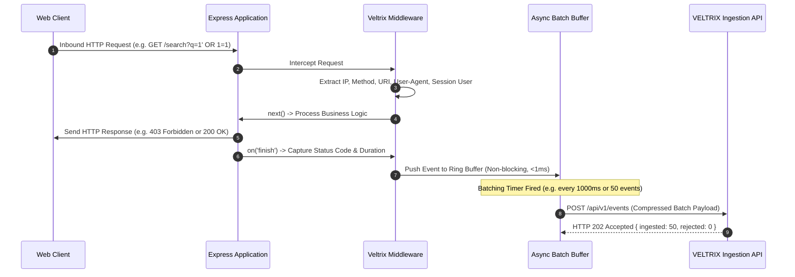
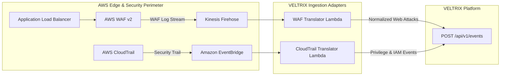
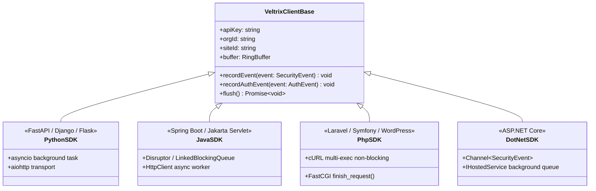

# VELTRIX: Website Integration Contract & Telemetry Specifications (`specs/website-integration-contract.md`)

**Document Version:** 1.1.0 (Post-Safety Review Hardened)  
**Status:** PROPOSED / IN REVIEW (PR #4 Architecture Review)  
**Classification:** Telemetry Ingestion Adapters & SDK Contract  
**Target Ingestion Engine:** VELTRIX Phase 4 Event Ingestion API (`POST /api/v1/events`)  

---

## 1. Overview & Core Contract Principles

To provide continuous attack monitoring across diverse web topologies, VELTRIX supports a unified telemetry integration model. Whether telemetry originates from an in-process web application SDK, an edge reverse proxy (Nginx, Apache), a global CDN (Cloudflare), or cloud perimeter firewalls (AWS WAF), every integration must comply with the canonical **VELTRIX Event Ingestion Contract**.

### Non-Negotiable Integration Rules
1. **Zero Runtime Disruption:** In-process SDKs (Node.js, Python, Java, PHP, .NET) MUST operate strictly asynchronously. Telemetry collection, serialization, and HTTP dispatch MUST NEVER block or delay the host application's HTTP request/response lifecycle.
2. **Fail-Open Policy & Exception Isolation:** If the VELTRIX Ingestion API is unreachable, times out, or throws a 5xx error, the client application MUST continue serving user requests unaffected. Errors are trapped internally and logged with rate-limiting to prevent log saturation.
3. **Bounded In-Memory Buffering:** High-throughput collectors and SDKs MUST buffer telemetry locally with a strictly capped capacity (default 500 events / 5MB ceiling) to prevent memory growth under network partition.
4. **Overflow & Drop Policy:** When the buffer fills, the SDK enters drop-oldest mode, discarding the oldest queued event, incrementing an internal atomic counter (`droppedEventsCount`), and logging a diagnostic warning.
5. **Exponential Backoff & Duplicate Handling:** Transient network failures trigger truncated exponential backoff ($1\text{s}, 2\text{s}, 4\text{s}$) with jitter ($\pm 20\%$). Client retries reuse the original `idempotencyKey = eventId` so backend conditional writes suppress duplicate ingestion atomically.
6. **Delivery Limitations & Optional Durable Spool:** In-memory buffers will lose pending events if the host process crashes unexpectedly. For environments requiring strict zero-loss compliance, SDKs provide an optional disk-backed write-ahead log or embedded SQLite spool (`DurableSpoolStorage`) that drains asynchronously.
7. **Tenant & Asset Scoping:** Every payload MUST supply a verified Organization ID (`x-organization-id` header or JWT claim) and asset identifier (`metadata.siteId` or registered domain). Cross-tenant submissions are structurally rejected with HTTP `403 Forbidden`.
8. **Sanitization of Sensitive Data:** Integrations MUST redact sensitive parameters (passwords, session tokens, API secrets, credit card numbers, authorization bearer headers) prior to transmission.

---

## 2. Canonical Telemetry Event Schema

All integrations transform raw HTTP traffic into the standardized `@veltrix/shared` `SecurityEvent` schema before posting to `POST /api/v1/events`.

```typescript
interface WebSecurityEvent {
  eventId?: string;                       // RFC 9562 UUIDv7 (generated client-side or by API)
  orgId?: string;                         // Verified against JWT or API Key
  timestamp: string;                      // ISO 8601 UTC canonicalized (e.g. "2026-11-01T12:00:00.000Z")
  eventType: WebSecurityEventType;        // Defined below
  severity: 'INFO' | 'LOW' | 'MEDIUM' | 'HIGH' | 'CRITICAL';
  category: 'AUTHENTICATION' | 'NETWORK' | 'API' | 'DATA_ACCESS' | 'SYSTEM';
  sourceIp: string;                       // Validated IPv4 or IPv6
  username?: string;                      // Authenticated user handle (if session exists)
  sourceSystem: string;                   // Integration identifier: e.g. "sdk:nodejs:express", "collector:nginx", "edge:cloudflare"
  metadata: {
    siteId: string;                       // Registered VELTRIX website asset ID
    domain: string;                       // Primary FQDN (e.g. "app.example.com")
    httpMethod: 'GET' | 'POST' | 'PUT' | 'PATCH' | 'DELETE' | 'HEAD' | 'OPTIONS';
    requestUri: string;                   // Sanitized path and query string (e.g. "/api/v1/users?id=1")
    httpStatus: number;                   // HTTP status code returned by target server (e.g. 200, 403, 500)
    responseTimeMs?: number;              // Request processing duration in milliseconds
    userAgent?: string;                   // Client User-Agent string
    clientDeclaredAttackType?: string;    // Ingestion namespaced if declared by client
    matchedPatterns?: string[];           // Optional signature matched by WAF/collector
    wafAction?: 'ALLOW' | 'BLOCK' | 'CHALLENGE' | 'LOG';
    isBot?: boolean;
    ja3Fingerprint?: string;              // TLS fingerprint if captured by edge/reverse proxy
    confidenceLevel?: 'SUSPICIOUS_ATTEMPT' | 'BLOCKED_ATTEMPT' | 'POTENTIAL_EXPLOITATION' | 'CONFIRMED_EXPLOITATION';
    corroboratingSignals?: string[];      // e.g. ["UNHANDLED_DB_SYNTAX_ERROR", "STACK_TRACE_IN_RESPONSE", "LATENCY_SPIKE"]
  };
  isSimulated?: boolean;
  idempotencyKey?: string;                // Client idempotency key to prevent drop during retries
}
```

### Standardized Web Security Event Types

| Event Type (`eventType`) | Description | Default Category | Default Severity |
| :--- | :--- | :--- | :---: |
| `web.request.normal` | Benign HTTP request baseline telemetry (sampled or targeted) | `NETWORK` | `INFO` |
| `web.attack.sqli` | SQL Injection pattern detected in URL query, headers, or body | `NETWORK` | `HIGH` |
| `web.attack.xss` | Cross-Site Scripting attempt detected in parameters or payloads | `NETWORK` | `MEDIUM` |
| `web.attack.traversal` | Path Traversal / Local File Inclusion attempt (`../`, `/etc/passwd`) | `NETWORK` | `HIGH` |
| `web.attack.bot` | Malicious scraping, credential stuffing tool, or headless bot pattern | `NETWORK` | `MEDIUM` |
| `web.attack.api_abuse` | Rate limit violation, broken object level authorization (BOLA) probe | `API` | `HIGH` |
| `auth.login.failed` | Failed authentication on login endpoint | `AUTHENTICATION` | `LOW` |
| `auth.login.success` | Successful authentication | `AUTHENTICATION` | `INFO` |
| `auth.credential_stuffing`| High-frequency multi-account login failures from single IP | `AUTHENTICATION` | `HIGH` |

---

## 3. Node.js SDK and Express Middleware

### 3.1 Architecture & Workflow
The `@veltrix/sdk-node` package runs inside the Node.js process. An Express middleware wraps the HTTP request/response pipeline, non-blockingly collecting metadata and enqueuing telemetry into an asynchronous ring buffer.



### 3.2 Express Middleware Implementation Pattern

```typescript
import express from 'express';
import { VeltrixClient, veltrixMiddleware } from '@veltrix/sdk-node';

const app = express();

// Initialize the VELTRIX client
const veltrix = new VeltrixClient({
  apiKey: process.env.VELTRIX_API_KEY!,
  orgId: process.env.VELTRIX_ORG_ID!,
  siteId: process.env.VELTRIX_SITE_ID!,
  endpoint: process.env.VELTRIX_INGESTION_URL || 'https://api.veltrix.io',
  bufferFlushIntervalMs: 1000,
  maxBufferSize: 500,
  sanitizeParams: ['password', 'token', 'secret', 'authorization', 'creditCard']
});

// Register VELTRIX security middleware as early as possible
app.use(veltrixMiddleware(veltrix));

// Standard application routes
app.post('/api/login', (req, res) => {
  // Application authentication logic
  const authSucceeded = performAuth(req.body);
  if (!authSucceeded) {
    // Explicitly notify Veltrix of failed authentication
    veltrix.recordAuthEvent(req, {
      success: false,
      username: req.body.username,
      reason: 'INVALID_CREDENTIALS'
    });
    return res.status(401).json({ error: 'Unauthorized' });
  }

  veltrix.recordAuthEvent(req, {
    success: true,
    username: req.body.username
  });
  return res.json({ token: 'jwt...' });
});
```

---

## 4. Reverse Proxy Log Collectors: Nginx & Apache

For traditional monolithic architectures where applications cannot be modified directly, VELTRIX provides lightweight log-forwarding configurations for FluentBit, Filebeat, or Vector that parse access and error logs and post directly to the Ingestion API.

### 4.1 Nginx Log Format & Ingestion Pipeline

To provide rich telemetry, Nginx `http` block is configured with a JSON log format:

```nginx
# /etc/nginx/conf.d/veltrix-log-format.conf
log_format veltrix_json escape=json '{'
    '"timestamp":"$time_iso8601",'
    '"sourceIp":"$remote_addr",'
    '"httpMethod":"$request_method",'
    '"requestUri":"$request_uri",'
    '"httpStatus":$status,'
    '"bytesSent":$bytes_sent,'
    '"responseTimeMs":$request_time,'
    '"referrer":"$http_referer",'
    '"userAgent":"$http_user_agent",'
    '"forwardedFor":"$http_x_forwarded_for",'
    '"host":"$host"'
'}';

access_log /var/log/nginx/veltrix-access.json veltrix_json;
```

#### FluentBit Forwarder Configuration
```ini
[SERVICE]
    Flush        1
    Daemon       Off
    Log_Level    info

[INPUT]
    Name         tail
    Path         /var/log/nginx/veltrix-access.json
    Parser       json
    Tag          nginx.access

[FILTER]
    Name         modify
    Match        nginx.access
    Add          orgId ${VELTRIX_ORG_ID}
    Add          sourceSystem collector:nginx
    Add          category NETWORK
    Add          severity LOW
    Add          eventType web.request.normal

[OUTPUT]
    Name         http
    Match        nginx.access
    Host         api.veltrix.io
    Port         443
    URI          /api/v1/events
    Format       json
    Header       Content-Type application/json
    Header       x-organization-id ${VELTRIX_ORG_ID}
    Header       x-api-key ${VELTRIX_API_KEY}
    Tls          On
```

### 4.2 Apache HTTP Server Log Format

In Apache `httpd.conf` or virtual host configuration:
```apache
LogFormat "{\"timestamp\":\"%{%Y-%m-%dT%H:%M:%S%z}t\",\"sourceIp\":\"%a\",\"httpMethod\":\"%m\",\"requestUri\":\"%U%q\",\"httpStatus\":%>s,\"responseTimeMs\":%D,\"userAgent\":\"%{User-Agent}i\",\"host\":\"%v\"}" veltrix_apache_json

CustomLog "/var/log/apache2/veltrix-access.json" veltrix_apache_json
```

---

## 5. Cloud & Edge Integrations

### 5.1 Cloudflare Integration (Cloudflare Workers & Logpush)

Cloudflare edge proxies inspect millions of requests globally. VELTRIX integrates with Cloudflare via two mechanisms:
1. **Cloudflare Logpush (High Volume):** Sends filtered WAF and HTTP transaction logs directly to Amazon S3 or Kinesis, where a serverless Lambda translates and posts events to `POST /api/v1/events`.
2. **Cloudflare Worker (Low Latency / Edge Intervention):** A Cloudflare Worker inspects requests at the edge, evaluates threat patterns, and communicates with VELTRIX via asynchronous `event.waitUntil()`.

```javascript
// Cloudflare Worker: veltrix-edge-worker.js
export default {
  async fetch(request, env, ctx) {
    const startTime = Date.now();
    const response = await fetch(request);
    const duration = Date.now() - startTime;

    // Asynchronously dispatch security event to VELTRIX without delaying client response
    ctx.waitUntil((async () => {
      const clientIp = request.headers.get('cf-connecting-ip') || 'unknown';
      const cfRay = request.headers.get('cf-ray');
      const threatScore = request.cf?.threatScore || 0;

      const eventPayload = {
        timestamp: new Date().toISOString(),
        eventType: threatScore > 10 ? 'web.attack.bot' : 'web.request.normal',
        severity: threatScore > 50 ? 'HIGH' : threatScore > 10 ? 'MEDIUM' : 'LOW',
        category: 'NETWORK',
        sourceIp: clientIp,
        sourceSystem: 'edge:cloudflare',
        metadata: {
          siteId: env.VELTRIX_SITE_ID,
          domain: new URL(request.url).hostname,
          httpMethod: request.method,
          requestUri: request.url,
          httpStatus: response.status,
          responseTimeMs: duration,
          userAgent: request.headers.get('user-agent'),
          cfRay: cfRay,
          asn: request.cf?.asn,
          country: request.cf?.country,
          wafAction: threatScore > 50 ? 'BLOCK' : 'ALLOW'
        }
      };

      await fetch(`${env.VELTRIX_ENDPOINT}/api/v1/events`, {
        method: 'POST',
        headers: {
          'Content-Type': 'application/json',
          'x-organization-id': env.VELTRIX_ORG_ID,
          'x-api-key': env.VELTRIX_API_KEY
        },
        body: JSON.stringify(eventPayload)
      });
    })());

    return response;
  }
};
```

---

### 5.2 AWS Perimeter Integrations: AWS WAF & CloudTrail



#### AWS WAF Adapter Transformation Rules
1. **Source Mapping:** `sourceIp` derived from `httpRequest.clientIp`.
2. **Action Mapping:** `action: "BLOCK"` triggers `severity: "HIGH"`; `action: "ALLOW"` with matched rule triggers `severity: "MEDIUM"`.
3. **Attack Classification:**
   - Rule `AWS-AWSManagedRulesCommonRuleSet` matched: Map to `web.attack.sqli` or `web.attack.xss` based on rule group ID.
   - Rule `AWS-AWSManagedRulesKnownBadInputsRuleSet` matched: Map to `web.attack.traversal`.
   - Rule `AWS-AWSManagedRulesAnonymousIpList` matched: Map to `web.attack.bot`.

---

## 6. Generic HTTP JSON Ingestion Webhook

For custom proxies, API gateways (Kong, Traefik, Envoy), or unsupported frameworks, VELTRIX provides a generic HTTP webhook contract that accepts single or batch events.

### 6.1 Authentication
- Header `x-api-key: <VELTRIX_INGESTION_API_KEY>` OR Bearer token `Authorization: Bearer <JWT>`
- Header `x-organization-id: <ORG_ID>` (must match API Key tenant binding)

### 6.2 Endpoint
`POST /api/v1/events`

### 6.3 Batch Payload Example
```json
[
  {
    "eventId": "018d5f30-74e1-7cb2-b43a-e9fa651f8b1c",
    "timestamp": "2026-11-01T12:00:00.000Z",
    "eventType": "web.attack.sqli",
    "severity": "HIGH",
    "category": "NETWORK",
    "sourceIp": "198.51.100.42",
    "sourceSystem": "gateway:kong",
    "metadata": {
      "siteId": "site-ecommerce-prod",
      "domain": "store.company.com",
      "httpMethod": "GET",
      "requestUri": "/api/products?category=electronics' UNION SELECT username,password FROM users--",
      "httpStatus": 403,
      "responseTimeMs": 12,
      "userAgent": "sqlmap/1.5.2#stable",
      "matchedPatterns": ["UNION SELECT", "SQL comment dash dash"]
    }
  }
]
```

### 6.4 Response Status Codes
- `202 Accepted`: Payload validated, queued for sliding-window detection.
- `400 Bad Request`: Malformed JSON or Zod schema validation failure.
- `401 Unauthorized`: Missing or invalid API key / Bearer token.
- `403 Forbidden`: Cross-tenant mismatch between `x-organization-id` and API key binding.
- `429 Too Many Requests`: Ingestion rate limit exceeded ($> 1,000\text{ req/s}$ per tenant without burst approval).

---

## 7. Future SDK Architectural Specifications

To maintain platform consistency when implementing SDKs in other languages, the following language-specific architectures must be preserved:



### Python SDK (`veltrix-python`)
- **Target Frameworks:** FastAPI (ASGI middleware), Django (WSGI/ASGI middleware), Flask (WSGI middleware).
- **Asynchronous Execution:** Uses Python `asyncio` background task worker with `aiohttp` or `httpx` connection pooling.
- **Fail-Open Guarantee:** Wrapped in `try...except Exception` logging to `logging.getLogger('veltrix')` with zero request blocking.

### Java SDK (`veltrix-java`)
- **Target Frameworks:** Spring Boot 3.x (`OncePerRequestFilter`), Jakarta EE Servlet Filter.
- **Concurrency Architecture:** Uses high-performance ring buffer (`LMAX Disruptor` or `LinkedBlockingQueue`) with a dedicated daemon thread posting via Java 11 `HttpClient`.

### PHP SDK (`veltrix-php`)
- **Target Frameworks:** Laravel middleware, Symfony bundle, WordPress plugin.
- **FastCGI Detachment:** Invokes `fastcgi_finish_request()` to complete and flush the HTTP response to the end-user immediately, executing the telemetry HTTP dispatch during PHP script shutdown.

### .NET SDK (`Veltrix.AspNetCore`)
- **Target Frameworks:** ASP.NET Core 8.0/9.0 middleware.
- **Channel Queuing:** Enqueues events into `System.Threading.Channels.Channel<SecurityEvent>`, processed by an `IHostedService` background worker using `IHttpClientFactory`.
