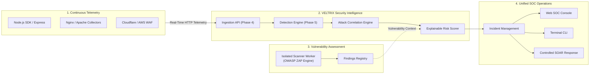
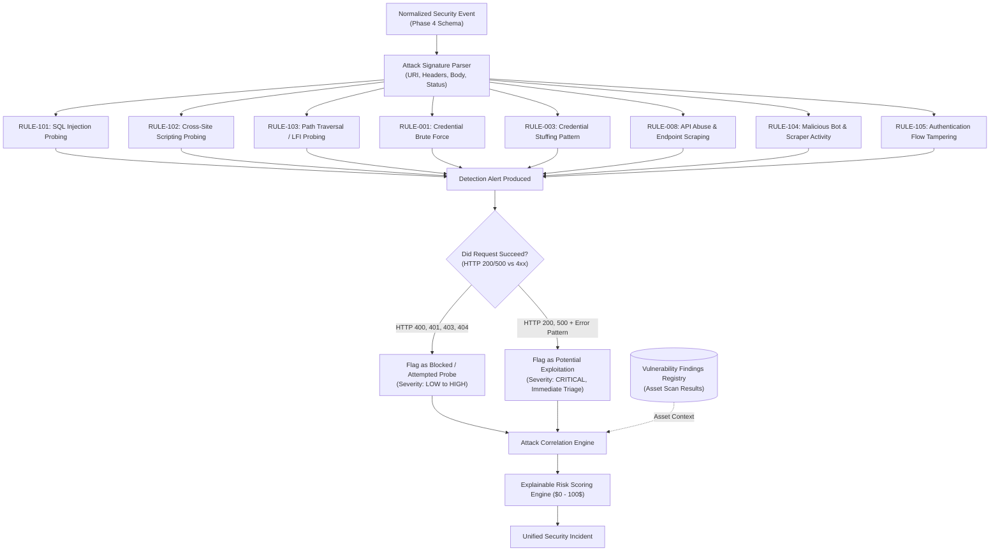
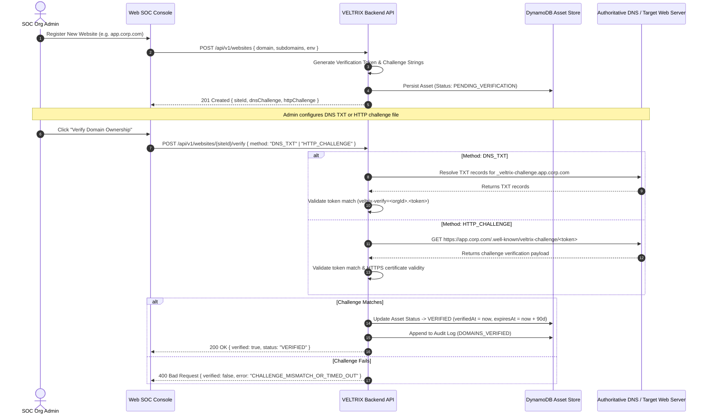
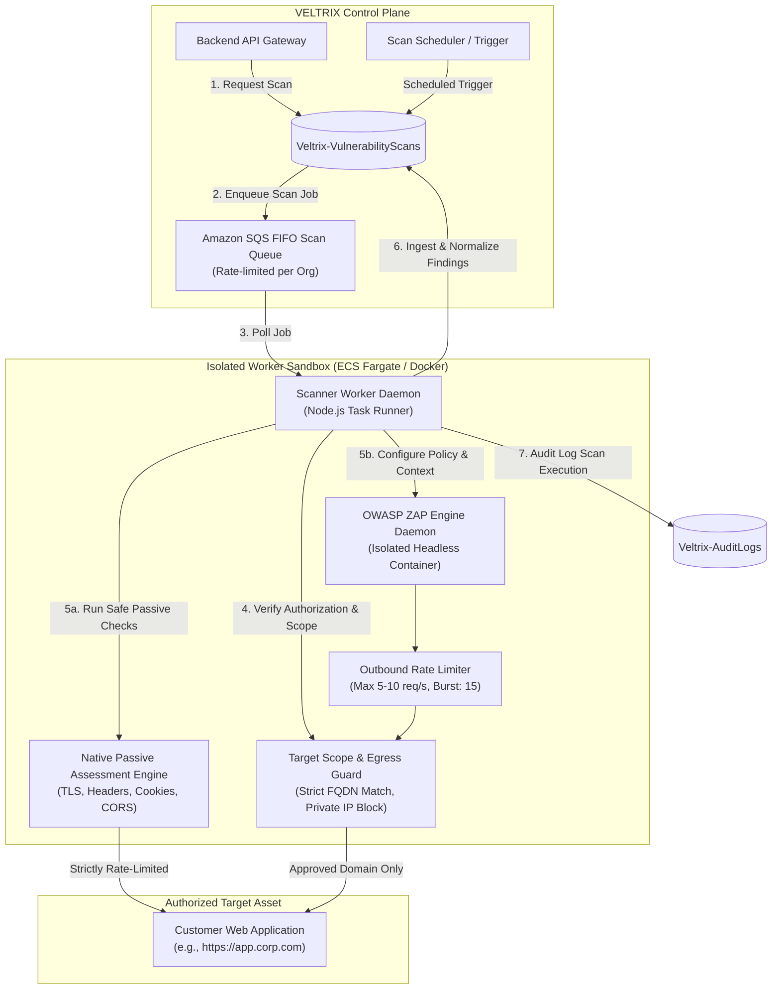
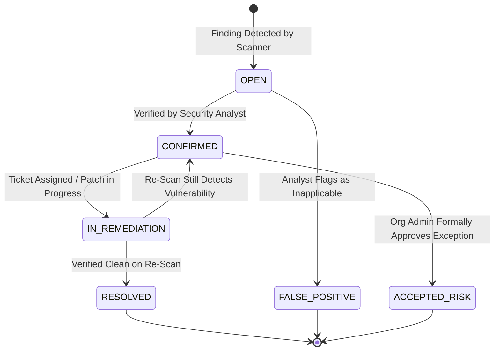
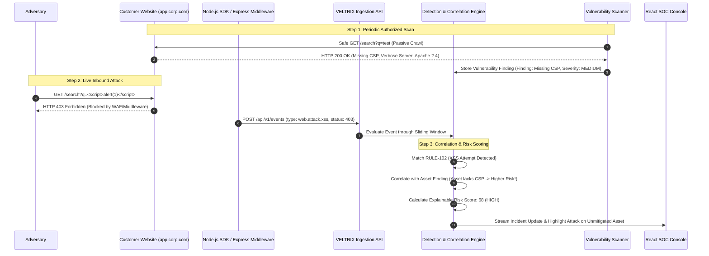

# VELTRIX: Website Security Architecture Specification (`specs/website-security-architecture.md`)

**Document Version:** 1.0.0  
**Status:** Approved Specification  
**Classification:** Enterprise Website Security Architecture & System Design  
**Target Platform:** Unified Website Attack Monitoring & Authorized Vulnerability Assessment  

---

## 1. Executive Summary & Vision

Modern web applications are subjected to relentless automated scanning, credential abuse, and targeted exploitation attempts. At the same time, security teams struggle with fragmented tooling: one vendor for runtime web application firewalls (WAF) and log analysis, and another for periodic dynamic application security testing (DAST) or vulnerability assessment. This fragmentation creates blind spots where real-world attacks target known but unpatched vulnerabilities without correlation.

**VELTRIX** bridges this divide by evolving into a **Unified Website Security Platform** that seamlessly unifies:
1. **Continuous Website Attack Monitoring:** Ingesting real-time telemetry from web applications, reverse proxies, and cloud CDNs to detect attacks (SQL injection, XSS, path traversal, brute force, API abuse, bot activity) using high-precision sliding temporal windows.
2. **Authorized Website Vulnerability Assessment:** Conducting scheduled, non-destructive, policy-governed vulnerability scans (TLS/SSL security, HTTP security headers, cookie attributes, CORS misconfigurations, information disclosure, and authenticated active assessments) powered by an isolated worker architecture evaluating OWASP ZAP.
3. **Attack-to-Vulnerability Correlation:** Correlating observed inbound attack vectors with known asset vulnerability findings to compute high-fidelity, explainable risk scores and prioritize incident triage.



---

## 2. Three Architecture Layers

VELTRIX organizes website security into three decoupled, cohesive layers maintaining strict domain boundaries.

```mermaid
flowchart TD
    subgraph LayerA["Layer A: Integration & Telemetry Layer"]
        A1["Node.js SDK & Express Middleware"]
        A2["Nginx & Apache Log Collectors"]
        A3["Cloudflare Worker / Logpush Integration"]
        A4["AWS WAF & CloudTrail Ingestion Adapters"]
        A5["Generic HTTP JSON Webhook Ingestion"]
        A6["Future SDKs: Python, Java, PHP, .NET"]
    end

    subgraph LayerB["Layer B: Website Security Analysis Layer"]
        B1["Phase 5 Core Threat Detection Engine (10 Sigma Rules)"]
        B2["Website Attack Monitoring Module (SQLi, XSS, Path Traversal, Bot)"]
        B3["Attack-to-Vulnerability Correlation Engine"]
        B4["Explainable Risk Scoring Engine ($0 - 100$)"]
        B5["Vulnerability Assessment Engine (Passive & Active)"]
        B6["Vulnerability Findings Registry & State Machine"]
    end

    subgraph LayerC["Layer C: SOC Management & Operations Layer"]
        C1["Website Asset Registry & Multi-Tenant Inventory"]
        C2["Domain Ownership Verification (DNS TXT & HTTP Challenge)"]
        C3["Integration & Agent Health Monitoring"]
        C4["Scan Policy & Schedule Orchestrator"]
        C5["Incident Management & Kill-Chain Visualizer"]
        C6["Controlled SOAR Containment Playbooks"]
        C7["Cryptographic Audit Ledger (SHA-256 Chain)"]
        C8["Unified React SOC Console & Terminal CLI"]
    end

    LayerA -->|Normalized Security Events| LayerB
    LayerB -->|Detections, Findings & Incidents| LayerC
```



---

### Layer A: Integration and Telemetry

The Integration and Telemetry Layer connects external website assets, reverse proxies, and cloud infrastructure to the existing Phase 4 Ingestion API (`POST /api/v1/events`).

#### Core Invariants
1. **Zero Raw Log Bloat:** Integrations normalize diverse logs (Nginx combined, Apache standard, Cloudflare JSON, WAF JSON) into the standardized `@veltrix/shared` `SecurityEvent` schema.
2. **Deterministic Authentication:** Integrations authenticate using tenant API keys or Cognito JWTs, passing `x-organization-id` and `x-api-key`.
3. **Client-Side Nonce / UUIDv7:** Ingested events carry unique `eventId` and `idempotencyKey` properties to prevent dropping high-velocity attack bursts while suppressing network retries.
4. **Tenant & Asset Binding:** Telemetry must carry `orgId` and `metadata.assetId` (or verified `sourceSystem` hostname) matching the registered asset inventory.

#### Supported Telemetry Sources

| Integration | Telemetry Method | Primary Payload Attributes Captured | Latency Target |
| :--- | :--- | :--- | :--- |
| **Node.js SDK & Express** | In-process middleware interceptor | Request method, path, query string, headers, client IP, user identity, status code, response time | $< 5\text{ ms}$ overhead |
| **Nginx Log Collector** | Filebeat / FluentBit / Tail daemon | Client IP, request line, HTTP status, referrer, user-agent, upstream time | $< 2\text{ s}$ batch delivery |
| **Apache Log Collector** | Access & error log forwarder | Client IP, request line, HTTP status, virtual host, auth user | $< 2\text{ s}$ batch delivery |
| **Cloudflare Integration** | Cloudflare Worker / Logpush | Edge client IP, ray ID, WAF action, threat score, ASN, country, ja3 fingerprint | Sub-second webhook |
| **AWS WAF Integration** | Kinesis Firehose $\to$ Lambda forwarder | Client IP, matched WAF rule, action (`BLOCK`/`ALLOW`), URI, headers | $< 5\text{ s}$ stream |
| **AWS CloudTrail** | EventBridge rule $\to$ SQS adapter | IAM identities, API calls, source IP, user agent, KMS actions | $< 10\text{ s}$ stream |
| **Generic HTTP JSON** | Direct HTTPS webhook | Standardized JSON payload for custom gateways and edge proxies | $< 100\text{ ms}$ processing |
| **Future SDKs** | Python, Java, PHP, .NET middleware | Equivalent standardized payload generation with zero external runtime deps | $< 5\text{ ms}$ overhead |

---

### Layer B: Website Security Analysis

The Website Security Analysis Layer separates attack detection, correlation, and vulnerability analysis into decoupled modules.



#### Crucial Principle: Probe vs. Exploitation
A fundamental flaw in naive SIEM implementations is conflating an attack *attempt* with a successful *compromise*:
1. **Attack Attempt / Probe:** An attacker sends `GET /products?id=1' OR 1=1--`. The web server or WAF intercepts the request and responds with `HTTP 403 Forbidden` or `HTTP 400 Bad Request`.
   - *Verdict:* This is an attack attempt. The asset remained secure. It is recorded as a threat detection (`RULE-101`), raising the attacker IP's threat multiplier, but it does **not** create a compromised system alert.
2. **Potential Exploitation:** An attacker sends `GET /products?id=1' UNION SELECT username,password FROM users--`. The server responds with `HTTP 200 OK` with an anomalous response size or database error traceback (`SQL syntax error`).
   - *Verdict:* The application evaluated the payload. This warrants an escalated priority incident with high base risk.
3. **Vulnerability-Correlated Attack:** If the asset inventory has an open vulnerability finding for *SQL Injection on `/products`* from a previous scan, an incoming probe against `/products` immediately receives an Asset Criticality Multiplier penalty ($1.5\times$), elevating priority before damage occurs.

---

### Layer C: SOC Management & Operations

The SOC Management Layer provides operational controls for the security team:
1. **Website Asset Inventory:** Multi-tenant registry tracking registered domains, approved subdomains, environments (`PRODUCTION`, `STAGING`, `DEVELOPMENT`), asset criticality tier, and verification status.
2. **Domain Ownership Verification:** Mandatory zero-trust verification proving domain control prior to allowing vulnerability scans.
3. **Integration & Agent Health Monitoring:** Tracks telemetry heartbeat, events per minute, delivery latency, and connectivity status for each configured integration.
4. **Vulnerability Scan Policy & Scheduler:** Schedules passive scans (daily) and active assessments (weekly/monthly/on-demand) with strict scope boundaries.
5. **Vulnerability Findings Management:** Full lifecycle tracking (`OPEN` $\to$ `CONFIRMED` $\to$ `IN_REMEDIATION` $\to$ `RESOLVED` $\to$ `ACCEPTED_RISK` $\to$ `FALSE_POSITIVE`) with CVSS v3.1 scoring, remediation guidance, and re-scan validation.
6. **Incident Management & SOAR Containment:** Orchestrates response actions (`BLOCK_IP` at Cloudflare/AWS WAF, `REVOKE_SESSION`, `RATE_LIMIT_IP`) backed by human approval gates and cryptographic audit logging.

---

## 3. Website Asset Registry & Domain Verification

To prevent unauthorized scanning or malicious telemetry injection, all website assets must undergo strict registration and cryptographic or DNS verification.



### Domain Verification Specifications
1. **DNS TXT Record:**
   - **Host:** `_veltrix-challenge.<domain>`
   - **Value:** `veltrix-verify=<orgId>.<secureToken>`
   - **TTL:** Standard (300s recommended)
2. **HTTP Challenge File:**
   - **URL:** `https://<domain>/.well-known/veltrix-challenge/<token>`
   - **Method:** `GET`
   - **Required Status:** `HTTP 200 OK`
   - **Content-Type:** `text/plain` or `application/json`
   - **Response Body:** `{"veltrixChallengeToken":"<token>","orgId":"<orgId>"}`
   - **Security Policy:** Challenge endpoint MUST be served over HTTPS. Redirects are followed up to 3 hops within the same domain only.
3. **Verification Validity & Re-Certification:**
   - Domain verification is valid for **90 days**.
   - Assets undergo automatic daily background DNS re-check. If the challenge record is removed or DNS ownership changes, the asset enters `GRACE_PERIOD` (7 days) before transitioning to `REVOKED`.
   - **Zero-Bypass Policy:** Active vulnerability scans are structurally blocked by the engine if `status !== 'VERIFIED'` or if `expiresAt < Date.now()`.

---

## 4. Vulnerability Assessment Engine & Isolated Worker Architecture

Vulnerability scanning introduces distinct operational and security challenges:
- High outbound network traffic that could degrade the target service if unconstrained.
- Risk of security scans being mistaken for malicious attacks if unauthorized.
- Scanner processes (e.g., OWASP ZAP) require significant memory and CPU, making them unsuitable for shared, synchronous API containers.

To address these challenges, VELTRIX implements a **Dedicated Isolated Scanner Worker Architecture**.



---

### 4.1 Evaluation of OWASP ZAP as Scanner Engine

| Dimension | Evaluation Criteria | Findings for VELTRIX Integration | Decision |
| :--- | :--- | :--- | :---: |
| **API & Automation** | Headless control via REST API / SDK | OWASP ZAP exposes a comprehensive JSON API (`/JSON/core/view/`, `/JSON/ascan/action/`) with active scan policy tuning, contextual authentication, and alert enumeration. | **APPROVED** |
| **Scanning Modalities** | Passive vs. Active separation | ZAP strictly separates passive spider/inspection rules from active attack plugins, enabling non-destructive default modes. | **APPROVED** |
| **Resource Footprint** | Memory, CPU, and container sizing | JVM-based daemon requires 1.5GB–4GB RAM during deep spidering and scanning. Unsuited for Lambda; well-suited for isolated ECS Fargate or Docker containers. | **APPROVED (Containerized)** |
| **Safety Controls** | Fine-grained threshold & strength tuning | Attack strength (`LOW`, `MEDIUM`, `HIGH`) and alert threshold (`LOW`, `MEDIUM`, `HIGH`) can be locked to safe defaults (`LOW` strength, non-destructive payloads only). | **APPROVED** |
| **Licensing** | Open source & commercial distribution | Apache License 2.0 allows enterprise embedding and distribution without restrictive copyleft requirements. | **APPROVED** |

---

### 4.2 Passive vs. Active Assessment Rules

#### Phase 1: Native Passive Assessment (Zero Impact)
Passive assessment executes without sending attack payloads; it inspects HTTP responses during benign site crawling.

1. **TLS / SSL Configuration:**
   - Certificate expiration and issuer chain validation.
   - TLS version enforcement (Flags TLS 1.0 and TLS 1.1 as `MEDIUM`).
   - Weak cipher suite detection (RC4, 3DES, CBC mode ciphers).
2. **HTTP Security Headers:**
   - `Strict-Transport-Security` (HSTS): Missing, short max-age ($< 1\text{ year}$), or missing `includeSubDomains`.
   - `Content-Security-Policy` (CSP): Missing, using `unsafe-inline`, `unsafe-eval`, or wildcard `*` sources.
   - `X-Frame-Options` / CSP `frame-ancestors`: Clickjacking exposure.
   - `X-Content-Type-Options`: Missing `nosniff`.
   - `Referrer-Policy`: Missing or insecure (`unsafe-url`).
   - `Permissions-Policy`: Missing or overly permissive feature delegation.
3. **Cookie Security Attributes:**
   - Sensitive session cookies missing `Secure` flag.
   - Missing `HttpOnly` flag on authentication/session tokens.
   - Missing or insecure `SameSite` attribute (`None` without `Secure` or lax on sensitive mutations).
4. **CORS Misconfiguration:**
   - Insecure origin reflection (`Access-Control-Allow-Origin: *` with `Access-Control-Allow-Credentials: true`).
   - Null origin reflection (`Access-Control-Allow-Origin: null`).
5. **Information Exposure:**
   - Verbose server identification banners (`Server: Apache/2.4.41 (Ubuntu)`, `X-Powered-By: PHP/7.4.3`).
   - Exposure of sensitive debug endpoints (`/.env`, `/.git/HEAD`, `/actuator/health`, `/phpinfo.php`).

#### Phase 2: Controlled Active Assessment (Opt-In & Strictly Gated)
Active assessment injects specific test strings to identify vulnerabilities:
- Reflected Cross-Site Scripting (XSS) parameter probing with non-executable canary strings (`veltrix-xss-probe-<uuid>`).
- SQL Error-Based Probing using benign syntax characters (`'`, `"`).
- Path Traversal parameter checking using relative path sequences targeting safe test paths.
- Open Redirect parameter validation using approved loopback destinations.

---

### 4.3 Safety Invariants & Out-of-Scope Protection

The Scanner Worker enforces the following inviolable safety guardrails:
1. **Strict Target Whitelisting:** Target URLs are checked against the asset's verified `primaryDomain` and `approvedSubdomains`. Any redirect to external domains (e.g. `google.com`, `cdn.auth0.com`, `stripe.com`) is **dropped immediately** by the egress guard.
2. **Private Network Egress Block (SSRF Prevention):** The scanner worker cannot resolve or connect to RFC 1918 private IP ranges (`10.0.0.0/8`, `172.16.0.0/12`, `192.168.0.0/16`), link-local metadata addresses (`169.254.169.254`), or loopback (`127.0.0.0/8`).
3. **Controlled Rate Limiting:** Default scanning rate is capped at **5 requests per second** (burst max 10 req/s). If the target returns more than three `HTTP 429 Too Many Requests` or `HTTP 503 Service Unavailable` responses within 30 seconds, the scanner enters exponential backoff or aborts to prevent target disruption.
4. **Prohibited Assessment Categories:**
   - **No Denial of Service (DoS/DDoS) testing.**
   - **No resource-exhaustion stress testing.**
   - **No brute-force fuzzing of state-changing production forms** (e.g. contact forms, checkout buttons, password reset endpoints).
   - **No destructive data manipulation** (`DELETE`, `PUT`, `DROP`, `TRUNCATE`).

---

## 5. Vulnerability Findings Schema & State Machine

Findings produced by the Vulnerability Assessment Engine are stored in `Veltrix-VulnerabilityFindings` and follow a strict lifecycle state machine.



### Finding Attributes
```typescript
interface VulnerabilityFinding {
  findingId: string;              // RFC 9562 UUIDv7
  orgId: string;                  // Multi-tenant organization binding
  siteId: string;                 // Target asset identifier
  scanId: string;                 // Originating scan run ID
  title: string;                  // e.g. "Missing Strict-Transport-Security Header"
  category: VulnerabilityCategory;// 'TLS' | 'HEADERS' | 'COOKIES' | 'CORS' | 'INJECTION' | 'XSS' | 'INFO_DISCLOSURE'
  severity: 'INFO' | 'LOW' | 'MEDIUM' | 'HIGH' | 'CRITICAL';
  cvssScore: number;              // 0.0 to 10.0
  cvssVector: string;             // CVSS:3.1/AV:N/AC:L/PR:N/UI:N/S:U/C:N/I:L/A:N
  status: FindingStatus;          // 'OPEN' | 'CONFIRMED' | 'IN_REMEDIATION' | 'RESOLVED' | 'ACCEPTED_RISK' | 'FALSE_POSITIVE'
  affectedUrl: string;            // Exact URI where finding was observed
  parameter?: string;             // Vulnerable parameter or header name
  evidence: {
    request?: string;             // Sanitized request excerpt
    responseHeaders?: Record<string, string>;
    matchedPattern?: string;      // Proof of finding
  };
  remediation: {
    guidance: string;             // Clear fix instructions
    cweId?: string;               // e.g. "CWE-319"
    owaspCategory?: string;       // e.g. "A05:2021-Security Misconfiguration"
    referenceUrls: string[];
  };
  firstDetectedAt: string;        // ISO 8601 UTC
  lastDetectedAt: string;         // ISO 8601 UTC
  resolvedAt?: string;
  assignedTo?: string;            // Analyst user ID
  riskScoreContribution: number;  // Weight contributed to Asset Risk Score
}
```

---

## 6. End-to-End Data Flow

The following sequence illustrates how telemetry, detections, scans, and incidents interact seamlessly:



---

## 7. Implementation Roadmap & Single-Developer Boundaries

To ensure this enterprise architecture is realistic, modular, and implementable by a single developer initially, implementation is staged with strict component boundaries:

1. **Boundary 1 (Phase 6): Asset Inventory & Integrations**
   - Implements website registration, DNS TXT / HTTP verification challenges, and telemetry adapters (Node.js SDK, Express middleware, Nginx collector). Zero scanner implementation.
2. **Boundary 2 (Phase 7): Website Attack Monitoring & Correlation**
   - Implements web-specific detection rules (`RULE-101` to `RULE-105`), telemetry parsers, and attack-to-vulnerability correlation in the detection pipeline.
3. **Boundary 3 (Phase 8): Vulnerability Assessment Engine**
   - Implements native passive checks (TLS, headers, cookies, CORS, info disclosure) first, followed by containerized OWASP ZAP worker integration for active scans.
4. **Boundary 4 (Phase 9–13): SOC Dashboard, SOAR, CLI & Audit Trail**
   - Completes UI integration, automated response actions, CLI commands, and end-to-end integration testing.
