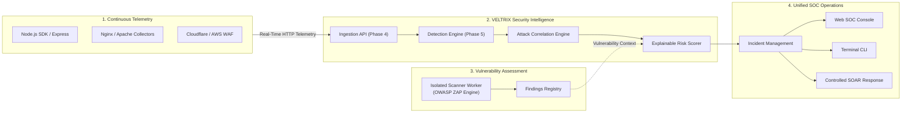
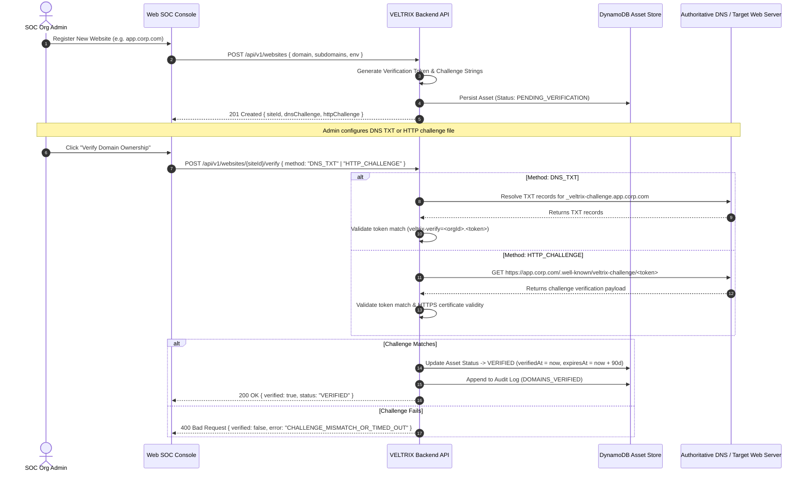
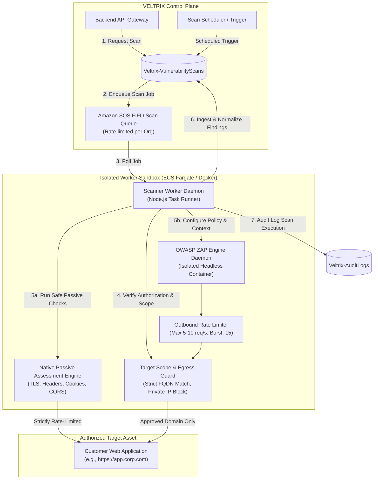
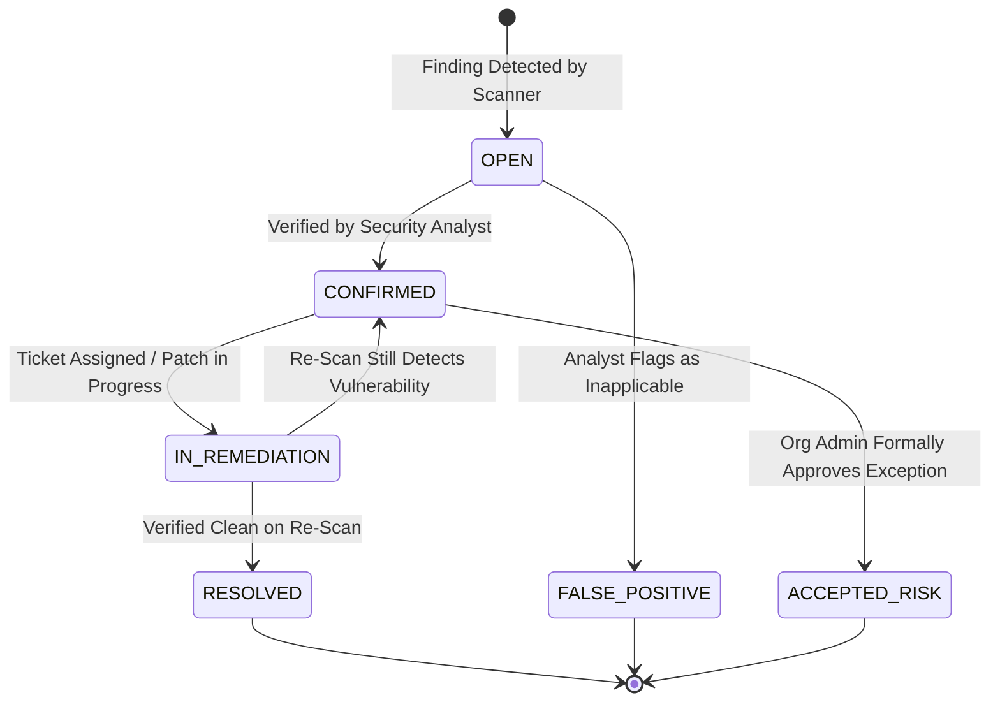
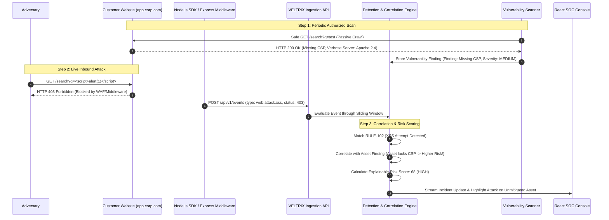

# VELTRIX: Website Security Architecture Specification (`specs/website-security-architecture.md`)

**Document Version:** 1.1.0 (Post-Safety Review Hardened)  
**Status:** PROPOSED / IN REVIEW (PR #4 Architecture Review)  
**Classification:** Enterprise Website Security Architecture & System Design  
**Target Platform:** Unified Website Attack Monitoring & Authorized Vulnerability Assessment  

---

## 1. Executive Summary & Vision

Modern web applications are subjected to relentless automated scanning, credential abuse, and targeted exploitation attempts. At the same time, security teams struggle with fragmented tooling: one vendor for runtime web application firewalls (WAF) and log analysis, and another for periodic dynamic application security testing (DAST) or vulnerability assessment. This fragmentation creates blind spots where real-world attacks target known but unpatched vulnerabilities without correlation.

**VELTRIX** bridges this divide by evolving into a **Unified Website Security Platform** that seamlessly unifies:
1. **Continuous Website Attack Monitoring:** Ingesting real-time telemetry from web applications, reverse proxies, and cloud CDNs to detect attacks (SQL injection, XSS, path traversal, brute force, API abuse, bot activity) using high-precision sliding temporal windows.
2. **Authorized Website Vulnerability Assessment:** Conducting scheduled, non-destructive, policy-governed vulnerability scans (TLS/SSL security, HTTP security headers, cookie attributes, CORS misconfigurations, information disclosure, and authenticated active assessments) powered by an isolated worker architecture evaluating OWASP ZAP.
3. **Attack-to-Vulnerability Correlation:** Correlating observed inbound attack vectors with known asset vulnerability findings to compute high-fidelity, explainable risk scores and prioritize incident triage.



---

## 2. Three Architecture Layers

VELTRIX organizes website security into three decoupled, cohesive layers maintaining strict domain boundaries.

```mermaid
flowchart TD
    subgraph LayerA["Layer A: Integration & Telemetry Layer"]
        A1["Node.js SDK & Express Middleware"]
        A2["Nginx & Apache Log Collectors"]
        A3["Cloudflare Worker / Logpush Integration"]
        A4["AWS WAF & CloudTrail Ingestion Adapters"]
        A5["Generic HTTP JSON Webhook Ingestion"]
        A6["Future SDKs: Python, Java, PHP, .NET"]
    end

    subgraph LayerB["Layer B: Website Security Analysis Layer"]
        B1["Phase 5 Core Threat Detection Engine (10 Sigma Rules)"]
        B2["Website Attack Monitoring Module (SQLi, XSS, Path Traversal, Bot)"]
        B3["Attack-to-Vulnerability Correlation Engine"]
        B4["Explainable Risk Scoring Engine ($0 - 100$)"]
        B5["Vulnerability Assessment Engine (Passive & Active)"]
        B6["Vulnerability Findings Registry & State Machine"]
    end

    subgraph LayerC["Layer C: SOC Management & Operations Layer"]
        C1["Website Asset Registry & Multi-Tenant Inventory"]
        C2["Domain Ownership Verification (DNS TXT & HTTP Challenge)"]
        C3["Integration & Agent Health Monitoring"]
        C4["Scan Policy & Schedule Orchestrator"]
        C5["Incident Management & Kill-Chain Visualizer"]
        C6["Controlled SOAR Containment Playbooks"]
        C7["Cryptographic Audit Ledger (SHA-256 Chain)"]
        C8["Unified React SOC Console & Terminal CLI"]
    end

    LayerA -->|Normalized Security Events| LayerB
    LayerB -->|Detections, Findings & Incidents| LayerC
```



---

### Layer A: Integration and Telemetry

The Integration and Telemetry Layer connects external website assets, reverse proxies, and cloud infrastructure to the existing Phase 4 Ingestion API (`POST /api/v1/events`).

#### SDK Telemetry Reliability & Non-Blocking Invariant
1. **Never Block Host Request Lifecycle:** In-process SDKs (Node.js, Express, Python, Java, PHP, .NET) operate strictly asynchronously. Telemetry interception, parsing, and transmission never delay the host application's HTTP response lifecycle.
2. **Bounded Memory Usage:** The in-memory ring buffer has a strictly capped capacity (configurable `maxBufferSize`, default 500 events, hard memory ceiling ~5 MB).
3. **Overflow & Event-Drop Policy:** If the VELTRIX Ingestion API is unreachable or experiences network latency, and the ring buffer reaches capacity, the SDK enters **drop-oldest overflow mode**:
   - The oldest buffered event is discarded to accommodate incoming telemetry.
   - An internal atomic counter (`droppedEventsCount`) increments.
   - A rate-limited diagnostic warning is logged via the application logger.
4. **Retry, Backoff & Jitter:** Network dispatches use truncated exponential backoff ($1\text{s}, 2\text{s}, 4\text{s}$) with randomized jitter ($\pm 20\%$) up to a maximum of 3 attempts before dropping.
5. **Duplicate Prevention:** Client retries preserve the original `idempotencyKey = eventId`, allowing the backend DynamoDB conditional write (`attribute_not_exists`) to suppress duplicates atomically.
6. **Process Crash Boundaries & Limitations:** In-memory buffered events are transient and will be lost if the host process crashes unexpectedly (e.g. unhandled exception, SIGKILL, container restart).
7. **Optional Durable Local Spool:** For regulated environments requiring zero telemetry loss under process failure:
   - SDK provides an optional pluggable disk-backed spool interface (`DurableSpoolStorage`).
   - Events are written synchronously to an append-only local write-ahead log (WAL) or embedded SQLite buffer before asynchronous batch drain.
   - On process boot, the spool automatically recovers and flushes uncommitted events.

#### Supported Telemetry Sources

| Integration | Telemetry Method | Primary Payload Attributes Captured | Latency Target |
| :--- | :--- | :--- | :--- |
| **Node.js SDK & Express** | In-process middleware interceptor | Request method, path, query string, headers, client IP, user identity, status code, response time | $< 5\text{ ms}$ overhead |
| **Nginx Log Collector** | Filebeat / FluentBit / Tail daemon | Client IP, request line, HTTP status, referrer, user-agent, upstream time | $< 2\text{ s}$ batch delivery |
| **Apache Log Collector** | Access & error log forwarder | Client IP, request line, HTTP status, virtual host, auth user | $< 2\text{ s}$ batch delivery |
| **Cloudflare Integration** | Cloudflare Worker / Logpush | Edge client IP, ray ID, WAF action, threat score, ASN, country, ja3 fingerprint | Sub-second webhook |
| **AWS WAF Integration** | Kinesis Firehose $\to$ Lambda forwarder | Client IP, matched WAF rule, action (`BLOCK`/`ALLOW`), URI, headers | $< 5\text{ s}$ stream |
| **AWS CloudTrail** | EventBridge rule $\to$ SQS adapter | IAM identities, API calls, source IP, user agent, KMS actions | $< 10\text{ s}$ stream |
| **Generic HTTP JSON** | Direct HTTPS webhook | Standardized JSON payload for custom gateways and edge proxies | $< 100\text{ ms}$ processing |
| **Future SDKs** | Python, Java, PHP, .NET middleware | Equivalent standardized payload generation with zero external runtime deps | $< 5\text{ ms}$ overhead |

---

### Layer B: Website Security Analysis

The Website Security Analysis Layer separates attack detection, correlation, and vulnerability analysis into decoupled modules.

#### Attack vs. Exploitation Classification: Four Confidence Tiers
HTTP status codes (200, 4xx, 5xx) and response payload sizes alone **never establish successful exploitation**. An HTTP 200 response may simply be a generic error page, a home page redirect, or a standard SPA response. An HTTP 500 error may be an unrelated unhandled route bug rather than an injection exploit.

VELTRIX enforces **Four Evidence-Based Confidence Tiers**:

| Confidence Tier | Classification Definition | Required Corroborating Evidence | Severity & SOC Action |
| :--- | :--- | :--- | :--- |
| **1. Suspicious Attempt** | Inbound attack signature matched in URI, query parameter, header, or body. | Pattern match only; target response is unverified or inconclusive. | **LOW / MEDIUM** — Recorded as threat detection alert; feeds threat multiplier; no incident created. |
| **2. Blocked Attempt** | Inbound attack signature matched, but verified security control intervened. | Corroborated by WAF block action (`action: BLOCK`), middleware rejection (`403 Forbidden`), or early parameter sanitization. | **LOW / INFO** — Logged as defense-in-depth verification; attacker IP tracked in sliding window. |
| **3. Potential Exploitation** | Inbound attack signature reached application layer accompanied by execution anomalies. | Corroborated by trusted application signals: unhandled database syntax error traceback in error logs, database timeout spike, anomalous response latency, or unexpected server stack trace. | **HIGH** — Incident created for rapid triage; flags unhandled exception targeting known attack vector. |
| **4. Confirmed Exploitation** | Multi-source proof that the attack succeeded and compromised system state or confidentiality. | Corroborated by verified data leakage indicators (e.g. database schema tokens in response), unauthorized privilege mutation immediately following injection, or canary token breach. | **CRITICAL** — Automated emergency alert; high-priority SOAR containment proposal. |

#### Configurable & Explainable Risk Contribution Model
Rather than applying an arbitrary fixed 1.5x multiplier, VELTRIX evaluates asset vulnerabilities using a **Configurable Risk Contribution Model**:

$$\text{RiskScore} = \min\left(100, \text{Round}\left(S_{\text{base}} \times M_{\text{freq}} \times M_{\text{asset}} \times M_{\text{threat}} + C_{\text{vuln\_match}} + B_{\text{sequence}}\right)\right)$$

Where the vulnerability correlation term $C_{\text{vuln\_match}}$ is calculated dynamically based on verified attack surface overlap:

$$C_{\text{vuln\_match}} = w_{\text{overlap}} \times \left(\frac{\text{CVSS}_{\text{finding}}}{10}\right) \times K_{\text{confidence}}$$

- **Attack Surface Overlap Factor ($w_{\text{overlap}}$):**
  - **Exact Match ($w = 25$):** Attack URI and parameter match the exact vulnerable endpoint and parameter of an active open finding (e.g. SQLi probe on `/api/search?q=` where Finding #104 is an open SQLi on `/api/search?q=`).
  - **Path-Level Match ($w = 15$):** Attack targets the affected path but on a different parameter.
  - **Asset-Level Match ($w = 5$):** Attack type matches an open finding anywhere on the asset.
  - **No Match ($w = 0$):** No active vulnerability on target asset.
- **Confidence Multiplier ($K_{\text{confidence}}$):**
  - `CONFIRMED_EXPLOITATION`: $1.0$
  - `POTENTIAL_EXPLOITATION`: $0.8$
  - `SUSPICIOUS_ATTEMPT`: $0.4$
  - `BLOCKED_ATTEMPT`: $0.1$ (blocked probes targeting vulnerable endpoints still indicate adversary interest).

#### Testing & Calibration Plan
The Risk Contribution Model undergoes empirical calibration:
1. **Baseline Synthetic Testing:** Execute 50,000 synthetic test events across 6 attack scenarios, measuring risk score distributions.
2. **False Positive Suppression Calibration:** Verify that blocked probes against non-vulnerable assets never score above 45 (Medium tier).
3. **Threshold Sensitivity Tuning:** Allow organization administrators to tune $w_{\text{overlap}}$ weights per environment tier (higher in Production, lower in Dev).

---

### Layer C: SOC Management & Operations

The SOC Management Layer provides operational controls for the security team:
1. **Website Asset Inventory:** Multi-tenant registry tracking registered domains, approved subdomains, environments (`PRODUCTION`, `STAGING`, `DEVELOPMENT`), asset criticality tier, and verification status.
2. **Domain Ownership Verification:** Mandatory zero-trust verification proving domain control prior to allowing vulnerability scans.
3. **Integration & Agent Health Monitoring:** Tracks telemetry heartbeat, events per minute, delivery latency, and connectivity status for each configured integration.
4. **Vulnerability Scan Policy & Scheduler:** Schedules passive scans (daily) and active assessments (weekly/monthly/on-demand) with strict scope boundaries.
5. **Vulnerability Findings Management:** Full lifecycle tracking (`OPEN` $\to$ `CONFIRMED` $\to$ `IN_REMEDIATION` $\to$ `RESOLVED` $\to$ `ACCEPTED_RISK` $\to$ `FALSE_POSITIVE`) with CVSS v3.1 scoring, remediation guidance, and re-scan validation.
6. **Incident Management & SOAR Containment:** Orchestrates response actions (`BLOCK_IP` at Cloudflare/AWS WAF, `REVOKE_SESSION`, `RATE_LIMIT_IP`) backed by human approval gates and cryptographic audit logging.

---

## 3. Website Asset Registry & Domain Ownership Revocation

To prevent unauthorized scanning or malicious telemetry injection, all website assets must undergo strict registration and cryptographic or DNS verification.



### Domain Verification Specifications
1. **DNS TXT Record:**
   - **Host:** `_veltrix-challenge.<domain>`
   - **Value:** `veltrix-verify=<orgId>.<secureToken>`
   - **TTL:** Standard (300s recommended)
2. **HTTP Challenge File:**
   - **URL:** `https://<domain>/.well-known/veltrix-challenge/<token>`
   - **Method:** `GET`
   - **Required Status:** `HTTP 200 OK`
   - **Content-Type:** `text/plain` or `application/json`
   - **Response Body:** `{"veltrixChallengeToken":"<token>","orgId":"<orgId>"}`
   - **Security Policy:** Challenge endpoint MUST be served over HTTPS. Redirects are followed up to 3 hops within the same domain only.

### Ownership Revocation & Grace Period Safety Invariants
- **90-Day Verification Window:** Domain verification is valid for a maximum of 90 days.
- **Daily Re-Check:** Background scheduler performs daily DNS verification probes.
- **Immediate Scan Freeze on Grace Period:** If a verification check fails (e.g. TXT record deleted or modified), the asset enters `GRACE_PERIOD` (7 days).
  - **CRITICAL INVARIANT:** `GRACE_PERIOD` **immediately freezes and blocks all new scans**.
  - All queued and scheduled scans for the asset are **cancelled immediately**.
  - The control plane emits an immediate abort signal to any actively running scanner workers targeting the asset.
  - The 7-day grace period is strictly an administrative notification window allowing the owner to restore DNS records before asset deregistration; **it is NEVER permission to continue scanning**.
  - Resuming scans strictly requires successful domain re-verification.

---

## 4. Vulnerability Assessment Engine & Isolated Worker Architecture

Vulnerability scanning introduces distinct operational and security challenges:
- High outbound network traffic that could degrade the target service if unconstrained.
- Risk of security scans being mistaken for malicious attacks if unauthorized.
- Scanner processes (e.g., OWASP ZAP) require significant memory and CPU, making them unsuitable for shared, synchronous API containers.

To address these challenges, VELTRIX implements a **Dedicated Isolated Scanner Worker Architecture**.



---

### 4.1 Evaluation of OWASP ZAP as Scanner Engine

| Dimension | Evaluation Criteria | Findings for VELTRIX Integration | Decision |
| :--- | :--- | :--- | :---: |
| **API & Automation** | Headless control via REST API / SDK | OWASP ZAP exposes a comprehensive JSON API (`/JSON/core/view/`, `/JSON/ascan/action/`) with active scan policy tuning, contextual authentication, and alert enumeration. | **APPROVED** |
| **Scanning Modalities** | Passive vs. Active separation | ZAP strictly separates passive spider/inspection rules from active attack plugins, enabling non-destructive default modes. | **APPROVED** |
| **Resource Footprint** | Memory, CPU, and container sizing | JVM-based daemon requires 1.5GB–4GB RAM during deep spidering and scanning. Unsuited for Lambda; well-suited for isolated ECS Fargate or Docker containers. | **APPROVED (Containerized)** |
| **Safety Controls** | Fine-grained threshold & strength tuning | Attack strength (`LOW`, `MEDIUM`, `HIGH`) and alert threshold (`LOW`, `MEDIUM`, `HIGH`) can be locked to safe defaults (`LOW` strength, non-destructive payloads only). | **APPROVED** |
| **Licensing** | Open source & commercial distribution | Apache License 2.0 allows enterprise embedding and distribution without restrictive copyleft requirements. | **APPROVED** |

---

### 4.2 Comprehensive SSRF & Network Egress Protection

To completely eliminate Server-Side Request Forgery (SSRF) and prevent scanner abuse against internal infrastructure, the scanner worker enforces dual-layer validation:

#### 1. Prohibited Destination IP Matrix
All socket connections are evaluated against the following blocked ranges:

| Address Category | Prohibited CIDR Ranges & Values | Rationale |
| :--- | :--- | :--- |
| **IPv4 Private** | `10.0.0.0/8`, `172.16.0.0/12`, `192.168.0.0/16` | RFC 1918 internal networks. |
| **IPv4 Loopback** | `127.0.0.0/8` | Host loopback addresses. |
| **IPv4 Link-Local & Cloud Metadata** | `169.254.0.0/16` (specifically `169.254.169.254`) | AWS / cloud instance metadata endpoints. |
| **IPv4 Broadcast & Special** | `0.0.0.0/8`, `224.0.0.0/4` (Multicast), `240.0.0.0/4` (Reserved), `255.255.255.255/32` | Non-routable and broadcast. |
| **IPv4 Documentation** | `192.0.2.0/24`, `198.51.100.0/24`, `203.0.113.0/24` | TEST-NET ranges. |
| **IPv6 Loopback & Unspecified** | `::1/128`, `::/128` | Host loopback and unspecified. |
| **IPv6 Unique-Local (ULA)** | `fc00::/7` | RFC 4193 private IPv6. |
| **IPv6 Link-Local** | `fe80::/10` | Link-local IPv6. |
| **IPv4-Mapped IPv6** | `::ffff:0:0/96` (e.g. `::ffff:127.0.0.1`, `::ffff:10.0.0.1`, `::ffff:169.254.169.254`) | Bypasses naive IPv4 checks by wrapping in IPv6. |
| **IPv6 Documentation / Discard** | `2001:db8::/32`, `100::/64` | Documentation and discard ranges. |

#### 2. Connection-Time DNS Resolution & Rebinding Prevention
- **DNS Rebinding Attack Protection:** Attackers can configure DNS records that resolve to a public IP on pre-check but resolve to `127.0.0.1` or `169.254.169.254` milliseconds later.
- **Connection-Time IP Pinning:**
  - The scanner worker intercepts socket creation at connection time (`lookup` hook / custom HTTP Agent).
  - The exact IP address resolved for the TCP handshake is validated against the prohibited matrix **before the SYN packet is sent**.
  - The connection is pinned directly to the validated IP, passing the verified IP to `socket.connect({ host: validatedIp })` with `servername` set to the target FQDN for SNI.
- **CNAME Resolution Recursion:** The resolver recursively traverses all CNAME aliases. If any intermediary alias points to an unapproved domain or internal IP, the request is immediately dropped.
- **HTTP 3xx Redirect Re-Validation:** Every HTTP redirect (`301`, `302`, `307`, `308`) is intercepted. The redirection target URL is validated against the approved FQDN scope and its resolved IP is validated against the prohibited matrix before following.
- **Dual-Layer Enforcement:** In addition to application-level checks, worker containers reside in isolated VPC subnets with network security groups that reject outbound traffic to internal VPC CIDRs and AWS metadata endpoints.

---

### 4.3 Emergency Scan Cancellation & Worker Lifecycle

The Web SOC Console and CLI provide an emergency stop mechanism: `POST /api/v1/scans/{scanId}/abort`.

1. **Target SLO:** The platform targets a **500ms Service Level Objective (SLO)** from user abort trigger to worker socket termination.
2. **Cancellation Signaling & Polling:**
   - Control plane updates scan status to `ABORT_REQUESTED` in DynamoDB and publishes an immediate abort signal to the worker via high-priority Redis Pub/Sub or SQS urgent channel.
   - The isolated worker process polls the abort flag on every HTTP request cycle (at most every 250ms).
3. **Process Termination & Active Request Cleanup:**
   - Upon receiving the abort signal, the worker immediately drains all active outbound HTTP connection pools.
   - Sends graceful `SIGTERM` to running browser/ZAP processes.
   - If ZAP daemon does not exit within 5 seconds, worker issues `SIGKILL`.
4. **Cancellation Acknowledgement:**
   - Worker writes an `ABORTED` state to `Veltrix-VulnerabilityScans` including `abortedAt`, `abortedBy`, and total requests completed prior to termination.
   - Appends an immutable audit log record (`SCAN_ABORTED`).
5. **Failure & Timeout Reporting:**
   - If the worker fails to acknowledge cancellation within **10 seconds**, the control plane automatically transitions the scan to `ABORT_FAILED_TIMED_OUT`, terminates the container task via AWS ECS API, and alerts the SOC.

---

## 5. Vulnerability Findings Schema & State Machine

Findings produced by the Vulnerability Assessment Engine are stored in `Veltrix-VulnerabilityFindings` and follow a strict lifecycle state machine.



### Finding Attributes
```typescript
interface VulnerabilityFinding {
  findingId: string;              // RFC 9562 UUIDv7
  orgId: string;                  // Multi-tenant organization binding
  siteId: string;                 // Target asset identifier
  scanId: string;                 // Originating scan run ID
  title: string;                  // e.g. "Missing Strict-Transport-Security Header"
  category: VulnerabilityCategory;// 'TLS' | 'HEADERS' | 'COOKIES' | 'CORS' | 'INJECTION' | 'XSS' | 'INFO_DISCLOSURE'
  severity: 'INFO' | 'LOW' | 'MEDIUM' | 'HIGH' | 'CRITICAL';
  cvssScore: number;              // 0.0 to 10.0
  cvssVector: string;             // CVSS:3.1/AV:N/AC:L/PR:N/UI:N/S:U/C:N/I:L/A:N
  status: FindingStatus;          // 'OPEN' | 'CONFIRMED' | 'IN_REMEDIATION' | 'RESOLVED' | 'ACCEPTED_RISK' | 'FALSE_POSITIVE'
  affectedUrl: string;            // Exact URI where finding was observed
  parameter?: string;             // Vulnerable parameter or header name
  evidence: {
    request?: string;             // Sanitized request excerpt
    responseHeaders?: Record<string, string>;
    matchedPattern?: string;      // Proof of finding
  };
  remediation: {
    guidance: string;             // Clear fix instructions
    cweId?: string;               // e.g. "CWE-319"
    owaspCategory?: string;       // e.g. "A05:2021-Security Misconfiguration"
    referenceUrls: string[];
  };
  firstDetectedAt: string;        // ISO 8601 UTC
  lastDetectedAt: string;         // ISO 8601 UTC
  resolvedAt?: string;
  assignedTo?: string;            // Analyst user ID
  riskScoreContribution: number;  // Weight contributed to Asset Risk Score
}
```

---

## 6. End-to-End Data Flow



---

## 7. Implementation Roadmap & Single-Developer Boundaries

1. **Boundary 1 (Phase 6): Asset Inventory & Integrations**
   - Implements website registration, DNS TXT / HTTP verification challenges, and telemetry adapters (Node.js SDK, Express middleware, Nginx collector). Zero scanner implementation.
2. **Boundary 2 (Phase 7): Website Attack Monitoring & Correlation**
   - Implements web-specific detection rules (`RULE-101` to `RULE-105`), telemetry parsers, and attack-to-vulnerability correlation in the detection pipeline.
3. **Boundary 3 (Phase 8): Vulnerability Assessment Engine**
   - Implements native passive checks (TLS, headers, cookies, CORS, info disclosure) first, followed by containerized OWASP ZAP worker integration for active scans.
4. **Boundary 4 (Phase 9–13): SOC Dashboard, SOAR, CLI & Audit Trail**
   - Completes UI integration, automated response actions, CLI commands, and end-to-end integration testing.
