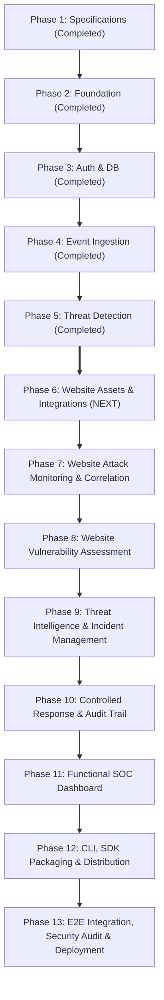

# VELTRIX: Revised Engineering Development Roadmap (`specs/website-security-roadmap-update.md`)

**Document Version:** 1.1.0 (Post-Safety Review Hardened)  
**Status:** PROPOSED / IN REVIEW (PR #4 Architecture Review)  
**Classification:** Strategic Development Plan & Task Allocation  
**Target Milestone:** Competition Readiness & Enterprise Scalable Unified Website Security Platform  

---

## 1. Executive Summary & Strategic Evolution

VELTRIX has successfully built and verified the foundational core of its autonomous cybersecurity platform across Phases 1 through 5:
- **Phase 1: Specifications & Architecture** — Completed and verified.
- **Phase 2: Project Foundation & Monorepo Setup** — Workspaces initialized with shared domain contracts.
- **Phase 3: Authentication & Database** — Cognito RBAC, multi-tenant isolation, and DynamoDB time-sharded partitioning.
- **Phase 4: Event Ingestion API** — UUIDv7 atomic idempotency, high-precision event deduplication, and HMAC-SHA256 signed cursor queries.
- **Phase 5: Threat Detection Engine** — 10 Sigma detection rules, automatic event-to-detection pipeline, verified threat intel provenance, and fixed-window keyset deduplication.

To realize the vision of a **Unified Website Security Platform**, the platform is expanding to cover both **Continuous Website Attack Monitoring** and **Authorized Website Vulnerability Assessment**.

### Revised 13-Phase Roadmap Overview

---

## 2. Phase-by-Phase Task Breakdown (Phases 6–13)

### Phase 6: Website Assets & Integrations
*Focus: Asset inventory registry, domain ownership verification, and inbound telemetry adapters.*

| Task ID | Task Title & Scope | Primary Deliverables | Target Interfaces |
| :--- | :--- | :--- | :--- |
| **TASK-601** | **Website Asset Inventory & Domain Registry** | Data models, Zod schemas, and storage methods for `Veltrix-WebsiteAssets`. Support primary domain, approved subdomains, environment (`PROD`/`STAGING`/`DEV`), and asset health. | `packages/shared/src/schemas/index.ts` `backend/src/storage/storage-interface.ts` |
| **TASK-602** | **Domain Ownership Verification & Grace Period Freeze** | Implement DNS TXT challenge resolution (`dns.promises.resolveTxt`) and HTTP challenge endpoint verification (`/.well-known/veltrix-challenge/<token>`). Enforce 90-day validity window. Implement immediate scan freeze upon `GRACE_PERIOD`: cancel queued/scheduled scans, emit worker abort signal, and require successful re-verification before resuming scans. | `backend/src/services/domain-verification.ts` `backend/src/routes/websites.ts` |
| **TASK-603** | **Website Asset Management REST API** | Endpoints: `POST /api/v1/websites`, `GET /api/v1/websites`, `GET /api/v1/websites/:siteId`, `PATCH /api/v1/websites/:siteId`, `POST /api/v1/websites/:siteId/verify`, `DELETE /api/v1/websites/:siteId`. Enforce RBAC and tenant isolation. | `backend/src/routes/websites.ts` |
| **TASK-604** | **Node.js SDK & Express Middleware Package** | Author `@veltrix/sdk-node` package with `VeltrixClient` and `veltrixMiddleware`. Strictly non-blocking async execution (never blocks host requests), bounded in-memory ring buffer (default 500 events / 5MB cap), drop-oldest overflow policy with `droppedEventsCount`, exponential backoff with jitter, duplicate suppression via `idempotencyKey`, and optional disk WAL/SQLite spool (`DurableSpoolStorage`) for zero-loss compliance. | `packages/sdk-node/src/index.ts` `packages/sdk-node/src/middleware.ts` |
| **TASK-605** | **Reverse Proxy & Edge Ingestion Adapters** | Implement FluentBit JSON configuration templates for Nginx and Apache logs, and Cloudflare Worker telemetry forwarder script. | `packages/integrations/nginx/` `packages/integrations/cloudflare/` |
| **TASK-606** | **Phase 6 Automated Test Suites** | Comprehensive unit & integration tests covering website CRUD, DNS/HTTP challenge verification, cross-tenant isolation, SDK ring buffer, and log parsing. | `backend/tests/websites.test.ts` `packages/sdk-node/tests/middleware.test.ts` |

---

### Phase 7: Website Attack Monitoring, Correlation & Risk Scoring
*Focus: Ingesting web attack telemetry, detecting injection/traversal/abuse patterns, correlating attacks with asset vulnerabilities, and computing explainable risk scores.*

| Task ID | Task Title & Scope | Primary Deliverables | Target Interfaces |
| :--- | :--- | :--- | :--- |
| **TASK-701** | **Web Attack Signature & Rule Definitions** | Implement website-specific detection rules: `RULE-101` (SQL Injection Probing), `RULE-102` (Cross-Site Scripting Probing), `RULE-103` (Path Traversal / LFI Probing), `RULE-104` (Malicious Bot & Scraper Activity), `RULE-105` (Authentication Flow Tampering). | `backend/src/detection/rules/web/` `packages/shared/src/types/index.ts` |
| **TASK-702** | **Attack vs. Exploitation Confidence Classification** | Telemetry parser implementing four evidence-based confidence tiers (`SUSPICIOUS_ATTEMPT`, `BLOCKED_ATTEMPT`, `POTENTIAL_EXPLOITATION`, `CONFIRMED_EXPLOITATION`). Require corroborating application/WAF error signals (DB syntax exceptions, latency spikes, canary triggers); prohibit automatic Critical alerts from status code or response size alone. | `backend/src/detection/web-parser.ts` |
| **TASK-703** | **Multi-Stage Attack Correlation Engine** | Correlate inbound web attack detections across sliding temporal windows (15m default), grouping related alerts by `sourceIp` and `siteId` into unified incidents. | `backend/src/correlation/engine.ts` `backend/src/correlation/types.ts` |
| **TASK-704** | **Explainable Mathematical Risk Scoring Engine** | Implement deterministic formula: $\text{RiskScore} = \min(100, \text{Round}(S_{\text{base}} \times M_{\text{freq}} \times M_{\text{asset}} \times M_{\text{threat}} + B_{\text{sequence}}))$. Generate transparent factor breakdowns. | `backend/src/risk/engine.ts` |
| **TASK-705** | **Vulnerability-Aware Attack Prioritization** | Cross-reference attack target URIs with known open vulnerability findings on the asset; apply $1.5\times$ risk multiplier when an active attack targets an unmitigated vulnerability. | `backend/src/correlation/vuln-correlator.ts` |
| **TASK-706** | **Incident Persistence & Storage Harness** | Store correlated incidents in `Veltrix-Incidents` with GSI1 status/risk indexing, chronologically ordered attack timelines, and tenant isolation. | `backend/src/storage/storage-interface.ts` `backend/src/storage/memory-store.ts` `backend/src/storage/dynamodb-store.ts` |
| **TASK-707** | **Phase 7 Automated Test Suite** | Test all 5 web attack rules, probe vs. exploit classification, correlation grouping, risk math verification, and vulnerability-weighted scoring. | `backend/tests/web-detection-correlation.test.ts` |

---

### Phase 8: Website Vulnerability Assessment
*Focus: Isolated scanner worker architecture, passive checks, containerized OWASP ZAP evaluation, findings management, and scanning governance.*

| Task ID | Task Title & Scope | Primary Deliverables | Target Interfaces |
| :--- | :--- | :--- | :--- |
| **TASK-801** | **Vulnerability Assessment Domain Types & Schemas** | Define Zod schemas and TypeScript types for scan configurations, scan jobs, vulnerability findings, CVSS v3.1 scores, and remediation guidance. | `packages/shared/src/schemas/index.ts` `packages/shared/src/types/index.ts` |
| **TASK-802** | **Safe Native Passive Assessment Engine** | Implement non-destructive passive checks: TLS cipher suites/versions, HTTP security headers (HSTS, CSP, X-Frame-Options, etc.), cookie flags, CORS configuration, and info disclosure banners. | `backend/src/scanner/passive/` |
| **TASK-803** | **Isolated Scanner Worker Daemon & ZAP Runner** | Implement queue-polled isolated worker daemon. Evaluate and integrate headless OWASP ZAP container runner via ZAP API with safe non-destructive active scan policies. | `backend/src/scanner/worker.ts` `backend/src/scanner/zap-client.ts` |
| **TASK-804** | **Comprehensive SSRF Guard, Rate Limiter & Emergency Cancellation** | Enforce domain verification check, HMAC authorization tokens, connection-time IP validation and socket pinning (defeating DNS rebinding), recursive CNAME inspection, redirect re-validation, complete IPv4/IPv6/IPv4-mapped prohibited matrix, token-bucket rate limiting (max 5-10 req/s with backoff), and emergency abort kill-switch targeting 500ms SLO for socket termination. | `backend/src/scanner/governance.ts` `backend/src/scanner/rate-limiter.ts` |
| **TASK-805** | **Vulnerability Findings Registry & State Machine** | Implement findings persistence in `Veltrix-VulnerabilityFindings`. Support lifecycle states: `OPEN` $\to$ `CONFIRMED` $\to$ `IN_REMEDIATION` $\to$ `RESOLVED` $\to$ `ACCEPTED_RISK` $\to$ `FALSE_POSITIVE`. | `backend/src/storage/storage-interface.ts` `backend/src/services/findings-service.ts` |
| **TASK-806** | **Vulnerability Scanning & Findings REST API** | Endpoints: `POST /api/v1/scans`, `GET /api/v1/scans`, `GET /api/v1/scans/:scanId`, `POST /api/v1/scans/:scanId/abort`, `GET /api/v1/findings`, `PATCH /api/v1/findings/:findingId`. | `backend/src/routes/scans.ts` `backend/src/routes/findings.ts` |
| **TASK-807** | **Security & Compliance Report Generator** | Generate structured Executive Summary, Vulnerability Assessment Detail, and OWASP Top 10 compliance reports in JSON and Markdown formats. | `backend/src/services/report-generator.ts` |
| **TASK-808** | **Phase 8 Automated Test Suite** | Test passive analyzers, rate limiter, SSRF egress guard, unauthorized scan rejection, findings state machine transitions, and report generation. | `backend/tests/vulnerability-assessment.test.ts` |

---

### Phase 9: Threat Intelligence & Incident Management
*Focus: Embedded threat intel, IP reputation dossier, incident triage workflow, and investigative notes.*

| Task ID | Task Title & Scope | Primary Deliverables | Target Interfaces |
| :--- | :--- | :--- | :--- |
| **TASK-901** | **Embedded Threat Intelligence IOC Catalog** | Offline-capable IOC database containing known Tor exit nodes, malicious proxies, and botnet IPs with periodic feed sync capabilities. | `backend/src/threat-intel/ioc-store.ts` |
| **TASK-902** | **IP Reputation & Dossier Lookup Tool** | Comprehensive IP dossier API returning threat score, ASN, geolocation, known attack history across tenant assets, and flag indicators. | `backend/src/routes/threat-intelligence.ts` |
| **TASK-903** | **Incident Lifecycle State Machine** | Transition workflow: `NEW` $\to$ `INVESTIGATING` $\to$ `CONTAINED` $\to$ `RESOLVED` (or `FALSE_POSITIVE`). Enforce authorized transition rules and assignee tracking. | `backend/src/services/incident-service.ts` |
| **TASK-904** | **Investigative Notes & Evidence Thread** | Multi-user analyst comment thread with chronological evidence attachments and tagging. | `backend/src/routes/incidents.ts` |
| **TASK-905** | **Incident Search & Cursor Pagination API** | Query incidents with multi-attribute filtering (status, severity, siteId, time range) using signed HMAC-SHA256 cursors. | `backend/src/routes/incidents.ts` |
| **TASK-906** | **Phase 9 Automated Test Suite** | Unit and integration tests for IOC lookups, incident lifecycle transitions, assignee updates, and query cursor pagination. | `backend/tests/incidents.test.ts` |

---

### Phase 10: Controlled Response & Audit Trail
*Focus: Defensive containment playbooks, zero-bypass approval gates, rollback registry, and cryptographic hash ledger.*

| Task ID | Task Title & Scope | Primary Deliverables | Target Interfaces |
| :--- | :--- | :--- | :--- |
| **TASK-1001** | **Defensive Response Engine (SOAR)** | Implement containment actions: `BLOCK_IP` (WAF/Cloudflare), `RATE_LIMIT_IP`, `REVOKE_SESSION`, `SUSPEND_USER`, `STEP_UP_AUTH`. | `backend/src/response/handler.ts` |
| **TASK-1002** | **Zero-Bypass Human Approval Gates** | High-impact actions (`BLOCK_IP`, `SUSPEND_USER`) queue as `PENDING_APPROVAL`. Execution strictly requires Org Admin approval token. | `backend/src/response/approval-gate.ts` |
| **TASK-1003** | **Target Sandboxing & Whitelist Validation** | Safeguard preventing containment actions from executing against internal gateways, DNS resolvers, or non-whitelisted target IP ranges. | `backend/src/response/sandboxing.ts` |
| **TASK-1004** | **Operational Rollback Registry** | Handlers for reverting containment actions (`UNBLOCK_IP`, `REINSTATE_USER`) with complete state restoration. | `backend/src/response/rollback.ts` |
| **TASK-1005** | **Cryptographic Audit Logger & SHA-256 Ledger** | Append-only ledger linking records: $\text{Hash}_k = \text{SHA256}(\text{Hash}_{k-1} \,\|\, \text{Payload})$. Serialized via SQS FIFO queue with `MessageGroupId = orgId`. | `backend/src/audit/integrity-chain.ts` |
| **TASK-1006** | **Phase 10 Automated Test Suite** | Test automated actions, approval gate rejection, target sandboxing, rollback execution, and cryptographic chain verification/tamper detection. | `backend/tests/response-audit.test.ts` |

---

### Phase 11: Functional SOC Dashboard
*Focus: Upgrading the existing React/Vite/Tailwind frontend into a unified SOC console connecting to real backend APIs.*

| Task ID | Task Title & Scope | Primary Deliverables | Target Interfaces |
| :--- | :--- | :--- | :--- |
| **TASK-1101** | **Navigation Shell & Global State Refactor** | Refactor existing `App.tsx` layout into modular shell with persistent sidebar, top navbar, tenant context switcher, and React Query API state management. | `frontend/src/components/layout/` |
| **TASK-1102** | **SOC Executive Overview Page** | Live KPI tiles (events, attack detections, open incidents, active scans, asset health), telemetry velocity chart, and severity donut. | `frontend/src/pages/Overview.tsx` |
| **TASK-1103** | **Live Security Events & Log Explorer** | Real-time paginated table of ingested events with search, severity filter, category filter, and JSON event drawer. | `frontend/src/pages/Events.tsx` |
| **TASK-1104** | **Threat Detections & Rules Management** | Active threat alerts view and 10 Sigma rules catalog with toggle switches, sensitivity sliders, and threshold tuning. | `frontend/src/pages/Detections.tsx` `frontend/src/pages/DetectionRules.tsx` |
| **TASK-1105** | **Website Asset Inventory & Domain Verification UI** | Registered websites list, add website modal, DNS TXT & HTTP challenge instructions, verification status badges, and asset health indicators. | `frontend/src/pages/Websites.tsx` |
| **TASK-1106** | **Website Integrations Management** | Integration catalog (Node.js SDK, Nginx, Apache, Cloudflare, AWS WAF), API key generation, copy-paste config snippets, and agent heartbeats. | `frontend/src/pages/Integrations.tsx` |
| **TASK-1107** | **Vulnerability Assessment & Scan Runner UI** | Scan scheduler, on-demand scan modal (Passive vs. Active toggle), live scan progress bar, and emergency abort button. | `frontend/src/pages/VulnerabilityScans.tsx` |
| **TASK-1108** | **Vulnerability Findings & Reports View** | Findings list with severity badges, CVSS filter, affected URI inspector, remediation guidance tab, and export report button (PDF/MD/JSON). | `frontend/src/pages/Findings.tsx` |
| **TASK-1109** | **Incidents & Attack Kill-Chain Timeline** | Incident triage queue, explainable risk score breakdown card, MITRE kill-chain visualizer, analyst notes thread, and SOAR response buttons. | `frontend/src/pages/Incidents.tsx` |
| **TASK-1110** | **Audit Ledger Inspector & Settings** | Cryptographic hash chain viewer with one-click "Verify Ledger Integrity" button, user management, and tenant settings. | `frontend/src/pages/AuditLogs.tsx` `frontend/src/pages/Settings.tsx` |

---

### Phase 12: CLI, SDK Packaging & Distribution
*Focus: Terminal operator CLI, SDK package bundling, and developer distribution.*

| Task ID | Task Title & Scope | Primary Deliverables | Target Interfaces |
| :--- | :--- | :--- | :--- |
| **TASK-1201** | **`@veltrix/cli` Command Architecture & Client** | Scaffold Commander.js CLI client sharing backend REST contracts with colored table formatters and `--json` support. | `cli/src/index.ts` `cli/src/api-client.ts` |
| **TASK-1202** | **CLI Authentication & Configuration Commands** | Implement `veltrix auth login / logout / status` and `veltrix config show / set`. | `cli/src/commands/auth.ts` |
| **TASK-1203** | **CLI Websites & Telemetry Commands** | Implement `veltrix websites list / add / verify` and `veltrix events list / tail / ingest`. | `cli/src/commands/websites.ts` `cli/src/commands/events.ts` |
| **TASK-1204** | **CLI Vulnerability Scanning Commands** | Implement `veltrix scan launch / status / abort` and `veltrix findings list / show`. | `cli/src/commands/scans.ts` |
| **TASK-1205** | **CLI Incidents & Response Commands** | Implement `veltrix incidents list / show / update` and `veltrix response block / rollback`. | `cli/src/commands/incidents.ts` |
| **TASK-1206** | **SDK Package Bundling & Distribution Setup** | Configure `@veltrix/sdk-node` npm packaging, TypeScript declarations, and documentation guides. | `packages/sdk-node/package.json` |
| **TASK-1207** | **Phase 12 Automated Test Suite** | CLI execution tests, exit code verification, table formatting tests, and SDK package build checks. | `cli/tests/cli.test.ts` |

---

### Phase 13: End-to-End Integration, Security Audit & Deployment
*Focus: Full-lifecycle attack-to-defense simulation, adversarial security audit, AWS deployment verification, and competition presentation.*

| Task ID | Task Title & Scope | Primary Deliverables | Target Interfaces |
| :--- | :--- | :--- | :--- |
| **TASK-1301** | **Full-Lifecycle Attack-to-Defense Simulation Lab** | Build 6 realistic attack simulation scenarios (SQLi attack against vulnerable website, credential stuffing, brute force, exfiltration, etc.). | `backend/src/simulation/` |
| **TASK-1302** | **End-to-End System Synchronization Verification** | Verify seamless real-time synchronization across Web SOC Console, Terminal CLI, and backend DynamoDB stores. | `tests/e2e/sync.test.ts` |
| **TASK-1303** | **Independent DevSecOps & Dependency Security Audit** | Run `npm audit`, zero-secret scan, and static code analysis across all monorepo workspaces. Document zero high/critical vulnerabilities. | `specs/phase-13-security-audit.md` |
| **TASK-1304** | **Multi-Tenant Penetration & Cross-Tenant Boundary Test** | Comprehensive adversarial penetration test asserting zero cross-tenant data leakage across events, websites, scans, findings, and incidents. | `backend/tests/penetration.test.ts` |
| **TASK-1305** | **Cryptographic Audit Chain Adversarial Tamper Test** | Prove that modifying any historical audit record in memory or storage breaks hash chain verification and identifies the tampered record. | `backend/tests/audit-tamper.test.ts` |
| **TASK-1306** | **AWS Infrastructure SAM Template & Cloud Verification** | Validate `infrastructure/template.yaml` (DynamoDB tables, ECS Fargate scanner task, Cognito User Pool, SQS FIFO queues, IAM least privilege). | `infrastructure/template.yaml` |
| **TASK-1307** | **Documentation & Competition Presentation Kit** | Finalize `README.md`, `docs/api-reference.md`, `docs/deployment-guide.md`, and 5-minute competition presentation demo script. | `docs/` |
| **TASK-1308** | **Final Competition & Enterprise Production Readiness Sign-off** | Complete final readiness review matrix confirming 100% test pass rate, clean builds, and zero blockers. | `specs/final-verification-report.md` |

---

## 3. Architecture Safety Review Decisions & Invariants

Following independent DevSecOps safety review during PR #4, the following architectural invariants are binding across all subsequent phases:

### 1. Domain Ownership Revocation & Grace Period Freeze
- **Scan Freeze:** Transition to `GRACE_PERIOD` **immediately freezes all scanning permissions**.
- **Immediate Cancellation:** All queued and scheduled scans are cancelled immediately upon entering `GRACE_PERIOD`.
- **Worker Signal:** Running worker containers receive an immediate abort signal.
- **No License to Scan:** The 7-day grace period is strictly an administrative renewal period for alerting the owner before full asset deregistration; **it is NEVER permission to continue scanning**.
- **Re-Verification Required:** Resuming scanning strictly requires successful domain re-verification via DNS TXT or HTTP challenge.

### 2. Comprehensive SSRF & Network Egress Protection
- **Prohibited Address Matrix:** Strictly blocks IPv4 private (RFC 1918), loopback (`127.0.0.0/8`), link-local (`169.254.0.0/16`), broadcast, documentation, IPv6 loopback (`::1`), unique-local (`fc00::/7`), link-local (`fe80::/10`), documentation, unspecified (`::`), and IPv4-mapped IPv6 (`::ffff:0:0/96`).
- **Connection-Time IP Resolution & Socket Pinning:** Resolves and validates target IPs at socket connection time, passing the verified IP directly to `socket.connect({ host: validatedIp })` with SNI header. Completely eliminates DNS rebinding attacks.
- **Recursive CNAME Validation:** Recursively resolves CNAME chains; intermediate aliases resolving to internal or prohibited addresses abort the connection.
- **Redirect Re-Validation:** All HTTP 3xx redirects re-validate both FQDN scope and connection-time IP before following.
- **Multi-Layer Egress Defense-in-Depth:** Application-level connection validation and socket pinning combined with proposed cloud network controls: restrictive Security Group allow rules (outbound 80/443 only), Network ACL stateless deny rules for internal CIDRs, Route 53 Resolver DNS Firewall, and proposed AWS Network Firewall routing (all labeled as proposed cloud architecture; pending Phase 11/12 implementation).

### 3. SDK Telemetry Reliability & Non-Blocking Invariant
- **Non-Blocking Guarantee:** In-process SDKs operate strictly asynchronously and never block host request/response execution.
- **Bounded Buffer:** Capped memory ceiling (default 500 events / ~5 MB).
- **Drop Policy:** Overflow triggers drop-oldest mode, increments atomic counter `droppedEventsCount`, and logs rate-limited warnings.
- **Exponential Backoff:** Retries use truncated backoff ($1\text{s}, 2\text{s}, 4\text{s}$) with randomized jitter ($\pm 20\%$). Reuses stable `idempotencyKey` for atomic DynamoDB duplicate suppression.
- **Optional Durable Spool:** Pluggable disk-backed write-ahead log / SQLite spool (`DurableSpoolStorage`) for zero-loss compliance under process crashes.

### 4. Attack vs Exploitation Confidence Classification
- **Corroboration Requirement:** HTTP 200, 4xx, or 5xx status codes alone must not establish successful exploitation.
- **Four Confidence Tiers:**
  1. `SUSPICIOUS_ATTEMPT`: Inbound pattern detected; unverified application impact (Low/Medium severity).
  2. `BLOCKED_ATTEMPT`: Verified security control (WAF/middleware) intercepted the attack (Low/Info severity).
  3. `POTENTIAL_EXPLOITATION`: Inbound attack accompanied by corroborating execution signals: unhandled DB syntax exceptions in error logs, database timeout spikes, or anomalous latency (High severity).
  4. `CONFIRMED_EXPLOITATION`: Multi-source proof (verified data leakage in payload, unauthorized privilege grant, canary token breach) (Critical severity).
- No automatic Critical incidents are created from status codes or response size alone.

### 5. Configurable Explainable Risk Contribution Model
- Replaces arbitrary fixed multipliers with an explainable additive risk contribution model:
  $$\text{RiskScore} = \min\left(100, \text{Round}\left(S_{\text{base}} \times M_{\text{freq}} \times M_{\text{asset}} \times M_{\text{threat}} + C_{\text{vuln\_match}} + B_{\text{sequence}}\right)\right)$$
  where $C_{\text{vuln\_match}}$ is calibrated by attack surface overlap ($w_{\text{overlap}} = 25$ for exact URI+parameter match, $w = 15$ for path match, $w = 5$ for asset match), CVSS severity, and confidence tier.
- Subject to empirical testing and calibration against 50,000 synthetic test events.

### 6. Emergency Cancellation Target SLO
- The platform targets a **500ms Service Level Objective (SLO)** from operator click to worker socket termination.
- Worker polls cancellation token every 250ms or receives urgent message.
- Worker terminates HTTP pools, sends `SIGTERM` (5s timeout), followed by `SIGKILL`.
- Worker acknowledges with `ABORTED` state and completed request count.
- If worker fails to acknowledge within 10 seconds, control plane transitions scan to `ABORT_FAILED_TIMED_OUT`, terminates container task via AWS API, and alerts the SOC.

### 7. Specification Status Governance
- All architecture and design documentation must reflect `PROPOSED / IN REVIEW` status until PR #4 is formally approved and merged into `main`.
